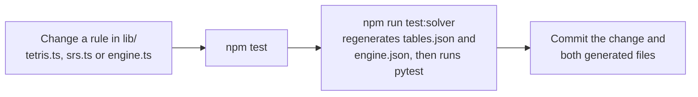

# Contributing

Thank you for helping improve this project. This guide explains how to set up a development environment, run the checks, follow the project's conventions, and add a heuristic, a controller or an experiment. It is for anyone who wants to change code, data or docs.

By taking part, you agree to follow the [code of conduct](CODE_OF_CONDUCT.md). To report a security issue, don't open a public issue: follow [SECURITY.md](SECURITY.md) instead.

## Ways to contribute

| Contribution | Where to start |
| --- | --- |
| Report a bug | Open an issue with the steps to reproduce, the seed and settings you used, and what you expected. |
| Fix a bug or improve the code | Read [Set up your environment](#set-up-your-environment) and [Conventions](#conventions), then open a pull request. |
| Add a heuristic | See [Add a heuristic](#add-a-heuristic). |
| Add a new kind of controller | See [Add a controller](#add-a-controller). |
| Run or propose an experiment | See [Propose an experiment](#propose-an-experiment). |
| Improve the docs | Edit the page under `docs/` or the root `.md` file, and follow the style of the pages around it. |

For a large change, open an issue first so we can agree on the approach before you spend time on it.

## Set up your environment

You need these tools. Only Node.js and npm are required for the app, the heuristics and the TypeScript tests.

| Tool | Version | Needed for |
| --- | --- | --- |
| Node.js and npm | Node.js 26 | The app, `lib/` tests and every script. Scripts and tests run `.ts` files directly through Node's built-in type stripping. |
| [uv](https://docs.astral.sh/uv/) | Any recent release | The OR solver in `or-solver/` and its tests. uv installs Python 3.13 for you from `or-solver/.python-version`. |
| [Ollama](https://ollama.com/library/clef) | 0.35.1 or later | Decision-model controllers only (`clef` and `clef-flash`). |

Clone or download this repository, then run these commands from the repository root:

```bash
npm ci                          # install the exact JavaScript dependencies from package-lock.json
uv sync --directory or-solver   # optional: create the solver's environment now (uv run does this on first use)
```

If you work on the decision-model controllers, pull the models:

```bash
ollama pull clef
ollama pull clef-flash
```

To run the app while you develop:

```bash
npm run dev      # the app at http://127.0.0.1:3000, this machine only
npm run solver   # the OR solver at http://127.0.0.1:8100, in a second terminal
```

Ollama listens on `localhost:11434` by default. The API routes and the scripts read `OLLAMA_URL` and `OR_SOLVER_URL` if you run either service somewhere else. For the full walkthrough, see [Getting started](docs/getting-started.md).

> [!NOTE]
> This project uses Next.js 16, whose APIs and conventions differ from older versions. Before you change code in `app/`, read the guide for the installed version in `node_modules/next/dist/docs/`. `next dev` maintains `AGENTS.md`; if it changes that file, commit the change with your work.

## Repository layout

| Path | What it holds |
| --- | --- |
| `lib/` | The game rules, the race simulation, the controllers and the heuristics. Pure TypeScript, with tests next to the modules they cover (`*.test.ts`). |
| `app/` | The Next.js page, the board component, the LED clock, the music and the two API routes (`app/api/decide`, `app/api/solve`). |
| `scripts/` | Command-line tools for the experiments: `collect`, `fit`, `bench`, `offline`, `live`, `race`, `race-summary` and `fixtures`. |
| `or-solver/` | The Python OR solver service (`orsolver/`) and its pytest suite (`tests/`). |
| `experiments/` | `RESULTS.md`, the raw data (`*.jsonl`, `*.json` and `data/`) and the console logs of the runs. |
| `docs/` | The documentation. Start at [docs/README.md](docs/README.md). |

[Architecture](docs/architecture.md) explains how these pieces fit together.

## Run the checks

Run these from the repository root before you open a pull request. None of them needs Ollama or a running server.

| Command | What it checks | When to run it |
| --- | --- | --- |
| `npm test` | The TypeScript unit tests in `lib/*.test.ts`, run with Node's built-in test runner. | Always. |
| `npm run lint` | ESLint with the Next.js config, including the React Compiler hook rules. | Always. |
| `npx tsc --noEmit` | Type-checks the whole project. Node strips types without checking them, so a script can run and still have type errors. | Always. |
| `npm run test:solver` | Regenerates the solver's rule tables and fixtures from the TypeScript engine, then runs the pytest parity and behavior tests. | When you change the rules, the board features or anything in `or-solver/`. |

```bash
npm test && npm run lint && npx tsc --noEmit
npm run test:solver
```

## Conventions

### `lib/` is pure TypeScript that Node runs directly

The same `lib/` modules run in the browser (through Next.js) and in Node (through the scripts and tests), with no build step for Node. To keep that working:

- Keep `lib/` free of React, the DOM and Next.js. Network calls go through the injected `Transports` in `lib/controllers.ts`, so the browser can use the API routes and the scripts can call the services directly.
- Import other `lib/` modules by relative path with the `.ts` extension, as in `import { placements } from "./tetris.ts";`. Code in `app/` imports them as `@/lib/<module>` instead.
- Mark type-only imports with `type`, as in `import { emptyBoard, type Board } from "./tetris.ts";`. Node removes types without resolving them, so an unmarked type import fails at run time.
- Use only TypeScript syntax that Node can erase: no `enum`, no `namespace` and no constructor parameter properties.
- Keep game logic deterministic. In `lib/`, use the seeded `mulberry32` generator from `lib/tetris.ts`, never `Math.random()`, so the same seed always gives the same pieces, garbage and results.

### The TypeScript engine is the rules authority

The Python solver doesn't define its own rules. `scripts/fixtures.ts` exports the board size, piece shapes, SRS kicks, spawn states, move sets, scoring and gravity table from the TypeScript engine into `or-solver/orsolver/tables.json`, and exports reachable-lock sets, board features and points for test boards into `or-solver/tests/fixtures/engine.json`. The pytest suite then checks that the Python engine matches.



- Never edit `tables.json` or `tests/fixtures/engine.json` by hand. Regenerate them with `npm run fixtures`, which `npm run test:solver` runs for you.
- If you change `boardFeatures` in `lib/heuristics.ts`, update `analyze` in `or-solver/orsolver/evaluate.py` to match. The parity tests compare the two.
- `lib/learned.ts` is generated by `scripts/fit.ts`. Change the fitting script and rerun it rather than editing the weights.

[Game engine](docs/game-engine.md) describes the rules in detail, and [OR solver](docs/or-solver.md) describes the parity tests.

### React code follows the React Compiler hook rules

`npm run lint` enables the React Compiler rules from `eslint-plugin-react-hooks`. Two of them catch most mistakes in this codebase:

| Rule | What it means | What to do instead |
| --- | --- | --- |
| `react-hooks/refs` | Don't read or write `ref.current` during render. | Touch refs in effects, event handlers or callbacks such as `requestAnimationFrame`. |
| `react-hooks/set-state-in-effect` | Don't call a state setter synchronously in an effect body. | Derive the value during render, set state in the event handler that caused the change, or set it from a callback the effect registers (a timer, an animation frame or a listener). |

`app/Board.tsx` shows both patterns. It copies the latest props into a ref inside an effect, and it updates state only from the animation-frame callback:

```ts
const live = useRef({ cfg, actionMs, onStatus }); // latest props for the frame loop
useEffect(() => { live.current = { cfg, actionMs, onStatus }; }); // a ref write in an effect, not in render

useEffect(() => {
  if (!running) return;
  const s = (simRef.current ??= createSim(engine, seed, live.current.cfg.advanced));
  let raf = 0, last = performance.now(), key = "";
  const frame = (now: number) => {
    // ...advance the simulation and ask the controller when a piece spawns...
    const v = viewOf(s);
    if (v.key !== key) { key = v.key; setView(v); } // state set from a callback, not from the effect body
    raf = requestAnimationFrame(frame);
  };
  raf = requestAnimationFrame(frame);
  return () => { cancelAnimationFrame(raf); cancel(s); };
}, [running, engine, seed, index]);
```

### Experiments stay reproducible

Every number in [experiments/RESULTS.md](experiments/RESULTS.md) must trace back to a committed data file and a command that produces it.

- For a race study, pass `scripts/race.ts` explicit seeds (for example `seeds=1-8`) and a new `tag=<label>`, so `scripts/race-summary.ts` can select your rows and leave older studies alone. The other scripts take their seeds and sizes as positional arguments; record them too.
- Commit the raw output (`*.jsonl`, `*.json`) and the console log under `experiments/`.
- Record the exact command lines in a "Reproduce" section in `RESULTS.md`, next to the results.
- Decision-model latency depends on the hardware. Say whether a run used `latency=measured` or a fixed `latency=<ms>`, and note the Ollama version.

[Experiments](docs/experiments.md) covers every script and data format.

### Secrets and personal data stay out of the repository

This is a public repository. Never commit:

- Passwords, API keys, tokens or `.env` files. `.env*` is already in `.gitignore`.
- Home-directory paths, user names, machine names, email addresses or IP addresses, in code, comments, logs or data files. Scripts that print paths can leak them into logs, so check the logs before you commit them.
- Local tool settings, such as `.claude/settings.local.json`, which is also ignored.

This check scans your staged changes and should print nothing:

```bash
git diff --cached -U0 | grep -nE '/(Users|home)/[^/[:space:]]+|BEGIN [A-Z ]*PRIVATE KEY'
```

Services you add should listen on `127.0.0.1` by default, as the dev server and the solver do. [SECURITY.md](SECURITY.md) explains the network exposure of the dev server and the safe demo mode.

## Add a heuristic

A heuristic is an entry in the `METHODS` array in `lib/heuristics.ts`. Each method gives every placement option one score, and the highest score wins. Once you add the entry, the method appears in the board's controller picker (grouped by kind), in every model board's assist menu, in `npm run bench` and in `scripts/race.ts` as `heuristic:<id>`.

1. Add an entry to `METHODS`:

   ```ts
   {
     id: "my-method", name: "My method", kind: "original",
     blurb: "One line on what it rewards. The board shows it under the method's name.",
     scores: (inp) => feats(inp).map((f) => -5 * f.holes - f.maxHeight + 2 * f.lines),
   },
   ```

   | Field | Rule |
   | --- | --- |
   | `id` | Unique, lowercase, with hyphens. Contestant names (`heuristic:my-method`) and data files use it, so don't rename it after you publish results. |
   | `name` | A short display name. |
   | `kind` | One of `classic`, `original`, `learned` or `fusion`. A new kind means adding it to the `Kind` type in `lib/heuristics.ts` and giving it a label in `KIND_LABEL` in `app/Board.tsx`. |
   | `blurb` | One sentence, shown on the board. |
   | `scores` | Returns one finite number per entry in `inp.options`, in the same order. Higher is better. |

2. Build on what is already there. `feats(inp)` returns cached features for every option (holes, heights, transitions, wells, landing height, lines and more). `z()` standardizes a score list so you can combine sources, and `byId("lookahead").scores(inp)` reuses another method. A fusion method reads the model's probabilities from `inp.probs`, which is missing when no model is in the loop.

3. Keep it deterministic and fast. If the method needs randomness, seed `mulberry32` from the board, as `rollout` does. The method runs at every spawn while the piece falls, so its compute time is part of its think time in a race.

4. Add a test in `lib/heuristics.test.ts`. The existing test "every method scores every option and picks a legal one" already checks the shape of your scores. Add one that checks the behavior you intend, for example:

   ```ts
   test("my-method takes the line clear", () => {
     const b = emptyBoard();
     for (let x = 0; x < 6; x++) b[H - 1][x] = 1; // bottom row open in columns 6-9
     const options = placements(b, "I");
     assert.equal(options[choose("my-method", { prev: b, piece: "I", options })].lines, 1);
   });
   ```

5. Measure it. The benchmark plays the method without a model and writes `experiments/bench-my-method.json`. The race compares it with the lookahead baseline under the same rules as the page:

   ```bash
   npm run bench -- 5 500 my-method
   node --no-warnings scripts/race.ts seeds=1-8 minutes=3 garbage=6,4,3,2 tag=my-method heuristic:my-method heuristic:lookahead
   node --no-warnings scripts/race-summary.ts tag=my-method vs=heuristic:lookahead
   ```

6. Update the docs. Add the method to the table in [Controllers](docs/controllers.md), and update the method count wherever the docs and `README.md` mention it.

## Add a controller

A controller turns a decision context into a ranked list of placements. The three existing kinds live in `lib/controllers.ts`: `model`, `heuristic` and `solver`. The race simulation in `lib/race.ts` asks a controller once per piece at spawn, keeps the piece falling while it thinks, and then plays the answer.

The contract is one function type:

```ts
export type Controller = (ctx: Ctx, signal?: AbortSignal) => Promise<Decision>;
export type Decision = { ranked: string[]; info: Info };
```

| Part | Meaning |
| --- | --- |
| `ctx` | The board at spawn, the piece and the next piece, the reachable placements (`ctx.reach`), the rules and timing state (level, gravity, lock delay, garbage clock) and the pieces left in the current 7-bag (`ctx.bagRemainder`). |
| `signal` | Aborted when the piece locks before the answer arrives, or when the race stops. Pass it to every network call so services don't keep working on stale requests. |
| `ranked` | Placement keys from `ctx.reach` (each placement's `key`), best first. The simulation plays the first one that is still reachable, matching by key or else by the board it produces. If none is, it falls back to Dellacherie and counts a fallback. |
| `info` | What the board shows about the decision. Add a variant to the `Info` union for your controller. |

To add one:

1. Write a factory in `lib/controllers.ts` that returns a `Controller`, and give your controller a `who` value, the string that `BoardCfg.who` holds (today: `model:<name>`, `solver` or `heuristic:<id>`).
2. Route that `who` in `controllerFor`, and give it a display name in `label`.
3. Add an `Info` variant, and render it in the decision panel in `app/Board.tsx`. The panel chooses what to show by `info.kind`.
4. Add an option for it to `Picker` in `app/Board.tsx`. If it has settings, add fields to `BoardCfg`, with defaults in `LINEUP` and in `parse` in `scripts/race.ts`.
5. If it calls a service, add a method to `Transports`. Implement it twice: in `WEB` in `app/Board.tsx`, through a new API route under `app/api/` that validates the request and reads the service URL from an environment variable, and in `NODE` in `scripts/race.ts`, by calling the service directly.
6. Make it raceable headless. `parse` in `scripts/race.ts` passes the contestant name through as `who`, so a new `who` works there once `controllerFor` knows it. Add parsing only if it needs options, as `solver:<budget>` does.
7. Add tests. `lib/race.test.ts` shows how to drive the simulation with a hand-made `Decision`; test your controller's ranking and its handling of a single reachable option.

[Controllers](docs/controllers.md) and [API reference](docs/api-reference.md) document the existing controllers and endpoints in full.

## Propose an experiment

Experiments are welcome, including ones that overturn an earlier result.

1. Open an issue that states the question, the controllers and settings you plan to compare, the seeds, the metric, and what result would change your mind.
2. Run it with the scripts in `scripts/`, using a new tag and explicit seeds. Prefer paired comparisons on the same seeds: `scripts/race-summary.ts` reports paired bootstrap confidence intervals against a baseline (`vs=`, by default `heuristic:lookahead`). It keeps the last row per tag, contestant, seed and garbage setting, so rerunning a command doesn't double-count seeds.
3. Open a pull request with the code changes, the raw data and logs, and a new section in `experiments/RESULTS.md` with the setup, the results, what they show and the commands to reproduce them. Report only what the data supports, and don't edit an earlier part's numbers: add a new part that supersedes it, as Part 3 does for Part 2.

## Write commit messages

Follow the style of the existing history:

- Write the subject in the imperative mood and sentence case, with no trailing period, in about 65 characters or fewer. For example: `Make garbage time-based; add vector blocks, LED clock and music`.
- After a blank line, explain what changed and why, wrapped at about 72 characters. Use a bulleted list when a commit makes several changes.
- When a commit adds results, say where the data lives (for example, `experiments/race.jsonl`, tag `time`).

```text
Add a contour lookahead heuristic

Contour fit scores only the current piece. This variant adds the best
follow-up for the known next piece, as lookahead does for Dellacherie.

- METHODS entry of kind "original", with a behavior test.
- Bench and race data in experiments/, tag contour-look.
```

## Open a pull request

Fork the repository, create a branch from `main`, and open a pull request against `main`. Keep each pull request to one change, and describe what it changes, why, and how you tested it.

Before you ask for review, check that:

- [ ] `npm test`, `npm run lint` and `npx tsc --noEmit` pass.
- [ ] `npm run test:solver` passes if you changed the rules, the board features or `or-solver/`, and the regenerated `tables.json` and `engine.json` are committed.
- [ ] New behavior has a test.
- [ ] `lib/` stays React-free, with relative `.ts` imports.
- [ ] Any new result in `experiments/RESULTS.md` comes from committed data, with seeds, a tag and the commands to reproduce it.
- [ ] The docs and `CHANGELOG.md` describe user-visible changes.
- [ ] The diff contains no secrets, home-directory paths, user names, machine names, email addresses or IP addresses.

## Next steps

- [Getting started](docs/getting-started.md): install and run every mode, then verify your setup.
- [Architecture](docs/architecture.md): how the board, the simulation, the controllers and the services connect.
- [Controllers](docs/controllers.md): the decision-model controller, all heuristics and the OR solver controller.
- [Experiments](docs/experiments.md): reproduce every study and read the data formats.
