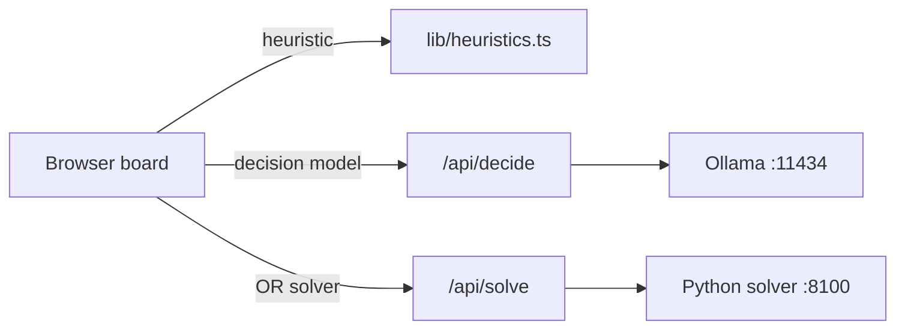

# Decision models

Three kinds of decision-maker play the same hard-mode Tetris game side by side: a decision model, a heuristic and an operations-research solver.


## What is this?

This repository is a lecture demo and a research playground. Each board in the browser runs the same seeded pieces and the same rising garbage, on the same clock. You pick who controls each board:

| Kind | What decides the move | Where it runs |
|---|---|---|
| **Decision model** | A local model (`clef` or `clef-flash`) answers one typed *choice* question per piece: which of up to 26 placements is best. | [Ollama](https://ollama.com/library/clef), through its `/v1/systemone` endpoint |
| **Heuristic** | A hand-written or fitted scoring rule rates every placement; the best one wins. 22 are built in. | In the browser, in TypeScript |
| **OR solver** | Operations research (OR): rolling-horizon planning searches several pieces ahead, plays the first placement, then plans again. | A Python service on `127.0.0.1:8100` |

With real-time gravity on (the default), a piece keeps falling while its controller thinks, and garbage arrives on a timer, so a slow answer can cost as much as a wrong one. That makes the demo a live argument about speed, intuition and planning, and the experiments in [`experiments/RESULTS.md`](experiments/RESULTS.md) show how much the outcome depends on the clock.



## Highlights

- **Real-time hard-mode Tetris.** SRS rotation with wall kicks, tucks and T-spins (3-corner rule), guideline gravity over 15 levels, a 500 ms lock delay with 15 move resets, and guideline scoring with a level multiplier.
- **22 heuristics.** 5 classic, 4 original, 3 learned from the models' own judgments and 10 rules that fuse a model's opinion with a heuristic. Any of them can also *assist* a model when its confidence is below a gate.
- **An OR solver.** Exact search over the current and next piece, 7-bag scenarios for the pieces after that, beam search per scenario and successive halving under a time budget, with hard constraints: no new sealed holes, a height cap and a safe spawn.
- **Decision models.** `clef` and `clef-flash` return a choice, a probability per option and a confidence. The board shows the confidence and the top three options live.
- **A fair garbage clock.** One garbage row every N seconds on a clock shared by every board. Rows that arrive while a controller thinks land at its next lock.
- **Stage touches.** A seven-segment LED countdown and a Web Audio chiptune of Korobeiniki that speeds up as the game gets harder.
- **Reproducible experiments.** Seeded headless scripts, raw logs and data, and one written-up results file. The TypeScript rules are exported to Python and checked by parity tests.

## Quick start

### Prerequisites

| Tool | Version | Needed for |
|---|---|---|
| Node.js with npm | 26 | The app, tests and scripts. Node runs the `.ts` scripts directly by stripping types. |
| [uv](https://docs.astral.sh/uv/) | A current release | The OR solver. uv installs Python 3.13 (from `or-solver/.python-version`) and the solver's dependencies on first run. |
| [Ollama](https://ollama.com/library/clef) | 0.35.1 or later (tested on 0.40.5) | Decision-model boards only. |

### Run a race

From the repository root (clone or download this repository first):

```bash
npm install

# Optional: the decision models (skip these to race heuristics and the solver only)
ollama pull clef
ollama pull clef-flash

# Terminal 1: the OR solver on 127.0.0.1:8100
npm run solver

# Terminal 2: the app on 127.0.0.1:3000
npm run dev
```

Open <http://127.0.0.1:3000> and press **Start**. The default lineup is `clef-flash`, the `lookahead` heuristic and the OR solver with advanced moves, on seed 42, for 3 minutes, with garbage every 6 seconds.

> [!NOTE]
> Every board works without Ollama: choose a heuristic from its controller menu. A board whose model or solver is unreachable gets no decisions: with real-time gravity on, its pieces lock wherever gravity takes them, and the board counts each failure as an error. The first model move is slow while Ollama loads the model; requests keep it loaded for 30 minutes.

To check your setup, run the tests:

```bash
npm test              # TypeScript tests: board, SRS, engine, race and heuristics
npm run test:solver   # regenerates the parity fixtures, then runs the Python tests
```

See [Getting started](docs/getting-started.md) for a full walkthrough.

## Run modes

| Command | What it starts | Listens on | Use it for |
|---|---|---|---|
| `npm run dev` | Next.js dev server | `127.0.0.1:3000` | Development on this machine. |
| `npm run dev:lan` | Next.js dev server | `0.0.0.0:3000` | Trusted networks only. Dev endpoints and source maps are exposed to the network. |
| `npm run demo` | Production build, then `next start` | `0.0.0.0:3000` | Showing the demo to an audience or on shared Wi-Fi. |
| `npm run solver` | OR solver (FastAPI under uvicorn) | `127.0.0.1:8100` | Any board that uses the OR solver. |

The app finds Ollama at `http://localhost:11434` and the solver at `http://127.0.0.1:8100`. Set `OLLAMA_URL` or `OR_SOLVER_URL` to point it elsewhere. For a talk, follow the [lecture guide](docs/lecture-guide.md).

## What we found

All numbers come from [`experiments/RESULTS.md`](experiments/RESULTS.md), which has the full setup, tables and confidence intervals.

- **How fairly the garbage clock is set decides who looks smartest.** When garbage came per piece placed (Part 2), slow controllers dodged garbage and the OR solver beat the `lookahead` heuristic by 38–44 s. With fair, time-based garbage (Part 3) the two roughly tie, and `lookahead` scores more whenever survival isn't at stake.
- **Planning still pays inside the solver.** With garbage every 2 s, the full solver lasts 72 s on average, against 56 s without advanced moves and 58 s without knowledge of the 7-bag.
- **Decision models can't keep up with gravity.** `clef-flash` (about 2.2 s per move) and `clef` (about 7.6 s) top out in 35–75 s.
- **Weaker heuristics collapse under fair garbage.** Well-keeper and danger-adaptive save rows for Tetrises, and those are the rows the garbage pushes into.
- **The models are nearly always undecided, and blind to holes** (Part 1). The best assists cut `clef-flash`'s offline regret by about two-thirds (17.2 to 5.7). `clef-hole-sense`, fitted to `clef`'s own board ratings with the missing hole penalty added back, was the best live assist.

Survival in the Part 3 race: games survived for the full 3 minutes, and mean time survived (seeds 1–8; models on seeds 1–3).

| Garbage every | OR solver + advanced | Lookahead | Dellacherie | Well-keeper | clef-flash | clef |
|---|---|---|---|---|---|---|
| 6 s | 8/8 | 8/8 | 6/8 · 178 s | 0/8 · 141 s | 0/3 · 55 s | 0/3 · 75 s |
| 4 s | **8/8** | 6/8 · 172 s | 1/8 · 128 s | 0/8 · 103 s | — | — |
| 3 s | **2/8 · 146 s** | 0/8 · 148 s | 0/8 · 85 s | 0/8 · 67 s | 0/3 · 35 s | 0/3 · 46 s |
| 2 s | **72 s** | 62 s | 46 s | 38 s | — | — |

To rerun any of it, see [Experiments](docs/experiments.md).

## Repository layout

```text
.
├── app/                  Next.js page and API routes
│   ├── page.tsx          three boards, race settings, podium
│   ├── Board.tsx         one board: controller picker, advanced moves, live stats
│   ├── Clock.tsx         seven-segment LED countdown
│   ├── music.ts          Web Audio chiptune
│   └── api/
│       ├── decide/       proxy to Ollama's /v1/systemone
│       └── solve/        proxy to the OR solver
├── lib/                  pure TypeScript modules and their *.test.ts files
│   ├── tetris.ts         board, hard-drop placements, options for the model
│   ├── srs.ts            SRS rotation, wall kicks, T-spins, reachability
│   ├── engine.ts         real-time rules: gravity, lock delay, scoring, garbage, levels
│   ├── race.ts           one board's real-time simulation and action playback
│   ├── controllers.ts    model, heuristic and solver controllers
│   ├── heuristics.ts     the 22 methods
│   ├── learned.ts        weights fitted by scripts/fit.ts
│   └── prompt.ts         the systemone request for one move
├── or-solver/            Python OR solver (uv project)
│   ├── orsolver/         engine, evaluator, search, HTTP server
│   └── tests/            pytest parity and behavior tests
├── scripts/              experiments and fixtures: collect, fit, bench, offline, live, race, race-summary, fixtures
├── experiments/          RESULTS.md, logs, JSONL results and collected model data
└── docs/                 documentation
```

## Documentation

| Page | What it covers |
|---|---|
| [Documentation home](docs/README.md) | Map of every page and where to start. |
| [Getting started](docs/getting-started.md) | Prerequisites, install, each run mode, your first race, verifying the setup. |
| [Lecture guide](docs/lecture-guide.md) | Presenting the demo: checklist, suggested lineups, what to point out, the story arc. |
| [Concepts](docs/concepts.md) | The three kinds of decision-maker and the ideas behind them. |
| [Architecture](docs/architecture.md) | Components, data flow, the single source of rules, the timing model. |
| [Game engine](docs/game-engine.md) | The rules precisely: SRS, T-spins, lock delay, gravity, scoring, garbage, seeds. |
| [Controllers](docs/controllers.md) | The model controller, all 22 heuristics, the solver controller, adding your own. |
| [OR solver](docs/or-solver.md) | The Python service: HTTP API, algorithm, constraints, budgets, testing. |
| [Experiments](docs/experiments.md) | Reproducing every experiment and the data formats. |
| [API reference](docs/api-reference.md) | HTTP endpoints and the main TypeScript modules. |
| [Troubleshooting](docs/troubleshooting.md) | Common problems and fixes. |

## Contributing

Contributions are welcome. [CONTRIBUTING.md](CONTRIBUTING.md) covers setup, conventions and the pull request checklist. In short: the TypeScript engine is the authority on the rules, so regenerate the solver's fixtures when you change them, and run the checks before you open a pull request:

```bash
npm run lint
npm test
npm run test:solver
```

Everyone taking part follows the [Code of Conduct](CODE_OF_CONDUCT.md). Changes are listed in the [changelog](CHANGELOG.md).

## Security

`npm run dev:lan` exposes developer endpoints and source maps to your network; use `npm run demo` in front of an audience. To report a vulnerability, use the repository's private vulnerability reporting rather than a public issue. See [SECURITY.md](SECURITY.md).

## License

[MIT](LICENSE).

## Acknowledgments

- **Korobeiniki**, the 19th-century Russian folk tune behind the Tetris theme, is in the public domain. The chiptune is synthesized live in the browser; no audio files ship with the repository.
- **Dellacherie's features with the El-Tetris weights**, and **Lee's GA-tuned four-feature weights**, are the classic heuristics this project builds on.
- **The Tetris Guideline and the Super Rotation System** define the rotation, wall kicks, T-spins, gravity and scoring. See [SRS](https://tetris.wiki/Super_Rotation_System) and [T-spin](https://tetris.wiki/T-Spin) on the Tetris Wiki.
- **The `clef` and `clef-flash` models** run locally through [Ollama](https://ollama.com/library/clef).
- Built with [Next.js](https://nextjs.org/docs), [React](https://react.dev), [FastAPI](https://fastapi.tiangolo.com) and [uv](https://docs.astral.sh/uv/).

Tetris is a trademark of The Tetris Company. This project is not affiliated with or endorsed by it.

## Next steps

- [Getting started](docs/getting-started.md): install everything and run your first race.
- [Concepts](docs/concepts.md): the ideas behind the three kinds of decision-maker.
- [Lecture guide](docs/lecture-guide.md): present the demo safely to an audience.
- [Experiment results](experiments/RESULTS.md): every finding, with its tables and caveats.
