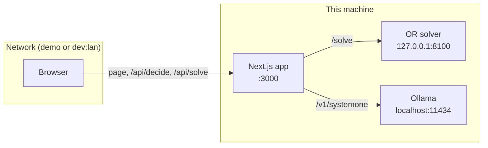

# Security policy

This page explains what this project is safe to use for, how to report a vulnerability privately, and how to run and share the demo without exposing your machine. It is for anyone who runs the demo in front of an audience, contributes code, or finds a security problem.

## Scope and supported use

This repository is a lecture demo and research playground that runs on one machine. It has no user accounts and no authentication, by design. Treat it as a local tool, not as a service to put on the internet.

| Component | What it is | Address |
| --- | --- | --- |
| Next.js app | The race UI and two API routes, `/api/decide` and `/api/solve` | `127.0.0.1:3000` or `0.0.0.0:3000`, depending on the script |
| OR solver | A Python FastAPI service in `or-solver/` | `127.0.0.1:8100` |
| Ollama | Runs the `clef` and `clef-flash` decision models | `localhost:11434` (the app's default) |

Security fixes are made on the `main` branch only. There are no versioned releases to backport to.

| Version | Supported |
| --- | --- |
| `main` (latest commit) | Yes |
| Older commits | No |

### In scope

- Code in this repository: the app in `app/`, the shared rules and controllers in `lib/`, the scripts in `scripts/`, and the solver in `or-solver/`.
- Configuration in this repository, such as `next.config.ts`, `package.json` scripts and `.gitignore`.
- Anything in the tracked files that leaks personal or machine-specific data.

### Out of scope

- Vulnerabilities in Ollama, the models, Next.js, React, FastAPI or other dependencies. Report those to their maintainers.
- Findings that need the development server on an untrusted network. The project documents that this is unsafe (see [Network exposure](#network-exposure)).
- Load on the unauthenticated API routes from someone already on a network where you chose to serve the app. This is a known limit, described in [API routes are unauthenticated proxies](#api-routes-are-unauthenticated-proxies).

## Report a vulnerability

Report vulnerabilities privately. **Do not open a public issue, pull request or discussion for a security problem.**

1. Open the repository on its host and go to its security page (on GitHub, the **Security** tab).
2. Choose **Report a vulnerability** to open a private security advisory.
3. Include:
   - what is affected (file, route, script or setting),
   - the steps or a request that reproduces it,
   - what an attacker could do with it,
   - the commit you tested.

If private vulnerability reporting is not turned on for the repository, open a public issue that asks for a private contact channel. Put no details of the vulnerability in that issue.

This is a personal research project. Reports are read and answered as time allows, with no service-level commitment. When a fix lands, the advisory can be published with credit to you, unless you ask to stay anonymous.

## Network exposure

The app has three ways to serve it. They differ in where they listen and in whether Next.js developer features are turned on.

| Command | Listens on | Dev endpoints and source maps | Use it for |
| --- | --- | --- | --- |
| `npm run dev` | `127.0.0.1:3000` | Yes | Development on this machine |
| `npm run dev:lan` | `0.0.0.0:3000` | Yes | Development from other devices on a network you trust |
| `npm run demo` | `0.0.0.0:3000` | No | Showing the demo to an audience or on shared Wi-Fi |

`npm run demo` runs `next build` and then `next start`. `npm run start` serves an existing build the same way.

### Why the dev server stays local

The development server exposes developer endpoints, such as one that opens files in your editor, and serves source maps that contain home-directory paths. Anyone who can reach it can see those paths and use those endpoints. For this reason:

- `npm run dev` binds to `127.0.0.1`, so only this machine can connect.
- `npm run dev:lan` binds to `0.0.0.0`. Use it only on a network you trust, such as your home network. Next.js blocks cross-origin requests to dev assets and endpoints unless the origin is allowed. Besides the `localhost` origins Next.js always allows, `next.config.ts` sets `allowedDevOrigins` to this machine's own non-loopback IPv4 addresses and its `.local` hostname, read when the server starts. There is no wildcard origin.

### Showing the demo to an audience

Use the production build:

```bash
npm run demo
```

This serves the app on port 3000 to the network with no dev endpoints and no source maps. Other people on the network can open the app and call its API routes, so:

- Prefer a network you control, such as a personal hotspot, over open conference Wi-Fi.
- Stop the server (`Ctrl+C`) when the talk ends.
- Keep the solver and Ollama on this machine. Only the app needs to face the network, because the app calls them from the server side.

The solver script binds to `127.0.0.1` on purpose:

```bash
npm run solver
```

Do not change it to `0.0.0.0`.



## API routes are unauthenticated proxies

The app has two API routes. Each one forwards a request to a local service and returns the result. Neither one checks who is calling.

| Route | Forwards to | Checks before forwarding |
| --- | --- | --- |
| `POST /api/decide` | Ollama at `OLLAMA_URL` + `/v1/systemone` (default `http://localhost:11434`) | `model` is `clef` or `clef-flash`; `options` is an array of 2 to 26 items |
| `POST /api/solve` | The solver at `OR_SOLVER_URL` + `/solve` (default `http://127.0.0.1:8100`) | `board` is an array; `active.piece` is a string; `timing.budgetMs` is greater than 0 and at most 10000 |

The solver then validates the full request with Pydantic models (board shape and cell ids, piece names and numeric ranges) and rejects values outside them. The `/api/solve` route also aborts a call after its time budget plus 2 seconds.

What this means for you:

- Anyone who can reach the app can make your machine run model inference and solver searches. On a shared network that costs you CPU, GPU and memory. Serve the app only where you accept that.
- `OLLAMA_URL` and `OR_SOLVER_URL` are read from the environment on the server. The routes send requests to whatever they point to, so set them only to services you run and trust.
- When a service is unreachable, the route's error response names the configured URL. With the defaults, that is a local address.

If you want to run this app anywhere other than your own machine, add authentication and rate limiting first. The project does not ship either.

## No secrets in the repository

The project needs no API keys, tokens or passwords. Ollama, the solver and the app all run locally and call each other without credentials.

`.gitignore` keeps local and generated files out of commits, including:

| Ignored path | Why |
| --- | --- |
| `.env*` | Environment files, in case you add local settings |
| `*.pem` | Private keys and certificates |
| `.next/` | Build output, including source maps with local paths |
| `.claude/settings.local.json` | Personal agent settings |
| `or-solver/.venv/`, `__pycache__/`, `.pytest_cache/` | Python environment and caches |
| `node_modules/`, `*.tsbuildinfo`, `next-env.d.ts` | Dependencies and generated TypeScript files |

Before you commit, check that new files, especially experiment logs under `experiments/`, contain no keys, local paths or personal details. If you commit a secret by mistake, treat it as exposed: revoke or rotate it, and then remove it from history.

## Share the project safely

A copy of the working folder carries more than the code. It includes the ignored files above, such as `.next/` with its local paths, and the `.git` directory with the full commit history and its author details.

To share the project, package only the committed files with `git archive`:

```bash
git archive --format=zip --output=../decision-models.zip HEAD
```

This writes `decision-models.zip` next to the repository folder. It contains the files tracked at `HEAD`. Ignored files, untracked files, uncommitted changes and the `.git` directory are left out. Commit your changes first if you want them included.

To check exactly what goes into the archive, list the tracked files:

```bash
git ls-files
```

## Next steps

- [Getting started](docs/getting-started.md): install the prerequisites and run each mode.
- [Lecture guide](docs/lecture-guide.md): the pre-talk checklist, including network safety.
- [API reference](docs/api-reference.md): request and response fields for every endpoint.
- [Contributing](CONTRIBUTING.md): development setup and the pull request checklist.
