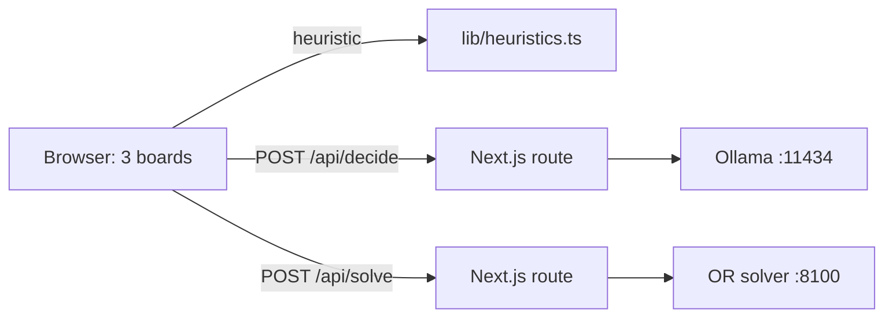

# Documentation

This is the home of the decision-models documentation. It explains what the project is, gives you a reading path for your goal, and lists every page with a one-line description.

## The project in 30 seconds

Three kinds of decision-maker play hard-mode Tetris side by side, on the same pieces and the same garbage clock:

| Decision-maker | What it is | Where it runs |
|---|---|---|
| Decision model | A local Ollama "System One" model (`clef` or `clef-flash`) that answers one typed `choice` question listing up to 26 placements | Ollama, through the app's `/api/decide` route |
| Heuristic | One of 22 hand-written, learned or fusion scoring rules in `lib/heuristics.ts` | In the browser, with no network call |
| OR solver | An operations-research planner that searches several pieces ahead and replans after every piece | A Python service in `or-solver/`, through the app's `/api/solve` route |

The default lineup is `clef-flash`, the `lookahead` heuristic and the OR solver with advanced moves on. The pieces keep falling while each controller thinks, so speed matters as much as judgment. The main finding: how fairly the garbage clock is set decides who looks smartest. On a fair, time-based clock the OR solver roughly ties the lookahead heuristic, and the decision models top out within 35–75 seconds. See [Part 3 of the results](../experiments/RESULTS.md#part-3-the-same-race-with-fair-time-based-garbage).

## Choose a reading path

### I attended the lecture

You want the idea and the evidence, not the setup.

1. [Concepts](concepts.md): the three kinds of decision-maker and the ideas behind them.
2. [Experiment results](../experiments/RESULTS.md): every finding, in three parts.
3. [Lecture guide](lecture-guide.md): the story arc of the talk, tied to those findings.

### I want to run the demo

You want three boards racing on your machine.

1. [Getting started](getting-started.md): prerequisites, install, run each mode and your first race.
2. [Lecture guide](lecture-guide.md): `npm run demo`, the pre-talk checklist and suggested lineups.
3. [Troubleshooting](troubleshooting.md): fixes for Ollama, the solver, ports, Node and audio.

### I want to understand the algorithms

You want to know exactly what each controller does and which rules it plays by.

1. [Concepts](concepts.md): System One typed questions, heuristics and features, rolling-horizon planning.
2. [Game engine](game-engine.md): SRS rotation, tucks, T-spins, lock delay, gravity, scoring and garbage.
3. [Controllers](controllers.md): the decision-model prompt, all 22 heuristics and how ranked keys fall back.
4. [OR solver](or-solver.md): the planner stage by stage, its constraints and its time budget.
5. [Architecture](architecture.md): how a decision travels from the board to a model or solver and back.

### I want to reproduce the experiments

You want to rerun the numbers and check them yourself.

1. [Getting started](getting-started.md): set up the app, Ollama and the solver.
2. [Experiments](experiments.md): every script (collect, fit, bench, offline, live, race, race-summary, fixtures) and its data format.
3. [Experiment results](../experiments/RESULTS.md): the published numbers to compare against.

### I want to contribute

You want to change the code without breaking the rules shared by TypeScript and Python.

1. [Contributing](../CONTRIBUTING.md): dev setup, conventions, tests and the pull request checklist.
2. [Architecture](architecture.md): why TypeScript is the single source of rules and how parity tests keep Python in step.
3. [Controllers](controllers.md): how to add a heuristic or a new controller.
4. [API reference](api-reference.md): the HTTP endpoints and the exported TypeScript functions and types.

## All pages

### Guides and reference

| Page | What it covers |
|---|---|
| [Getting started](getting-started.md) | Prerequisites, install, running each mode, your first race and how to verify the setup |
| [Lecture guide](lecture-guide.md) | Presenting the demo: production mode, the pre-talk checklist, settings, what to point out live |
| [Concepts](concepts.md) | The three kinds of decision-maker, the ideas behind them and the hard-mode rules at a high level |
| [Architecture](architecture.md) | Components, data flow, the shared rule tables, the timing model, with diagrams |
| [Game engine](game-engine.md) | The precise rules: board, SRS and kicks, T-spins, lock delay, gravity, scoring, garbage, levels, seeds |
| [Controllers](controllers.md) | The decision-model, heuristic and solver controllers, all 22 heuristics, and how to add one |
| [OR solver](or-solver.md) | The Python service: running it, its HTTP API, the algorithm, budgets, testing and parity |
| [Experiments](experiments.md) | How to reproduce every experiment, and the formats of the data files |
| [API reference](api-reference.md) | The app's and the solver's HTTP endpoints, plus the main TypeScript modules |
| [Troubleshooting](troubleshooting.md) | Common problems and their fixes |

### Project files

| File | What it covers |
|---|---|
| [Project README](../README.md) | The front page: what the project is, a quick start and where to go next |
| [Experiment results](../experiments/RESULTS.md) | All findings: Part 1 (heuristic assist), Part 2 (per-piece garbage, superseded) and Part 3 (time-based garbage) |
| [Contributing](../CONTRIBUTING.md) | Development setup, conventions, tests and the pull request checklist |
| [Security](../SECURITY.md) | Supported use, private reporting, and the dev server's network exposure |
| [Code of conduct](../CODE_OF_CONDUCT.md) | Expected behavior and how it is enforced |
| [Changelog](../CHANGELOG.md) | Notable changes, newest first |
| [License](../LICENSE) | MIT |

## Conventions in these docs

- **Commands** run from the repository root in a macOS or Linux shell, unless a page says otherwise.
- **Numbers** come only from [experiments/RESULTS.md](../experiments/RESULTS.md). If a page and the results disagree, the results win.
- **Ports** are the defaults set by the npm scripts and the API routes:

| Service | Address | Started by |
|---|---|---|
| App (Next.js) | `127.0.0.1:3000`, or `0.0.0.0:3000` for `dev:lan`, `start` and `demo` | `npm run dev` (or `dev:lan`, `start`, `demo`) |
| OR solver | `127.0.0.1:8100` | `npm run solver` |
| Ollama | `localhost:11434` | Ollama itself |

The API routes read `OLLAMA_URL` and `OR_SOLVER_URL` if you need to point them elsewhere.

## Next steps

- [Getting started](getting-started.md): get three boards racing on your machine.
- [Concepts](concepts.md): learn the ideas before the code.
- [Experiment results](../experiments/RESULTS.md): see what the races showed.
- [Contributing](../CONTRIBUTING.md): help improve the project.
