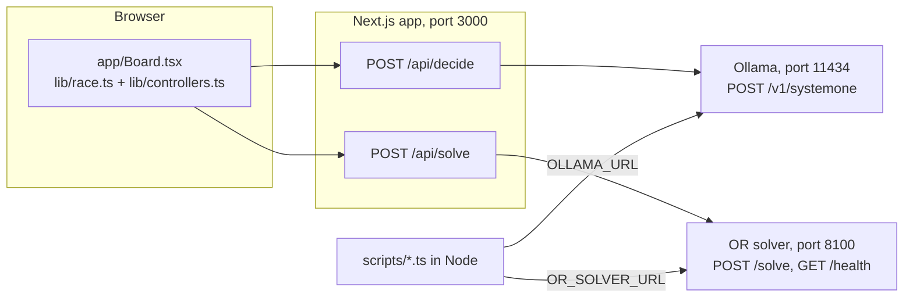
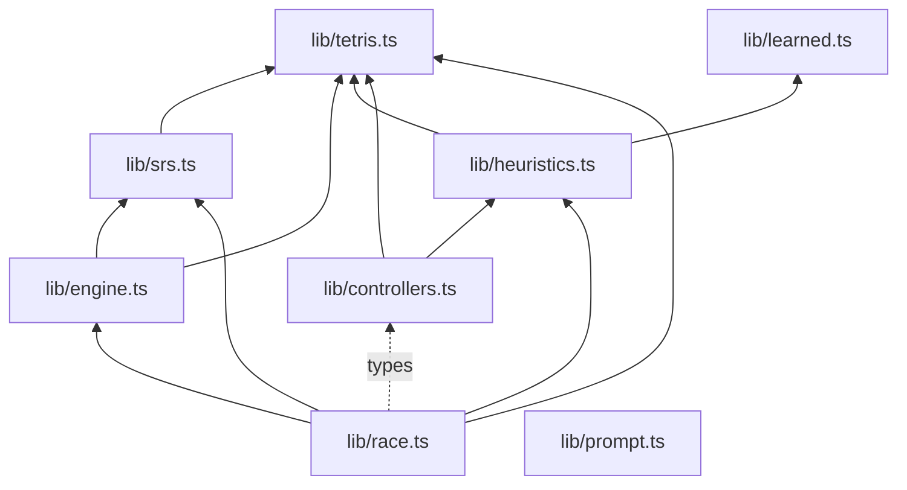
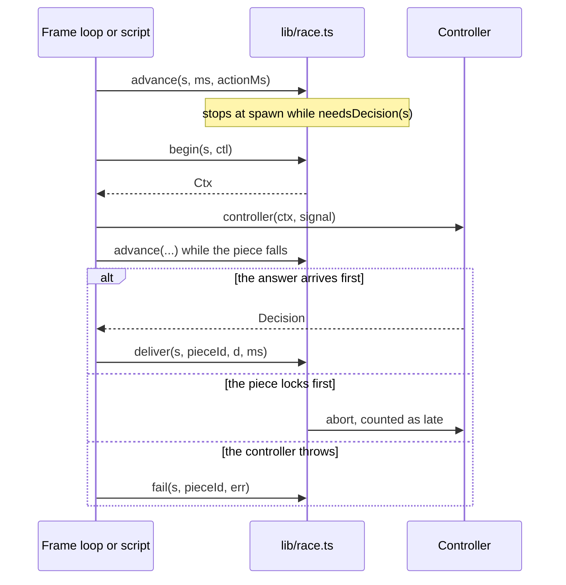

# API reference

This page documents every interface in the project you can call: the app's two HTTP routes, the OR solver's HTTP service, the environment variables that connect them, and the exported TypeScript API of the `lib/` modules. It is for engineers who want to script a race, call a controller from their own code, or add a new decision-maker. For the ideas behind these pieces, read [Concepts](concepts.md). For how they fit together, read [Architecture](architecture.md).

## At a glance



Heuristic controllers run in the same process as the game and call no endpoint. The browser reaches Ollama and the solver only through the app's routes. The scripts skip the routes and call both services directly.

| Interface | Defined in | Called by |
|---|---|---|
| `POST /api/decide` | `app/api/decide/route.ts` | The decision-model controller in the browser |
| `POST /api/solve` | `app/api/solve/route.ts` | The OR solver controller in the browser |
| `POST /solve` | `or-solver/orsolver/server.py` | `/api/solve` and `scripts/race.ts` |
| `GET /health` | `or-solver/orsolver/server.py` | You, to check that the service is up |
| `POST /v1/systemone` (Ollama) | Ollama | `/api/decide`, `scripts/collect.ts`, `scripts/live.ts`, `scripts/race.ts` |
| `lib/*.ts` | TypeScript modules | `app/` and `scripts/` |

## Conventions

These conventions apply to every endpoint and module on this page.

| Term | Meaning |
|---|---|
| Board | `number[][]` with 20 rows of 10 cells. Row 0 is the top row, and y grows downward. `0` is empty, `1`-`7` are piece ids (I 1, O 2, T 3, S 4, Z 5, L 6, J 7), and `8` is garbage. |
| Cells | A list of `[x, y]` pairs on that grid. |
| Piece state | `{ x, y, rot }`: the origin of the piece's SRS bounding box and its rotation state, `0` (spawn), `1` (R), `2`, or `3` (L). Pieces spawn at `x: 3` (`x: 4` for O), `y: 0`, `rot: 0`. |
| Placement key | `boardKey(board) + "\|" + spin`: 200 characters of `0`/`1` for the board after the lock and any line clears, then the spin (`none`, `mini` or `full`). Two input paths that produce the same board and spin share one key. |
| Times | Milliseconds, unless a field says otherwise. |

## Environment variables

| Variable | Default | Read by | Purpose |
|---|---|---|---|
| `OLLAMA_URL` | `http://localhost:11434` | `app/api/decide/route.ts`, `scripts/collect.ts`, `scripts/live.ts`, `scripts/race.ts` | Base URL of Ollama. Callers append `/v1/systemone`. |
| `OR_SOLVER_URL` | `http://127.0.0.1:8100` | `app/api/solve/route.ts`, `scripts/race.ts` | Base URL of the OR solver. Callers append `/solve`. |
| `POE_BETA` | The current `LEARNED.poeBeta` | `scripts/fit.ts` | The beta that `fit.ts` writes into `lib/learned.ts` for the `poe-tuned` heuristic. |

The routes read their URL when the route module loads, so set the variables before you start the server:

```bash
OLLAMA_URL=http://127.0.0.1:11434 OR_SOLVER_URL=http://127.0.0.1:8100 npm run dev
```

You can also put them in a `.env.local` file in the repository root. Next.js loads it for the app, and `.gitignore` excludes every `.env*` file. The scripts run under plain Node and read only the shell environment.

The solver's own host and port come from the `npm run solver` command (`--host 127.0.0.1 --port 8100`), not from a variable. If you run it on another port, set `OR_SOLVER_URL` to match.

## App HTTP endpoints

Both routes are small server-side proxies. The browser never talks to Ollama or the solver directly, so neither service needs CORS and both can stay on 127.0.0.1. The routes accept `POST` only. Next.js answers other methods with `405 Method Not Allowed`, except `OPTIONS`, which it answers itself with an `Allow` header. They have no authentication. Read [Security](../SECURITY.md) before you serve the app on a network.

A request body that is not valid JSON is not caught by either route, so Next.js answers with a server error (500).

### POST /api/decide

Asks a decision model to pick one placement from a lettered list. The decision-model controller builds the list with `toOptions()` and the board text with `toAscii()`.

#### Request body

| Field | Type | Required | Description |
|---|---|---|---|
| `model` | `string` | Yes | `"clef"` or `"clef-flash"`. |
| `board` | `string` | Yes | The board as text: 20 lines of 10 characters, top row first, `#` filled and `.` empty, joined by `\n`. The route does not validate it. |
| `piece` | `string` | Yes | The current piece, for example `"T"`. The route does not validate it. |
| `options` | `{ letter: string; text: string }[]` | Yes | 2 to 26 options. `letter` is the answer label (`A` to `Z`). `text` describes the placement, for example `rotation 2, column 6: clears 0 lines, +0 holes (total 0), max height 2, bumpiness 4`. |

The route returns 400 when `model` is not one of the two names, or when `options` is not an array of 2 to 26 items. It checks nothing else.

#### What the route sends to Ollama

The route posts to `{OLLAMA_URL}/v1/systemone` with the body that `moveRequest()` in `lib/prompt.ts` builds. Angle brackets mark the values filled in per call:

```json
{
  "model": "<model>",
  "keep_alive": "30m",
  "state": {
    "board": "<board>",
    "legend": "10 wide x 20 tall, top row first. '#' = filled, '.' = empty.",
    "piece": "<piece>",
    "goal": "Survive as long as possible and clear lines. Holes and tall stacks are bad.",
    "request_id": "<random UUID>"
  },
  "questions": {
    "move": {
      "type": "choice",
      "instructions": "Where should the <piece> piece be dropped for the best long-term Tetris play?",
      "criteria": { "A": "<text of option A>", "B": "<text of option B>" }
    }
  }
}
```

- `keep_alive: "30m"` keeps the model loaded for 30 minutes after each call.
- `request_id` is a fresh UUID on every call. Without it, replaying a seed would hit Ollama's cache and report fake timings.
- The route reads `answers.move` from Ollama's reply.

#### Response

`200 OK` with:

| Field | Type | Description |
|---|---|---|
| `letter` | `string` | The model's choice (`answers.move.choice`). |
| `probabilities` | `Record<string, number>` | The probability of each letter (`answers.move.probabilities`). |
| `confidence` | `number` | The model's confidence (`answers.move.confidence`). The heuristic assist runs when this is below the board's gate. |
| `ms` | `number` | How long the route waited for Ollama to respond. The browser measures its own think time and does not use this field. |

#### Errors

| Status | Body | When |
|---|---|---|
| 400 | `{ "error": "bad request" }` | The request failed validation. |
| 499 | Empty | The client aborted the request. The status is a convention for "client closed request". |
| 502 | `{ "error": "ollama <status>: <message>" }` | Ollama answered with a non-2xx status. `<message>` is Ollama's `error` field, or the status text. |
| 502 | `{ "error": "ollama returned no move answer" }` | Ollama answered 2xx without `answers.move`. |
| 502 | `{ "error": "ollama unreachable at <OLLAMA_URL>: <message>" }` | The request to Ollama failed, for example because Ollama is not running. |

#### Abort behavior

The route passes the incoming request's abort signal to its call to Ollama. When a piece locks before its decision arrives, `lib/race.ts` aborts the browser's request, the route cancels the Ollama call so Ollama does not queue stale work, and the route returns 499. The browser ignores errors from requests it aborted. The route sets no timeout of its own: a call lasts until Ollama answers or the client gives up.

#### Example

This command builds a real request for a T piece on an empty board (26 options) with the project's own functions, then sends it through the app. It needs `npm run dev` and a running Ollama with `clef-flash` pulled.

```bash
node --no-warnings --input-type=module -e '
import { emptyBoard, toAscii, toOptions, mulberry32 } from "./lib/tetris.ts";
import { reachable, spawnState } from "./lib/srs.ts";
const board = emptyBoard();
const options = toOptions(reachable(board, "T", spawnState("T"), false), mulberry32(1))
  .map(({ letter, text }) => ({ letter, text }));
console.log(JSON.stringify({ model: "clef-flash", board: toAscii(board), piece: "T", options }));
' | curl -s http://127.0.0.1:3000/api/decide -H 'Content-Type: application/json' -d @-
```

### POST /api/solve

Asks the OR solver for a placement. The body is the solver's [`POST /solve` request](#post-solve), forwarded unchanged.

#### Request body

The route checks three fields before it forwards the body. The solver then validates the whole body against its schema.

| Field | Rule in the route |
|---|---|
| `board` | Must be an array. |
| `active.piece` | Must be a string. |
| `timing.budgetMs` | Required, greater than 0 and at most 10000. The solver itself defaults it to 300, but this route rejects a body without it. |

#### Response

`200 OK` with the solver's [response](or-solver.md#response-body) plus one field:

| Field | Type | Description |
|---|---|---|
| `ms` | `number` | Round-trip time through the route, in milliseconds. |

#### Errors

| Status | Body | When |
|---|---|---|
| 400 | `{ "error": "bad request" }` | One of the three checks failed. |
| 502 | `{ "error": "<solver detail as JSON text>" }` | The solver answered with a non-2xx status. For a schema error this is FastAPI's 422 `detail` list, serialized as a string. |
| 502 | `{ "error": "OR solver unreachable at <OR_SOLVER_URL>: <message>" }` | The request failed: the solver is not running, the timeout fired, the client aborted, or the reply was not JSON. |

#### Timeout and abort behavior

The call to the solver ends on whichever comes first: the client aborts, or `budgetMs + 2000` ms pass. Unlike `/api/decide`, an aborted call is reported as 502, not 499. There is no fallback in the route: when the solver fails, that piece falls under gravity and the next piece asks again (see `fail()` in [`lib/race.ts`](#libracets)).

## OR solver HTTP service

The solver is a FastAPI app in `or-solver/orsolver/server.py`. Start it from the repository root:

```bash
npm run solver
```

This runs `uv run --directory or-solver uvicorn orsolver.server:app --host 127.0.0.1 --port 8100`. FastAPI also serves the generated schema at `/openapi.json` and interactive docs at `/docs`.

[OR solver](or-solver.md#http-api) is the full reference for this service: every field with its type, default and range, a worked example, and the error responses. This section summarizes the contract.

### GET /health

Returns `{"ok": true}` when the service is up.

```bash
curl -s http://127.0.0.1:8100/health
```

### POST /solve

Plans a placement for the active piece.

| Part | Fields | Details |
|---|---|---|
| Request | `board` and `active` are required. `next`, `bagRemainder`, `rules`, `state`, `timing` and `solver` are optional. Unknown fields are ignored. | [Request body](or-solver.md#request-body) |
| Response | `gameOver`, `placement`, `alternatives`, `expected`, `horizon`, `nodes`, `evals`, `scenarios`, `budgetMs`, `solveMs`, `stoppedBy` and `constraints` | [Response body](or-solver.md#response-body) |
| Errors | `422` with FastAPI's `detail` list when the body fails validation | [Errors](or-solver.md#errors) |

#### What the app's solver controller sends

`lib/controllers.ts` builds this body from the decision context. `strictInfo` withholds the bag remainder.

```ts
{
  board: ctx.board,
  active: { piece: ctx.piece, ...ctx.active },
  next: [ctx.next],
  bagRemainder: cfg.strictInfo ? null : ctx.bagRemainder,
  rules: { advanced: ctx.advanced, level: ctx.level, gravityMsPerRow: ctx.gravity ? ctx.gravityMs : 0, lockDelayMs: ctx.lockDelayMs, garbageMs: Math.round(ctx.garbageMs) },
  state: { pendingGarbage: ctx.pendingGarbage, msUntilGarbage: ctx.msUntilGarbage, avgPieceMs: ctx.avgPieceMs },
  timing: { budgetMs: cfg.budgetMs },
}
```

## TypeScript API

The `lib/` modules hold all the game logic and the controllers. They have no React and do no I/O of their own: controllers reach the network only through the `Transports` you pass in. The modules import each other with explicit `.ts` extensions, so Node 26 runs them directly through type stripping. The app imports them through the `@/lib/...` alias (`"@/*": ["./*"]` in `tsconfig.json`).

From a script in the repository root:

```ts
import { createGame, act, tick } from "./lib/engine.ts";
```



An arrow means "imports". Signatures below are copied from the source. Arrow-function exports are shown in call form, and when the source declares no return type, the description says what the function returns.

### lib/tetris.ts

Board basics, hard-drop placements, and the option list shown to the models.

#### Constants

| Name | Value | Description |
|---|---|---|
| `W` | `10` | Board width. |
| `H` | `20` | Board height. |
| `GARBAGE` | `8` | Cell id of a garbage cell. |
| `PIECES` | `PieceName[]` | `["I", "O", "T", "S", "Z", "L", "J"]`. |
| `PIECE_ID` | `Record<PieceName, number>` | `{ I: 1, O: 2, T: 3, S: 4, Z: 5, L: 6, J: 7 }`. |
| `ROTATIONS` | `Record<PieceName, Cells[]>` | Distinct normalized rotations: 1 for O, 2 for I, S and Z, 4 for T, L and J. |
| `LETTERS` | `"ABCDEFGHIJKLMNOPQRSTUVWXYZ"` | Option labels. |
| `LINE_SCORE` | `[0, 100, 300, 500, 800]` | Base points for 0 to 4 lines. |

#### Types

```ts
export type Board = number[][]; // H rows x W cols, 0 = empty, 1..7 = piece id, 8 = garbage
export type PieceName = "I" | "O" | "T" | "S" | "Z" | "L" | "J";
export type Cells = [number, number][]; // [x, y]
export type Action = "left" | "right" | "cw" | "ccw" | "down" | "drop";
export type Spin = "none" | "mini" | "full";
export type PieceState = { x: number; y: number; rot: number }; // SRS box origin, rot 0 = spawn, 1 = R, 2, 3 = L

export type Placement = {
  rot: number; // index into ROTATIONS[piece] (normalized shape)
  col: number; // left column of the normalized shape
  y: number; // landing row of the normalized shape's top edge
  board: Board;
  lines: number;
  holes: number;
  newHoles: number;
  height: number;
  bumpiness: number;
  // Set by the SRS search (lib/srs.ts); absent for plain hard-drop placements.
  key?: string; // path-independent identity: resulting board + spin
  state?: PieceState; // SRS lock state
  path?: Action[]; // from the search start; always ends with "drop"
  spin?: Spin;
  tuck?: boolean; // not reachable by a straight drop from the top in this rotation and column
};

export type Option<P extends Placement = Placement> = P & { letter: string; text: string };
```

In `Action`, `down` is a soft drop of one row and `drop` is a hard drop that locks.

#### Functions

| Signature | Description |
|---|---|
| `normalize(cells: Cells): Cells` | Shifts cells so the smallest x and y are 0, sorted by row and then column. |
| `emptyBoard(): Board` | A new 20 x 10 board of zeros. |
| `mulberry32(seed: number)` | Returns a seeded random-number function `() => number` in [0, 1). |
| `shuffle<T>(arr: T[], rng: () => number): T[]` | A shuffled copy (Fisher-Yates). |
| `makeBag(seed: number)` | Returns a function `() => PieceName` that deals a seeded 7-bag. The same seed gives the same sequence. |
| `fits(b: Board, cells: Cells, ox: number, oy: number)` | Returns `true` when every cell, offset by `(ox, oy)`, is on the board and empty. |
| `clearLines(b: Board): { board: Board; lines: number }` | Removes full rows, adds empty rows at the top, and counts the rows removed. |
| `colHeights(b: Board)` | Returns `number[]`: the height of each column, 0 when empty. |
| `holes(b: Board): number` | Empty cells with a filled cell somewhere above them in the same column. |
| `boardKey(b: Board)` | Returns the board's 200-character `0`/`1` occupancy string, top row first. |
| `toPlacement(b: Board, before: number, piece: PieceName, rot: number, col: number, y: number): Placement` | Locks the normalized shape at `(col, y)`, clears lines, and measures the result. `before` is the hole count of `b`. |
| `placements(b: Board, piece: PieceName): Placement[]` | Every distinct hard drop from the top: each rotation and column, one per resulting board. |
| `spinRank(p: Placement)` | Returns `0` for no spin, `1` for mini, `2` for full. |
| `describe(p: Placement)` | Returns the option text, such as `rotation 2, column 6: clears 0 lines, +0 holes (total 0), max height 2, bumpiness 4`, plus `, tucked under an overhang`, `, T-spin` or `, mini T-spin` when they apply. |
| `toOptions<P extends Placement>(ps: P[], rng: () => number): Option<P>[]` | Trims to 26 options when there are more (spins first, then fewest holes, then lowest stack), shuffles them so list order gives the model no hint, and labels them `A`, `B`, ... with `describe()` text. |
| `toAscii(b: Board)` | Returns the board as text: `#` filled, `.` empty, rows joined by `\n`, top row first. |

### lib/srs.ts

SRS movement: rotation states, wall kicks, T-spin detection, and a breadth-first search for every reachable lock with its input path. `scripts/fixtures.ts` exports these tables to the Python solver, so this file is the single source of the movement rules. See [Game engine](game-engine.md) for the rules in prose.

#### Constants

| Name | Type | Description |
|---|---|---|
| `SPAWN_SHAPES` | `Record<PieceName, { n: number; cells: Cells }>` | Each piece's spawn cells inside its `n` x `n` SRS box, y down. |
| `SRS` | `Record<PieceName, Cells[]>` | The cells of all four rotation states in the SRS box. |
| `KICKS_JLSTZ` | `Record<string, [number, number][]>` | Kick tests for J, L, S, T and Z, keyed by `"<from><to>"` such as `"01"`, written y up as published. |
| `KICKS_I` | `Record<string, [number, number][]>` | Kick tests for I, in the same form. |
| `OLD` | `Record<PieceName, { rot: number; dx: number; dy: number }[]>` | Maps each SRS rotation state to its `ROTATIONS` index and offset, so `Placement.rot`, `col` and `y` keep their hard-drop meaning. |

#### Functions

| Signature | Description |
|---|---|
| `spawnState(piece: PieceName): PieceState` | `{ x: 3, y: 0, rot: 0 }`, or `x: 4` for O. |
| `cellsOf(piece: PieceName, s: PieceState): Cells` | The piece's board cells in state `s`. |
| `fitsState(b: Board, piece: PieceName, s: PieceState): boolean` | `true` when the piece in state `s` is on the board and overlaps nothing. |
| `grounded(b: Board, piece: PieceName, s: PieceState)` | Returns `true` when the piece cannot move down one row. |
| `hardDrop(b: Board, piece: PieceName, s: PieceState): PieceState` | The state after dropping straight down as far as it fits. |
| `step(b: Board, piece: PieceName, s: PieceState, a: Action): { s: PieceState; kick: number } \| null` | Applies one input. For a rotation, `kick` is the index (0-4) of the kick test that worked; otherwise it is -1. Returns `null` when the input is blocked. Rotating O always returns `null`. |
| `tspin(b: Board, s: PieceState, kick: number): Spin` | The 3-corner rule around the T's center. Three occupied corners make a spin; it is `full` when both front corners are occupied or the fifth kick test (`kick === 4`) was used, otherwise `mini`. |
| `lockPlacement(b: Board, before: number, piece: PieceName, s: PieceState, spin: Spin, path: Action[]): Placement` | The placement for a lock at state `s`, with `key`, `state`, `path`, `spin` and `tuck` set. |
| `reachable(b: Board, piece: PieceName, start: PieceState, advanced: boolean): Placement[]` | Every lock reachable from `start`, one per resulting board, each with a shortest path ending in `drop`. A higher spin wins over a shorter path. With `advanced: false` the search rotates and shifts, then hard-drops. With `advanced: true` it also soft-drops, which finds tucks and spins. Returns `[]` when `start` does not fit. Sorted by `rot`, `col`, then `y`. |

### lib/engine.ts

The real-time game: gravity, lock delay, scoring, time-based garbage, levels and top-out. It is pure and deterministic: time moves only through `tick()` and `passTime()`, so the browser and the scripts share it.

#### Constants

| Name | Value | Description |
|---|---|---|
| `DEFAULT_CONFIG` | `{ gravity: true, startLevel: 1, garbageMs: 0, lockDelayMs: 500 }` | The default `EngineConfig`. |
| `GRAVITY_MS` | `number[]` of 15 | Guideline gravity in ms per row for levels 1 to 15: `1000 * (0.8 - (L-1) * 0.007)^(L-1)`, rounded. |
| `MAX_RESETS` | `15` | Lock-delay resets allowed per new lowest row. |

#### Types

```ts
export type EngineConfig = {
  gravity: boolean; // false = turn-based: the piece waits at spawn for its controller
  startLevel: number;
  // One garbage row every garbageMs of game time (0 = off), the same on every board. Rows queue up and are pushed
  // in at the next lock (the versus-Tetris rule), so a slow controller cannot dodge garbage by placing fewer pieces.
  garbageMs: number;
  lockDelayMs: number;
};

export type Game = {
  cfg: EngineConfig; board: Board; bag: () => PieceName; garbageRng: () => number; dealt: PieceName[];
  piece: PieceName; next: PieceName; active: PieceState; pieceId: number;
  fallMs: number; lockMs: number; resets: number; lowest: number; lastKick: number; // lastKick -1 = last move was not a rotation
  score: number; lines: number; level: number; pieces: number; over: boolean;
  tspins: number; tetrises: number; garbageRows: number;
  garbageClock: number; pendingGarbage: number; // ms toward the next row; rows queued for the next lock
};

export type LockEvent = {
  pieceId: number; piece: PieceName; cells: Cells; placed: Board; cleared: number[];
  lines: number; spin: Spin; points: number; garbage: number; forced: boolean; // garbage = rows pushed in; forced = locked by the lock delay
};
```

#### Functions

| Signature | Description |
|---|---|
| `gravityMs(level: number)` | Returns the ms per row for `level`, clamped to levels 1 to 15. |
| `points(lines: number, spin: Spin, level: number)` | Returns `level` times the base points: `LINE_SCORE[lines]` without a spin, `[100, 200, 400, 400]` for a mini T-spin, `[400, 800, 1200, 1600]` for a full T-spin. |
| `createGame(cfg: EngineConfig, seed: number, board: Board = emptyBoard()): Game` | A new game with the first piece spawned. The seed drives both the 7-bag and a separate garbage stream. |
| `addGarbage(g: Game)` | Pushes one garbage row in at the bottom, with its gap taken from the garbage stream. Sets `over` when the stack is pushed off the top. |
| `act(g: Game, a: Action): { moved: boolean; lock?: LockEvent }` | Applies one input. `drop` hard-drops and locks. A move while grounded resets the lock delay, at most `MAX_RESETS` times per new lowest row. |
| `passTime(g: Game, ms: number)` | Advances the garbage clock and queues rows. Call it for all game time, including pauses; `tick()` does not advance this clock. |
| `msUntilGarbage(g: Game)` | Returns the ms until the next row is queued, or 0 when garbage is off. |
| `tick(g: Game, ms: number): LockEvent[]` | Advances gravity and lock delay. Returns as soon as a piece locks, so the array holds at most one event. Returns `[]` when gravity is off or the game is over. |
| `reachableNow(g: Game, advanced: boolean): Placement[]` | `reachable()` from where the active piece is now. |
| `pathTo(g: Game, key: string, advanced: boolean): Action[] \| null` | The path from the current state to the lock with this key. It accepts the same board with a different spin, and returns `null` when the lock is unreachable. |
| `ghost(g: Game): PieceState` | Where the active piece would land if hard-dropped now. |
| `bagRemainder(g: Game): PieceName[]` | The pieces still to come in the bag that holds `next`. This is public information: it follows from the pieces already dealt. |

### lib/race.ts

One board's real-time simulation: the engine plus the decision lifecycle and visible action playback. Gravity never waits. The sim asks the controller at spawn, the piece keeps falling while the controller thinks, and the answer plays out one visible input at a time from wherever the piece is by then. The browser and `scripts/race.ts` share it.



#### Constants

| Name | Value | Description |
|---|---|---|
| `STEP` | `10` | Game time per simulation step, in ms. |
| `FX_MS` | `150` | The pause for a line-clear or garbage flash, in ms. |

#### Types

```ts
// late = locked before the decision arrived; missed = the decision arrived but the piece locked elsewhere
// (lock delay ran out mid-move); errors = controller failures (that piece falls under gravity).
export type Stats = { decisions: number; thinkMs: number; late: number; missed: number; fallbacks: number; errors: number; assists: number; overrides: number };

export type Sim = {
  game: Game; time: number; acc: number; rng: () => number; advanced: boolean;
  pending: { pieceId: number; t0: number; ctl?: AbortController } | null;
  target: { key: string; cells: Cells } | null;
  plan: { path: Action[]; from: string } | null; // cached path, valid while the piece is where we left it
  actionClock: number; fx: Fx[]; fxLeft: number;
  seen: Set<string>; // states the current piece was replanned from, to spot kick-up / fall-back loops
  queued: LockEvent[]; // locks made outside advance() (a failed turn-based decision), reported on the next advance
  info: Info | null; note: string | null; error: string | null; overAt: number | null; stats: Stats;
};

export type View = {
  key: string; board: Board; flash: number[]; flashKind: "clear" | "garbage" | null;
  piece: { name: PieceName; cells: Cells } | null; ghost: { cells: Cells; kind: "drop" | "target" } | null;
  next: PieceName; level: number; lines: number; score: number; pieces: number; tspins: number; tetrises: number;
  garbageInMs: number | null; garbageQueued: number;
  phase: "idle" | "thinking" | "moving" | "over" | "error"; thinkMs: number | null; lockInMs: number | null;
  info: Info | null; note: string | null; error: string | null; stats: Stats & { avgMs: number };
};
```

`Fx` is internal to the module.

#### Functions

| Signature | Description |
|---|---|
| `createSim(cfg: EngineConfig, seed: number, advanced: boolean): Sim` | A new sim around `createGame(cfg, seed)`. `advanced` turns on soft drops, tucks and spins. |
| `needsDecision(s: Sim)` | Returns `true` when the current piece has no request in flight, no target, no flash playing and no error, and the game is not over. |
| `begin(s: Sim, ctl?: AbortController): Ctx` | Marks a request as pending and returns the decision context for the board at spawn. Pass an `AbortController` so a lock can cancel the request. |
| `deliver(s: Sim, pieceId: number, d: Decision, ms: number)` | Accepts a decision. It ignores a stale one for a piece that already locked. It takes the first ranked key that is still reachable, matching the same board with any spin if the exact key is gone, and falls back to Dellacherie when none is. `ms` is added to the think-time stats. |
| `fail(s: Sim, pieceId: number, err: string)` | Records a controller error. With gravity, the piece falls where it falls; turn-based, it drops straight down. No heuristic stands in. |
| `cancel(s: Sim)` | Aborts the pending request, if any. |
| `advance(s: Sim, ms: number, actionMs: number): LockEvent[]` | Advances game time in `STEP` substeps and plays the target path. Each input costs `actionMs`, and a soft drop costs a quarter of that (at least `STEP`). It stops at spawn when a decision is needed, so every board asks at the same game time. Returns the locks that happened. |
| `viewOf(s: Sim): View` | A render snapshot. `View.key` changes whenever anything visible changes, so you can compare it to skip a re-render. |

### lib/controllers.ts

The three kinds of controller. Each one turns a decision context into a ranked list of placement keys. Network calls go through injected transports, so the browser (through the API routes) and the Node scripts (direct) share the same code. For how each controller decides, see [Controllers](controllers.md).

#### Constants

| Name | Value | Description |
|---|---|---|
| `MODELS` | `["clef", "clef-flash"] as const` | The decision models. |
| `DEFAULT_GATE` | `{ clef: 0.1, "clef-flash": 0.025 }` | The default assist gate per model. The assist runs when the model's confidence is below the gate. |
| `LINEUP` | `BoardCfg[]` | The default three boards: `model:clef-flash` with the assist off, `heuristic:lookahead`, and `solver` with a 300 ms budget and advanced moves on. |
| `HEURISTIC_IDS` | `string[]` | The `id` of every method in `METHODS`. |

#### Types

```ts
export type Model = (typeof MODELS)[number];

// who: "model:clef" | "model:clef-flash" | "solver" | "heuristic:<method id>"
export type BoardCfg = { who: string; assist: string; gate: number; budgetMs: number; advanced: boolean; strictInfo: boolean };

export type Ctx = {
  pieceId: number; board: Board; piece: PieceName; next: PieceName; active: PieceState; reach: Placement[];
  level: number; advanced: boolean; gravity: boolean; gravityMs: number; lockDelayMs: number;
  garbageMs: number; msUntilGarbage: number; pendingGarbage: number; avgPieceMs: number; bagRemainder: PieceName[]; rng: () => number;
};

export type Info =
  | { kind: "model"; picked: string; confidence: number; top: [string, number][]; assist?: string; assisted: boolean; overrode: boolean }
  | { kind: "heuristic"; picked: string; method: string; computeMs: number }
  | { kind: "solver"; picked: string; spin: Spin; solveMs: number; horizon: number; nodes: number; ev: number; constraints: string; stoppedBy: string; alternatives: string[] };
export type Decision = { ranked: string[]; info: Info };
export type Controller = (ctx: Ctx, signal?: AbortSignal) => Promise<Decision>;

export type DecideReply = { letter: string; probabilities: Record<string, number>; confidence: number };
export type SolveLock = { cells: Cells; spin: Spin; lines: number; value?: number; why?: string };
export type SolveReply = {
  placement: SolveLock; alternatives: SolveLock[]; expected: { value: number }; horizon: number; nodes: number;
  solveMs: number; stoppedBy: string; constraints: { status: string; violated: string[] };
};
export type Transports = {
  decide: (body: { model: string; board: string; piece: string; options: { letter: string; text: string }[] }, signal?: AbortSignal) => Promise<DecideReply>;
  solve: (body: unknown, signal?: AbortSignal) => Promise<SolveReply>;
};
```

`BoardCfg` fields:

| Field | Description |
|---|---|
| `who` | Which controller: `"model:clef"`, `"model:clef-flash"`, `"solver"`, or `"heuristic:<method id>"`. |
| `assist` | `"off"`, or the id of the heuristic that steps in when a model is unsure. Used by model boards only. |
| `gate` | The confidence below which the assist runs. |
| `budgetMs` | The solver's time budget per piece. |
| `advanced` | Soft drops, tucks and spins in the move search. |
| `strictInfo` | Withhold the bag remainder from the solver (`bagRemainder: null`). |

`SolveReply` declares only the fields the controller reads. The solver returns more; see the [solver response](or-solver.md#response-body).

`Ctx.avgPieceMs` is the board's game time per piece so far, at least 50, or 1000 before the first piece locks.

#### Functions

| Signature | Description |
|---|---|
| `label(cfg: BoardCfg): string` | The board's display name: the model name, `OR solver`, or the heuristic's `name`. |
| `controllerFor(cfg: BoardCfg, t: Transports): Controller` | Builds the controller for `cfg.who`. |

How each controller ranks:

- **Heuristic**: scores every placement in `ctx.reach` and ranks all of them by score. No network call.
- **Model**: with one reachable placement, returns it with confidence 1 and makes no call. Otherwise it builds up to 26 options with `toOptions()`, calls `t.decide()`, and ranks by probability. The returned letter goes first. If the assist is on and confidence is below `gate`, the assist heuristic picks instead, and `info.overrode` records whether it changed the pick.
- **Solver**: calls `t.solve()` with the body shown [above](#what-the-apps-solver-controller-sends), then maps `placement` and `alternatives` to this engine's keys through the boards they produce. A lock that matches no reachable board is dropped from the ranking.

The two `Transports` in the project:

| Transport | Defined in | `decide` | `solve` |
|---|---|---|---|
| `WEB` | `app/Board.tsx` | `POST /api/decide` | `POST /api/solve` |
| `NODE` | `scripts/race.ts` | `POST {OLLAMA_URL}/v1/systemone` with `moveRequest()` | `POST {OR_SOLVER_URL}/solve` |

Both throw an `Error` with the server's message on a non-2xx reply, which the sim records through `fail()`.

### lib/heuristics.ts

Board and placement features, and the 22 scoring methods. Every method maps the current options to one score each, and the highest score wins. For what each method does and where it came from, see [Controllers](controllers.md).

#### Types

```ts
export const BOARD_KEYS = ["aggHeight", "maxHeight", "bumpiness", "holes", "holeDepth", "rowsWithHoles", "rowTrans", "colTrans", "wells"] as const;
export type BoardKey = (typeof BOARD_KEYS)[number];
export type BoardF = Record<BoardKey, number> & { heights: number[]; well9: number };
export type F = BoardF & {
  landing: number; eroded: number; lines: number; contact: number; newHoles: number;
  // Lee's features are measured after the piece lands but before rows clear (as in his reference AI).
  leeAgg: number; leeHoles: number; leeBump: number;
};

export type Input = { prev: Board; piece: PieceName; next?: PieceName; options: Placement[]; probs?: number[] };
export type Kind = "classic" | "original" | "learned" | "fusion";
export type Method = { id: string; name: string; kind: Kind; blurb: string; scores: (inp: Input) => number[] };
```

`Input.probs` holds the model's probability for each entry in `options`, in the same order. Fusion methods combine it with heuristic scores. When it is absent, they treat it as uniform, except `borda`, which leaves the model's vote out.

The fields of `F` are defined in [Controllers](controllers.md#features).

#### Functions and constants

| Signature | Description |
|---|---|
| `boardFeatures(b: Board): BoardF` | The board features of `b`. |
| `placementFeatures(prev: Board, prevHoles: number, piece: PieceName, p: Placement): F` | All features of placement `p` on `prev`. `prevHoles` is the hole count of `prev`. |
| `feats(inp: Input): F[]` | `placementFeatures()` for every option, cached per `Input` object. Reuse one `Input` across methods to share the work. |
| `z(xs: number[])` | Returns z-scores of `xs`: all zeros when the values are equal. |
| `argmax(xs: number[])` | Returns the index of the first largest value. |
| `METHODS: Method[]` | The 22 methods, listed below. |
| `byId(id: string): Method` | The method with this id. Throws `unknown method <id>` otherwise. |
| `choose(id: string, inp: Input)` | Returns the index in `inp.options` of the best-scoring option for method `id`. |

Method ids by kind. Use them as `heuristic:<id>` in `BoardCfg.who`, or as `BoardCfg.assist`.

| Kind | Ids |
|---|---|
| `classic` (5) | `lee4`, `dellacherie`, `holes-first`, `transitions`, `lookahead` |
| `original` (4) | `well-keeper`, `danger-adaptive`, `contour`, `rollout` |
| `learned` (3) | `clef-distilled`, `clef-hole-sense`, `move-distilled` |
| `fusion` (10) | `poe`, `entropy-gate`, `shortlist`, `veto`, `hole-guard`, `poe-tuned`, `perplexity-shortlist`, `reliability-rank`, `borda`, `minimax-regret` |

### lib/prompt.ts and lib/learned.ts

| Export | Description |
|---|---|
| `type Opt = { letter: string; text: string }` | One option of the choice question. |
| `moveRequest(model: string, board: string, piece: string, options: Opt[])` | Returns the Ollama `/v1/systemone` body shown under [`POST /api/decide`](#what-the-route-sends-to-ollama). Shared by the route and the scripts. |
| `LEARNED` | The fitted weights used by the learned methods, `poe-tuned` and `reliability-rank`: `health`, `healthBias`, `move`, `moveLines`, `poeBeta`, `rhoModel`, `rhoLookahead`. `scripts/fit.ts` generates `lib/learned.ts`; do not edit it by hand. |

## Recipes

### Run a headless game

This script plays one minute of game time with the `lookahead` heuristic, a garbage row every 6 seconds, and seed 1. It mirrors the loop in `scripts/race.ts`, minus the latency simulation. Save it as `try-sim.ts` in the repository root:

```ts
import { createSim, needsDecision, begin, deliver, advance, STEP } from "./lib/race.ts";
import { controllerFor, type BoardCfg, type Transports } from "./lib/controllers.ts";
import { DEFAULT_CONFIG } from "./lib/engine.ts";

// A heuristic controller never touches the network, so these transports are never called.
const offline: Transports = {
  decide: () => Promise.reject(new Error("offline")),
  solve: () => Promise.reject(new Error("offline")),
};
const cfg: BoardCfg = { who: "heuristic:lookahead", assist: "off", gate: 0, budgetMs: 300, advanced: false, strictInfo: false };
const sim = createSim({ ...DEFAULT_CONFIG, garbageMs: 6000 }, 1, cfg.advanced);
const controller = controllerFor(cfg, offline);

while (!sim.game.over && sim.time < 60_000) {
  if (needsDecision(sim)) {
    const ctx = begin(sim);
    deliver(sim, ctx.pieceId, await controller(ctx), 0);
  }
  advance(sim, STEP, 80);
}
console.log({ score: sim.game.score, lines: sim.game.lines, pieces: sim.game.pieces, over: sim.game.over });
```

Run it:

```bash
node --no-warnings try-sim.ts
```

Delete the file when you are done; it is not part of the project.

### Write a custom controller

A controller is any function with the `Controller` type: it gets the context and returns ranked keys from `ctx.reach`. This one prefers the fewest holes, then the lowest stack:

```ts
import type { Controller } from "./lib/controllers.ts";

const fewestHoles: Controller = async (ctx) => {
  const ranked = [...ctx.reach].sort((a, b) => a.holes - b.holes || a.height - b.height).map((p) => p.key!);
  return { ranked, info: { kind: "heuristic", picked: ranked[0], method: "fewest-holes", computeMs: 0 } };
};
```

Call it in place of `controller` in the script above. To make a new controller selectable on the page, add it to `controllerFor()` and the board's picker as described in [Controllers](controllers.md) and [Contributing](../CONTRIBUTING.md).

## Next steps

- [Architecture](architecture.md): how a decision travels from a falling piece to these endpoints and back.
- [Controllers](controllers.md): the decision model, all 22 heuristics and the solver controller in depth.
- [OR solver](or-solver.md): the algorithm behind `POST /solve`, its budgets and its tests.
- [Troubleshooting](troubleshooting.md): what to do when an endpoint returns 502.
