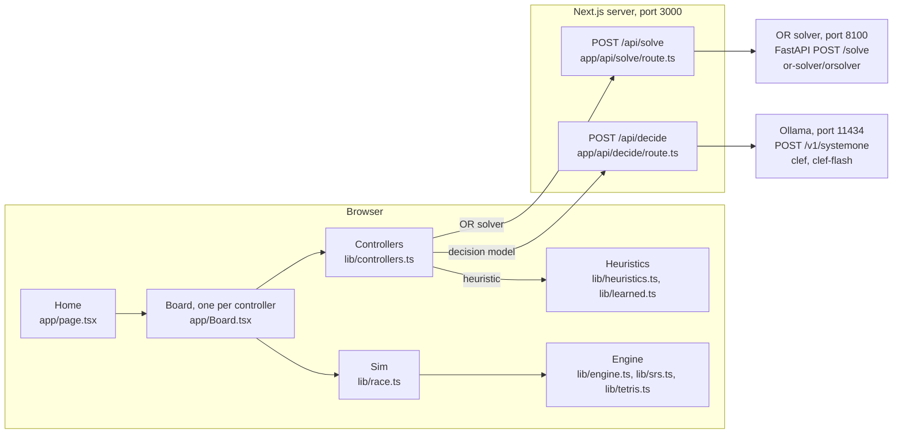
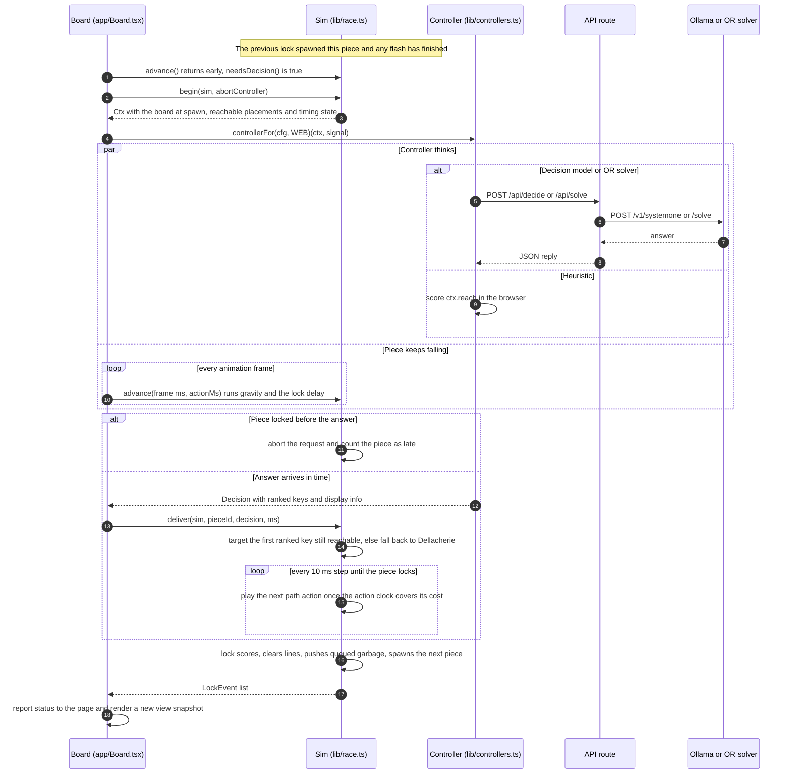
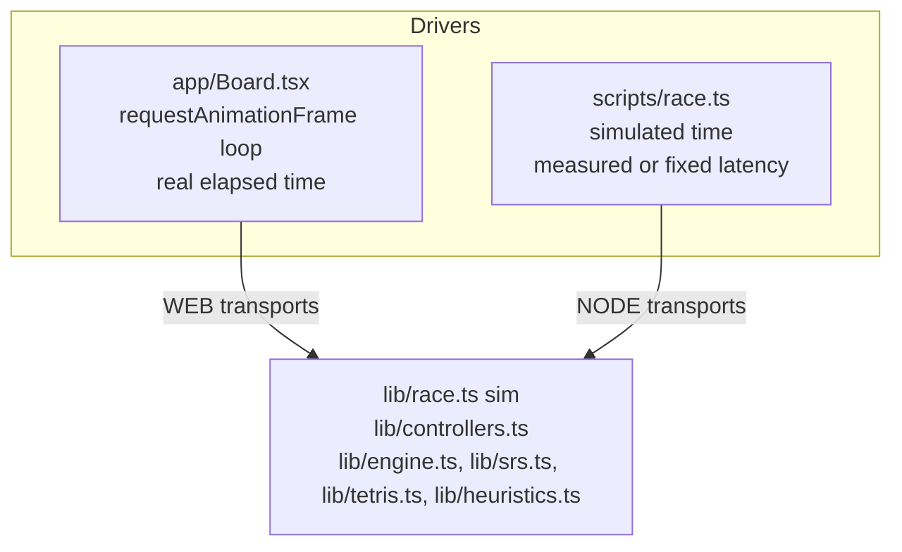
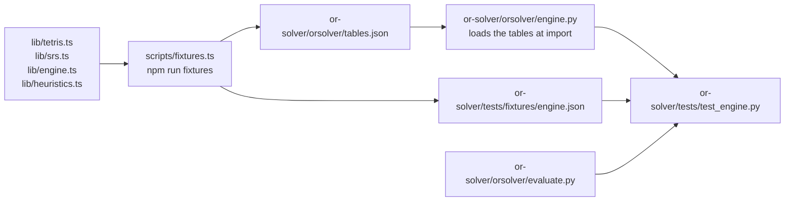
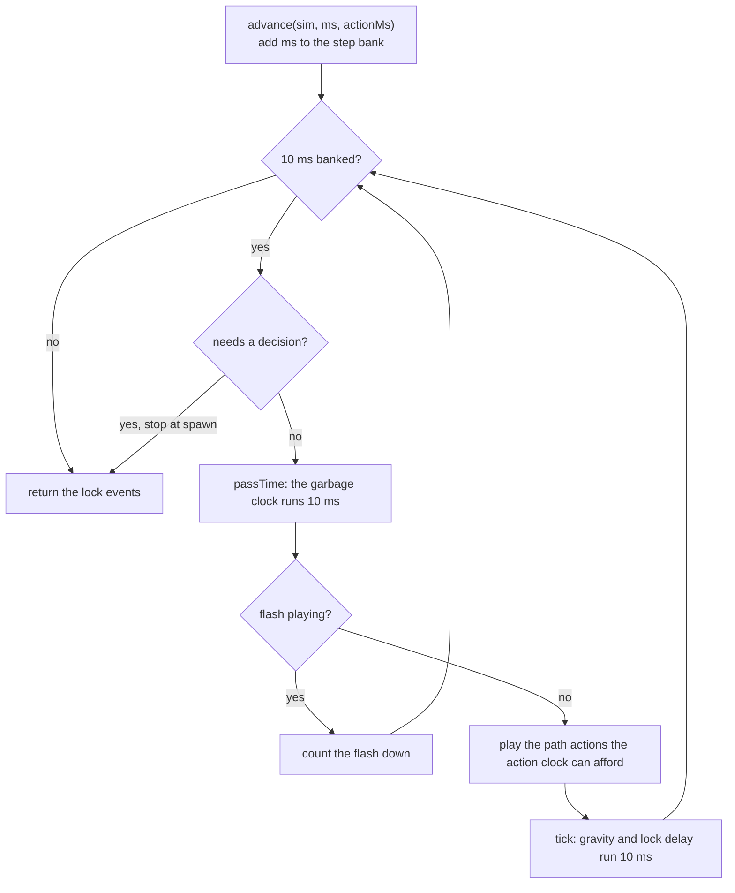
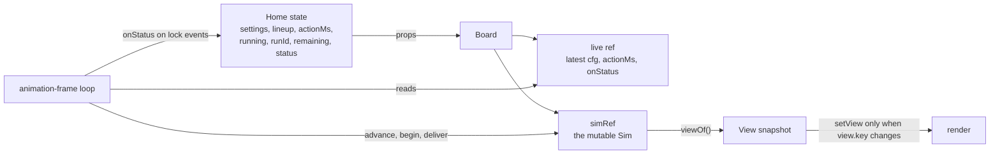

# Architecture

This page explains how the race is put together: the components, how one decision travels from a falling piece to Ollama or the OR solver and back, how the browser and the headless scripts share one engine, how the Python solver stays in step with the TypeScript rules, and how time is modeled. It is written for engineers who want to change or extend the system. For the rules themselves, see [Game engine](game-engine.md); for the decision-makers, see [Controllers](controllers.md).

## At a glance

Three boards run side by side in the browser. Each board owns a *sim*, a real-time simulation of one game built on a pure TypeScript engine. When a new piece spawns, the sim asks that board's *controller* for a placement. Heuristics answer in the browser. Decision models and the OR solver answer over HTTP through Next.js API routes, which forward to Ollama and to the Python solver. While a controller thinks, the piece keeps falling.



The browser only ever talks to the Next.js server. Ollama and the solver are reached server-side, so only port 3000 needs to be reachable by viewers, and there are no cross-origin requests.

## Components

| Component | Path | Runs in | Responsibility |
| --- | --- | --- | --- |
| Page | `app/page.tsx` | Browser | Race settings, the lineup of three controllers, Start, Pause and Reset, the countdown, the podium, music tempo. |
| Board | `app/Board.tsx` | Browser | One playfield: the controller picker, the animation-frame loop that drives its sim, rendering, and the HTTP transports for the browser. |
| Clock | `app/Clock.tsx` | Browser | Seven-segment LED countdown. |
| Music | `app/music.ts` | Browser | Web Audio chiptune of Korobeiniki; the page raises its tempo as the race gets harder. |
| Sim | `lib/race.ts` | Browser and Node | The decision lifecycle on top of the engine: ask at spawn, accept a decision, play the path out one visible action at a time, count late, missed and failed decisions, line-clear and garbage flashes. |
| Engine | `lib/engine.ts` | Browser and Node | Real-time game state: gravity, lock delay, scoring, time-based garbage, levels, top-out. |
| Movement | `lib/srs.ts` | Browser and Node | SRS rotation, wall kicks, the T-spin 3-corner rule, and a breadth-first search for every reachable lock with its action path. |
| Board model | `lib/tetris.ts` | Browser and Node | Board, pieces, seeded 7-bag, hard-drop placements, and the option list shown to decision models. |
| Controllers | `lib/controllers.ts` | Browser and Node | Turns a decision context into a ranked list of placement keys for each kind of controller. Network calls go through injected transports. |
| Heuristics | `lib/heuristics.ts`, `lib/learned.ts` | Browser and Node | The 22 scoring methods and the weights fitted from the models' judgments. |
| Prompt | `lib/prompt.ts` | Server and Node | Builds the System One request for one move. |
| Decide route | `app/api/decide/route.ts` | Next.js server | Validates the request and forwards it to Ollama's `/v1/systemone`. |
| Solve route | `app/api/solve/route.ts` | Next.js server | Validates the request and forwards it to the solver's `/solve`. |
| OR solver | `or-solver/orsolver/` | Python service | Rolling-horizon planning under a time budget. See [OR solver](or-solver.md). |
| Scripts | `scripts/*.ts` | Node | Headless experiments, weight fitting, and fixture export. See [Experiments](experiments.md). |

Everything under `lib/` is free of React and does no I/O of its own: controllers reach the network only through the transports they are given. The `lib/` modules import each other with explicit `.ts` extensions, so Node can run them directly through type stripping, while the app imports them through the `@/lib/...` path alias.

## The life of one decision

Every piece goes through the same lifecycle. The sim stops exactly at spawn, asks once, keeps the piece falling while it waits, and then plays the answer out from wherever the piece is when the answer arrives.



The steps in more detail:

1. **Spawn.** The engine's `lock()` spawns the next piece immediately. The sim does not ask yet if a line-clear or garbage flash is playing; `needsDecision()` is true only when the game is live, nothing is pending, there is no target, no flash, and no unhandled error.
2. **Ask.** `begin()` records the piece id and the game time, and builds a `Ctx`: the board at spawn, the current and next piece, every placement reachable from the current position (`reachableNow`), the level, gravity and lock delay, the garbage clock (`msUntilGarbage`, `pendingGarbage`), the board's average time per piece, the rest of the current 7-bag, and a seeded random number generator.
3. **Think.** The controller returns a `Decision`: a ranked list of placement keys plus display info for the panel under the board. A placement key is the resulting board after line clears, written as 200 characters of `0` and `1`, followed by `|none`, `|mini` or `|full`. It names a result, not a path, so it stays valid while the piece moves.
4. **Fall.** Each animation frame keeps calling `advance()`. Gravity and the lock delay run as normal. If the piece locks first, the sim aborts the request, which aborts the API route's upstream fetch so Ollama does not queue stale work.
5. **Deliver.** `deliver()` ignores a stale answer. Otherwise it walks the ranked keys and targets the first one still reachable from where the piece is now, accepting the same board with a different spin. If none is reachable, it falls back to Dellacherie over what is reachable.
6. **Play out.** On each step the sim plans a path from the current state to the target (`pathTo`) and spends the action clock on it one input at a time. If gravity moved the piece, it replans from the new state.
7. **Lock.** The engine scores the lock, clears lines, pushes in queued garbage rows, and spawns the next piece. The sim records a flash for cleared rows and another for garbage, and the cycle starts again.

### Controllers and transports

`controllerFor(cfg, transports)` picks the controller from the board's `who` field: `model:clef`, `model:clef-flash`, `solver`, or `heuristic:<method id>`.

| Controller | What it does with the context | Network |
| --- | --- | --- |
| Heuristic | Scores every reachable placement with the method and ranks them. | None |
| Decision model | Builds up to 26 lettered options (`toOptions`), asks one choice question, ranks options by probability, and lets the assist override the pick when confidence is below the gate. Skips the call when only one placement is reachable. | `decide` transport |
| OR solver | Sends the board, active piece, next piece, bag remainder (or `null` with strict info), rules, garbage state and budget. Maps the returned cells back to this engine's keys through the board they produce, so the two engines can choose different cells for the same result. | `solve` transport |

Transports keep the controllers identical in both environments:

| Transport | Defined in | `decide` goes to | `solve` goes to |
| --- | --- | --- | --- |
| `WEB` | `app/Board.tsx` | `/api/decide`, then Ollama | `/api/solve`, then the solver |
| `NODE` | `scripts/race.ts` | Ollama `/v1/systemone` directly | The solver `/solve` directly |

Both the API routes and the scripts read the upstream addresses from the environment:

| Variable | Default | Read by |
| --- | --- | --- |
| `OLLAMA_URL` | `http://localhost:11434` | `app/api/decide/route.ts`, `scripts/collect.ts`, `scripts/live.ts`, `scripts/race.ts` |
| `OR_SOLVER_URL` | `http://127.0.0.1:8100` | `app/api/solve/route.ts`, `scripts/race.ts` |

The request and response fields are listed in [API reference](api-reference.md).

### When a decision goes wrong

The sim never lets a heuristic quietly stand in for a controller that failed. Each outcome is counted and shown on the board.

| Counter | When it is counted | What happens to the piece |
| --- | --- | --- |
| `late` | The piece locked before the decision arrived. | It stays where gravity and the lock delay put it. The request is aborted. |
| `missed` | The decision arrived, but the lock delay ran out mid-move, or gravity kept undoing a kick so the sim saw the same state twice. | It locks where it is, or drops straight down from there. |
| `fallbacks` | No ranked key was reachable, the target became unreachable while moving, or a path step was blocked. | Dellacherie picks from what is reachable now. |
| `errors` | The controller threw, for example because Ollama or the solver was unreachable. | With gravity, it falls where it falls. Turn-based, it drops straight down. The next piece asks again. |

## One engine for the browser and the scripts

The browser and the headless race use the same sim, engine and controllers. Only the driver and the transports differ.



The two drivers treat thinking time differently:

- **Browser.** The sim advances by the real time between animation frames, capped at 250 ms per frame. A request runs concurrently, so the piece falls for as long as the request really takes.
- **Headless (`scripts/race.ts`).** The sim waits at spawn while the controller computes. Then it advances game time by the measured latency, or by a fixed `latency=<ms>` for reproducible runs, stopping early if the piece locks, and delivers the answer. The run ends at the time limit however long the last answer takes.

The other scripts work at a lower level. `scripts/bench.ts`, `scripts/collect.ts`, `scripts/live.ts` and `scripts/offline.ts` play with hard-drop `placements()` from `lib/tetris.ts` and the methods in `lib/heuristics.ts`, with no gravity or clock. `scripts/fit.ts` writes `lib/learned.ts`, `scripts/race-summary.ts` reads `experiments/race.jsonl` by default, and `scripts/fixtures.ts` exports the rules to Python (next section).

## Rules have a single source

The TypeScript engine is the authority on the rules. The Python solver loads its rule tables (shapes, kicks, move order, scoring, gravity) from a file generated from TypeScript, and parity tests check that both engines agree.



`scripts/fixtures.ts` writes two files:

| File | Contents |
| --- | --- |
| `or-solver/orsolver/tables.json` | `W`, `H`, the garbage cell id, the pieces, the SRS rotation states, spawn states, wall-kick tables (published with y up; the solver applies them as `(kx, -ky)`), the move order for basic and advanced search, line scores, T-spin points, and the gravity table. |
| `or-solver/tests/fixtures/engine.json` | 17 boards (empty, hand-made T-spin, tuck and well cases, and seeded random play), the reachable lock sets for every piece in basic and advanced mode on each (238 cases), board features, and points for each line count, spin and level tested. |

`tests/test_engine.py` checks that the Python engine finds the same reachable lock sets (board, spin and lines), computes the same board features, and awards the same points. The move order in `lib/srs.ts` (rotate, then shift, then drop) is part of this contract.

Regenerate the fixtures and run the parity tests together with:

```bash
npm run test:solver
```

## Timing model

All game time moves in fixed 10 ms steps, and every board measures the same quantities in the same units. A slow controller is not punished by a rule; it is punished by the piece falling while it thinks.

| Quantity | Value | Defined in |
| --- | --- | --- |
| Simulation step | 10 ms (`STEP`) | `lib/race.ts` |
| Flash for a line clear or a garbage push | 150 ms each (`FX_MS`); no gravity or moves while it plays | `lib/race.ts` |
| Action cost | `actionMs` per shift, rotation or final drop: slow 160 ms, normal 80 ms (default), fast 30 ms | `app/page.tsx` (`SPEEDS`); `action=80` in `scripts/race.ts` |
| Soft drop cost | `max(10, actionMs / 4)` ms per row; a hard drop is shown row by row at this cost until the piece is grounded | `lib/race.ts` |
| Lock delay | 500 ms; a move while grounded resets it, at most 15 times per new lowest row | `lib/engine.ts` (`MAX_RESETS`); `lockDelayMs: 500` in `app/page.tsx` and `scripts/race.ts` |
| Gravity | `1000 * (0.8 - (L - 1) * 0.007)^(L - 1)` ms per row, rounded to whole milliseconds, for levels 1 to 15: 1000 ms at level 1, 7 ms at level 15 | `lib/engine.ts` (`GRAVITY_MS`) |
| Level | Start level plus one for every 10 lines | `lib/engine.ts` |
| Garbage | One row every `garbageMs` of game time, queued and pushed in at the next lock; the page default is every 6 s | `lib/engine.ts` (`passTime`); `app/page.tsx` |
| Frame cap | At most 250 ms of game time per animation frame | `app/Board.tsx` |
| Race countdown | Wall clock, updated every 200 ms | `app/page.tsx` |

Each step of `advance()` runs in a fixed order:



A few consequences follow from this order:

- **Garbage depends only on time.** The garbage clock runs on every step, including flashes and turn-based waits, so every board on the same settings receives the same rows per minute however fast it plays. The k-th row's gap comes from the k-th draw of a garbage random number generator seeded from the race seed.
- **The ask happens at spawn.** `advance()` stops on the step where a decision is needed, so the question is asked at the exact game time the piece became playable.
- **Moves cost game time.** Gravity and the lock delay keep running while a path plays out, so a placement that needs many inputs can run out of lock delay and count as missed.
- **Turn-based mode still keeps time.** With real-time gravity off, `tick()` does nothing and the piece waits at spawn, but the garbage clock still runs while the controller thinks.

The OR solver gets its own time limit. The board picker offers budgets of 50, 300, 1000 and 2000 ms (default 300). Under gravity, the solver caps its budget at a quarter of the estimated time for the piece to fall to the stack (with a 15 ms floor), and sets its search deadline at 85% of the capped budget, less 2 ms. The solve route aborts the upstream request after the budget plus 2000 ms. See [OR solver](or-solver.md) for how the budget is spent.

[Part 3 of the results](../experiments/RESULTS.md#part-3-the-same-race-with-fair-time-based-garbage) shows why this model matters: how fairly the garbage clock is set decides who looks smartest.

### Determinism and seeds

Given a seed, the 7-bag piece sequence and the garbage gaps are the same on every board and in every run. [Randomizer, seeds and determinism](game-engine.md#randomizer-seeds-and-determinism) lists the three seeded streams and what the engine guarantees. Play differs between boards only because their decisions, and how long those decisions take, differ. The solver seeds its own random number generator from the board, piece, next piece and bag remainder, so a search that finishes or stops on a node budget is repeatable; one that stops on its deadline depends on how far it got.

## State ownership in React

The sim mutates in place every 10 ms, so it lives in a ref, outside React state. React only sees an immutable snapshot of what to draw.



| State | Owner | Held as | Notes |
| --- | --- | --- | --- |
| Settings: seed, minutes, real-time gravity, start level, rising garbage and its interval | `Home` | `useState` | Defaults: seed 42, 3 minutes, gravity on, level 1, garbage every 6 s. Changing any setting resets the race. |
| Engine config | `Home` | `useMemo` from the settings | Lock delay is fixed at 500 ms. |
| Lineup | `Home` | `useState`, starting from `LINEUP` | One `BoardCfg` per board: controller, assist, gate, solver budget, advanced moves, strict info. |
| Move speed (`actionMs`) | `Home` | `useState` | Default 80 ms. |
| `running`, `runId`, `remaining`, `status` | `Home` | `useState` | `status` holds each board's score, lines, pieces, level and top-out time. |
| Music | `Home` | `useRef` | Created on the first Start click, because browsers allow audio only after a user gesture. |
| Sim | `Board` | `useRef` (`simRef`) | Created when the board first runs; survives Pause. |
| View | `Board` | `useState<View>` | Replaced only when the snapshot's `key` changes. |
| Latest props | `Board` | `useRef` (`live`) | Refreshed in an effect after every render; read by the frame loop. |

How this plays out at run time:

- **Renders are throttled by a key.** `viewOf()` builds a `key` from what is visible: piece id and position, pieces placed, flash count, phase, think time and garbage countdown in 100 ms buckets, note, error, target, and queued garbage. The board calls `setView` only when the key changes, and the static grid is memoized on the board and flash rows.
- **Status flows up only on locks.** Every top-out happens inside a lock, so the board reports to the page only on frames with lock events. From that status the page derives who is alive and the podium (survival first, then score); with the countdown, it also decides when the race is finished and sets the music tempo.
- **Controller changes apply at the next piece.** The frame loop's effect depends only on `running`, `engine`, `seed` and `index`. A new controller, assist or advanced-moves setting is read from `live` at the next decision; a new move speed applies from the next frame.
- **Pause keeps the game; Reset replaces it.** Pause stops the loop and aborts any in-flight request; on resume, a piece that had no decision yet asks again from where it is. Reset and any settings change increment `runId`, and boards are keyed by index and `runId`, so they remount with a fresh sim.
- **A hidden tab pauses the race.** Browsers stop animation frames in a hidden tab but not network requests, which would hand slow controllers free thinking time, so the page pauses on `visibilitychange`.

## Where to change what

| To change | Edit | Then |
| --- | --- | --- |
| Piece shapes, SRS rotation, wall kicks, T-spin rule, reachability | `lib/srs.ts`, `lib/tetris.ts` | Run `npm test` and `npm run test:solver`. |
| Line or T-spin scoring | `LINE_SCORE` in `lib/tetris.ts`, `TSPIN_POINTS` in `lib/engine.ts`, and the `tspinPoints` literal in `scripts/fixtures.ts` | Run `npm run test:solver`; the points parity test catches a mismatch. |
| Gravity table, lock delay resets, garbage, levels, top-out | `lib/engine.ts` | Run `npm test` and `npm run test:solver`. |
| Lock delay length | `lockDelayMs` in `app/page.tsx` and `scripts/race.ts`, and `DEFAULT_CONFIG` in `lib/engine.ts` (used by the tests) | Run `npm test`. |
| Decision timing, action playback, flashes, late and missed rules | `lib/race.ts` | Run `npm test`. |
| The question sent to the models | `lib/prompt.ts`; option text and the 26-option trim in `toOptions` and `describe` in `lib/tetris.ts` | Re-run the experiments that depend on it. |
| The model list | `MODELS` and `DEFAULT_GATE` in `lib/controllers.ts`, and the allowed set in `app/api/decide/route.ts` | |
| Assist gate defaults, default lineup | `DEFAULT_GATE` and `LINEUP` in `lib/controllers.ts` | |
| A heuristic | `METHODS` in `lib/heuristics.ts`; the picker lists methods by kind automatically | Run `npm test`. See [Controllers](controllers.md). |
| A new kind of controller | The `Info` type and `controllerFor` in `lib/controllers.ts`, `Picker` and `Panel` in `app/Board.tsx`, and contestant parsing in `scripts/race.ts` | See [Controllers](controllers.md). |
| Solver search, constraints, budget settings | `or-solver/orsolver/search.py` | Run `npm run test:solver`. |
| Solver board evaluation | `or-solver/orsolver/evaluate.py` | Run `npm run test:solver`. |
| Solver HTTP schema | `or-solver/orsolver/server.py`, and the request built in `lib/controllers.ts` | Update [API reference](api-reference.md). |
| Race settings and their defaults, move speeds | `DEFAULTS` and `SPEEDS` in `app/page.tsx` | |
| Solver budgets offered in the picker | `BUDGETS` in `app/Board.tsx` | |
| Network binding of the app and solver | `scripts` in `package.json`; allowed dev origins in `next.config.ts` | Read [SECURITY.md](../SECURITY.md) first. |

## Next steps

- [Game engine](game-engine.md): the exact rules the engine enforces.
- [Controllers](controllers.md): every controller, all 22 heuristics, and how to add your own.
- [OR solver](or-solver.md): the Python service, its API and its search.
- [API reference](api-reference.md): request and response fields for every endpoint and the main TypeScript exports.
