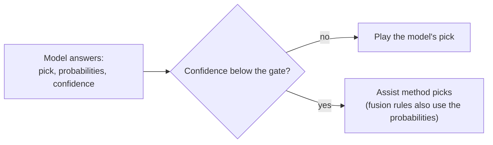
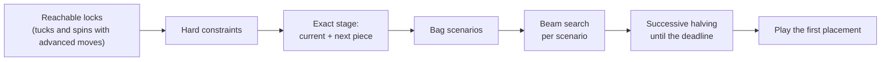
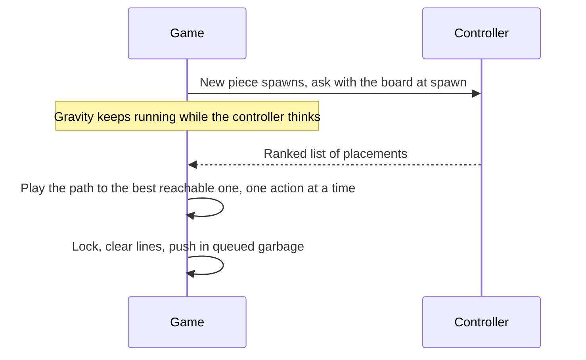

# Concepts

This page explains the ideas behind the demo: the three kinds of decision-maker, what each one knows and how it decides, and the hard-mode rules that judge them. It is written for a technical reader and needs no knowledge of the code. For implementation details, follow the links in each section.

## The question

Every time a new piece appears, something has to choose where it goes. The demo asks three very different decision-makers to make that choice, side by side, under identical conditions:

- **A decision model** gives a learned, intuitive judgment in one call.
- **A heuristic** scores every possible placement with a fixed formula and takes the best.
- **An operations research (OR) solver** plans several pieces ahead over the futures that could happen, then commits to one move.

All boards get the same pieces in the same order, the same garbage rows on the same clock, and the same gravity curve. The only thing that differs is the decision-maker.

| | Decision model | Heuristic | OR solver |
|---|---|---|---|
| How it decides | One learned judgment per move | A scoring formula over each placement | Explicit optimization over possible futures |
| What it sees | The board as text, the current piece, up to 26 described options | The board, the current piece, every reachable placement, the next piece | The board, the current and next piece, the rest of the 7-bag, gravity, the garbage clock |
| How far it looks ahead | None: it judges this move only | Most score this move only; `lookahead` adds the next piece, and `rollout` plays a few random pieces forward | About 5 pieces at the default budget |
| Typical decision time | About 2.2 s (clef-flash), 7.6 s (clef) | About 5 ms (`lookahead`) | About 100–160 ms |
| Where it runs | Ollama, locally | In the app, in TypeScript | A local Python service |

Decision times are from Part 3 of [the experiment results](../experiments/RESULTS.md#part-3-the-same-race-with-fair-time-based-garbage).

## Decision models

### What a System One model is

Psychology describes two modes of thinking: System 1 is fast and intuitive, System 2 is slow and deliberate. The decision models here play the System 1 role. You give one a situation and a question, and it returns a judgment with probabilities attached. The app does no search, planning or simulation around it: one request returns the whole answer.

The demo uses two local models served by Ollama: `clef` and its faster sibling `clef-flash`. The app calls them through Ollama's `/v1/systemone` endpoint with *typed questions*: each request carries a description of the current state and one or more named questions, and each question has a type that fixes the shape of the answer.

| Question type | You provide | You get back | Used for |
|---|---|---|---|
| `choice` | Lettered options, each with a short description | The chosen letter, a probability for every letter, and a confidence | Picking a move |
| `score` | An ordered scale of labels (here: terrible, poor, okay, good, excellent) | A score on that scale and a probability for each label | Rating board health in the experiments |

Because the answer is a probability distribution, not free text, code can combine it with other signals: rank by it, gate on it, or mix it with a heuristic's scores.

### How a move is asked

For each piece, the app sends one `choice` question:

- **State:** the board as 20 rows of `#` (filled) and `.` (empty), a legend, the piece name, and a goal: survive as long as possible and clear lines, and avoid holes and tall stacks.
- **Options:** every reachable placement, described in words. Each description gives the rotation and column, lines cleared, new holes and total holes, maximum height and bumpiness, and whether it is a tuck or a T-spin.
- **Limits:** a `choice` question takes at most 26 options (letters A to Z). When there are more, the app keeps spins first, then the options with the fewest holes, then those with the lowest stack. It shuffles the list because the model breaks ties toward the first option, and list order should give it no hint.

The model is not told the next piece, the rest of the bag, or how much time it has.

### Confidence and the assist gate

Every `choice` answer includes a *confidence*: how sure the model is of its pick. The *assist* uses it. When confidence falls below a per-board *gate*, a heuristic picks instead. Some assist methods are *fusion* rules that combine the model's probabilities with a heuristic's scores, so the model still has a say.

The default gates are 0.025 for clef-flash and 0.1 for clef. They assist on roughly two-thirds of moves and leave the model in charge of its most confident third. A gate of 1 assists on every move. The assist is off in the default lineup.

### Why it struggles here

The experiments found three reasons, all in [Part 1](../experiments/RESULTS.md#heuristic-assist-for-clef-and-clef-flash-experiment-results) and [Part 3](../experiments/RESULTS.md#part-3-the-same-race-with-fair-time-based-garbage) of the results:

1. **Flat distributions.** The models are nearly always undecided. Median confidence is 0.020 for clef-flash and 0.077 for clef, and clef-flash's mean normalized entropy is 0.98, close to a uniform guess over all options.
2. **A blind spot for holes.** Each option's text states how many holes it creates, and the goal says holes are bad. Even so, clef-flash puts 73% of its probability on hole-digging options, against 75% for a uniform guess, and digs an avoidable hole on 47% of moves. When clef rates boards, more holes at equal stack height earn a slightly *higher* rating (partial correlation +0.32).
3. **Latency against gravity.** A real-time piece keeps falling while its controller thinks. At about 2.2 s per move for clef-flash and 7.6 s for clef, pieces lock before the answer arrives (up to 3.3 times per game). Both models top out within 35–75 s with 130–200 points.

The models still carry real signal. Their rankings agree with the oracle (Spearman ρ 0.44 for clef-flash, 0.51 for clef, against 0.69 and 0.73 for `lookahead`), and clef-flash's top pick matches the oracle's best option 32% of the time against 8% for a random pick. The ranking is informative; the top pick isn't reliable.

### Learning from the model

The experiments also turn the models' judgments into heuristics:

- **`clef-distilled`** fits clef's 0–4 board ratings with ridge regression on board features. Used directly, it dies in about 106 pieces, because it inherits clef's indifference to holes.
- **`clef-hole-sense`** adds the missing hole penalty back. It survives 500 pieces on 5 of 5 seeds and was the best live assist for clef-flash.
- **`move-distilled`** fits the models' move probabilities and blends the result with `lookahead`.

The lesson from Part 1: learning from a model works as *diagnosis*, not imitation. Copying clef's ratings failed, and those ratings showed exactly what it was missing.

## Heuristics

A *heuristic* here is a scoring rule. For every placement the current piece can reach, it computes features of the resulting board, combines them into one number, and plays the highest. It is fast, deterministic and transparent, and it knows only what its formula encodes.

### Features

Most heuristics are built from a common set of board features:

| Feature | Definition | Why it matters |
|---|---|---|
| Holes | Empty cells with a filled cell somewhere above them in the same column | Usually a hole cannot be filled until the rows above it clear |
| Hole depth | For each hole, the filled cells above it, summed | Deep holes take longer to uncover |
| Rows with holes | Rows that contain at least one hole | Each one blocks a line clear |
| Aggregate height | The sum of all column heights | A tall stack leaves less room to recover |
| Max height | The tallest column | Close to the top means close to topping out |
| Bumpiness | The sum of height differences between neighboring columns | A jagged surface fits fewer pieces |
| Row transitions | Changes between filled and empty along each row, with the walls counted as filled | A proxy for gaps inside rows |
| Column transitions | Changes between filled and empty down each column, with the floor counted as filled | A proxy for covered gaps |
| Wells | Empty cells with filled cells or walls on both sides; a well *k* cells deep adds 1 + 2 + … + *k* | Deep wells only take an I piece |
| Landing height | The height of the piece's center where it lands | Lower placements keep the stack down |
| Eroded cells | Lines cleared by the piece × the piece's own cells in those lines | Rewards placements that clear rows with their own cells |

### Evaluators

The formula most of the project builds on is *Dellacherie's*: six features (landing height, eroded cells, row and column transitions, holes, wells) with weights tuned by particle swarm optimization in the El-Tetris project.

| Feature | Weight |
|---|---|
| Landing height | −4.50 |
| Eroded cells | +3.42 |
| Row transitions | −3.22 |
| Column transitions | −9.35 |
| Holes | −7.90 |
| Wells | −3.39 |

The 22 methods in the picker fall into four kinds:

| Kind | Count | What they are | Examples |
|---|---|---|---|
| Classic | 5 | Rules from Tetris AI research | `dellacherie`, `lee4`, `lookahead` |
| Original | 4 | New rules written for this project | `well-keeper`, `danger-adaptive`, `rollout` |
| Learned | 3 | Fitted to the models' own judgments | `clef-distilled`, `clef-hole-sense`, `move-distilled` |
| Fusion | 10 | Combine the model's probabilities with a heuristic | `poe`, `entropy-gate`, `hole-guard` |

Fusion rules are meant to run with a model's opinion. Without one, `entropy-gate`, `poe-tuned`, `perplexity-shortlist` and `shortlist` play exactly like `lookahead`. The full list, with a one-line idea for each, is in [Controllers](controllers.md).

### Lookahead

`lookahead` scores a placement as its Dellacherie value plus the best Dellacherie value available to the known next piece afterwards. In the heuristic-only benchmark it reached the 500-piece cap on every seed with 0.03 holes on average. In the race with fair garbage it decides in about 5 ms and is the only heuristic tested that keeps pace with the OR solver.

The same two-piece calculation, with the solver's bonuses and hard constraints added, is the first stage of the OR solver, so comparing the two measures what the rest of the solver adds.

## Operations research

*Operations research* is the discipline of choosing decisions that optimize an objective, subject to constraints, often under uncertainty. The solver frames each move that way:

| OR term | In this game |
|---|---|
| Decision | Where the current piece locks |
| Objective | The total score of the placements in a plan: Dellacherie's evaluator plus T-spin, Tetris and T-slot bonuses while the stack is low (10 rows or less, counting incoming garbage). Pieces after the next one are discounted by a factor of 0.9 per piece. A top-out costs more than any plan that survives. |
| Constraints | Rules a placement must not break (below) |
| Uncertainty | The order of the coming pieces, and where the gaps in garbage rows will be |

### Hard constraints

A *hard constraint* removes a move from consideration instead of lowering its score. The solver applies three:

| Constraint | A placement breaks it when |
|---|---|
| No new sealed holes | It clears no lines and adds a sealed hole: one that no piece can reach by moving down and sideways |
| Height cap | It leaves fewer than 4 empty rows above the stack, after counting the garbage about to arrive |
| Spawn safe | After garbage lands, any cell of the spawn area (the top two rows of the middle four columns) is filled, or the stack is pushed off the top |

When no move satisfies all three, the solver loosens them in order: sealed holes first, then the height cap, and spawn safety last.

### Rolling horizon

*Rolling-horizon planning* (also called receding-horizon planning) plans several steps ahead, carries out only the first step, and plans again once the next step arrives. The solver plans about 5 pieces ahead at its default 300 ms budget, plays one placement, and re-plans when the next piece spawns. Because it commits to so little, a plan never has to be right about the far future. It only has to make the next move a good starting point.

### Scenarios from the 7-bag

Pieces are dealt from a *7-bag*: each run of seven pieces contains one of each shape in a shuffled order. Once some of a bag has been dealt, the pieces left in it are known; only their order is not. The solver turns that into *scenarios*, possible orders of the coming pieces:

- When the remaining orders are few, it enumerates them.
- Otherwise it samples them, stratified so that every remaining piece leads equally often.
- Later bags are shuffled at random, and garbage gaps are sampled.

The solver also forecasts when garbage will land, from the shared garbage clock and how fast its own board has been placing pieces. A variant without bag knowledge treats every future piece as independent and random. Comparing the two measures what the bag is worth.

### Anytime search

An *anytime* algorithm can be stopped at any moment and still answer, and it answers better the longer it runs. That matters because the solver's thinking time is also the piece's falling time. It works in stages and keeps the best finished answer at each one:

- **Exact stage.** Scores every candidate together with the best follow-up for the next piece. This is the fallback answer.
- **Beam search.** Plays each scenario forward, keeping only the best few boards at each depth.
- **Successive halving.** Evaluates the strongest first moves on a few scenarios, drops the weaker half, doubles the number of scenarios for the rest, and repeats. Time goes to the moves still in contention.
- **Deadline.** Under gravity the solver thinks for at most a quarter of the piece's fall time, capped at its budget. On a deadline it only compares moves searched to the same depth.

Details, settings and the HTTP interface are in [OR solver](or-solver.md).

## Hard mode

*Hard mode* is the set of rules the race runs under. The rules are precise in [Game engine](game-engine.md); this is the high-level picture.

| Rule | How it works |
|---|---|
| Same pieces | A seeded 7-bag: the same seed deals the same sequence on every board (default seed 42) |
| Real-time gravity | The piece falls on the guideline curve, from 1000 ms per row at level 1 to 7 ms per row at level 15, while its controller thinks |
| Lock delay | A landed piece locks after 500 ms; moving or rotating it resets the delay, up to 15 times per new lowest row |
| Levels | One level per 10 lines cleared, from the start level (default 1) |
| Rising garbage | One row with a single gap every N seconds (default 6), on a clock shared by every board, with the same gaps on every board |
| Advanced moves | A per-board switch that lets the controller use soft drops, so *tucks* (sliding under an overhang) and [T-spins](https://tetris.wiki/T-Spin) become reachable under [SRS](https://tetris.wiki/Super_Rotation_System) rotation |
| Visible moves | Every move plays out on the board at the move-speed setting (default 80 ms per action) while gravity keeps running |
| Top-out | The game ends when a new piece cannot appear, or garbage pushes the stack off the top |
| Ranking | The podium ranks by time survived, then by score |

### The decision lifecycle

Each piece goes through the same steps on every board:

The time a controller has to answer is roughly the rows left to fall × the milliseconds per row, plus the lock delay. A taller stack or a higher level shrinks it. Three outcomes are counted:

| Term | Meaning |
|---|---|
| Late | The piece locked before the decision arrived |
| Missed | The decision arrived, but the lock delay ran out before the move finished |
| Fallback | The controller's picks were no longer reachable, so Dellacherie chose from where the piece is now |

A controller that fails outright loses only that piece: it falls where gravity takes it, and no heuristic stands in.

### Why the fairness of the clock matters

How garbage is timed decides what thinking costs. The project has used two rules:

| Garbage rule | Used in | What a slow controller gets |
|---|---|---|
| One row every N pieces placed | Part 2 (superseded) | Less garbage per minute, because it places fewer pieces |
| One row every N seconds on a shared clock; rows due while it thinks land at its next lock | Part 3 and the current code | The same garbage as everyone else, so thinking time costs rows |

Under the per-piece rule, slow controllers dodged garbage. Clef "survived" 3 minutes by placing about 26 pieces, and the OR solver beat `lookahead` by 38–44 s. Under the fair, time-based rule, most of that lead disappears. The solver and `lookahead` are roughly level: the solver survives a little more often at a 4 s interval (8/8 against 6/8), `lookahead` scores more whenever survival isn't at stake, and the solver's planning roughly pays for its 100–160 ms of thought.

The lesson from Part 3: a controller is only as good as the clock it is judged on.

## How the ideas play out

| Idea | What the experiments found | Source |
|---|---|---|
| A decision model as a move picker | Nearly always undecided; the ranking carries signal, the top pick is unreliable | Part 1 |
| Heuristic assist | Cuts clef-flash's offline regret by about two-thirds (17.2 → 5.7); live, holes after 50 pieces drop from 26 to 0 and the score triples | Part 1 |
| Learning from the model | `clef-hole-sense`, learned from clef's ratings, was the best live assist | Part 1 |
| OR planning under a fair clock | Roughly level with `lookahead`; advanced moves (72 s against 56 s at a 2 s interval) and bag knowledge (72 s against 58 s) still help it | Part 3 |
| Decision models in real time | Top out within 35–75 s | Part 3 |
| Saving rows for Tetrises | `well-keeper` and `danger-adaptive` collapse once garbage is fair, because the rows they save are the rows garbage pushes into | Part 3 |

*Regret* is the oracle's value of the best option minus that of the option picked; lower is better. The full method, tables and caveats are in [the experiment results](../experiments/RESULTS.md).

## Next steps

- [Getting started](getting-started.md): install everything and run your first race.
- [Controllers](controllers.md): all 22 heuristics, the model controller and how to add your own.
- [OR solver](or-solver.md): the solver's API, algorithm and settings.
- [Game engine](game-engine.md): the exact rules behind hard mode.
