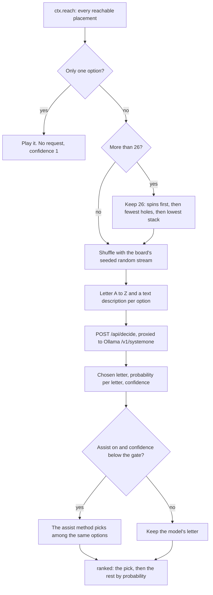
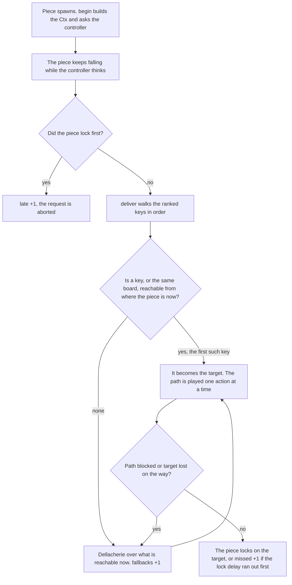

# Controllers

A controller is the decision-maker behind one board. Every time a piece spawns, the board hands its controller a snapshot of the game, and the controller answers with a ranked list of placements. This page covers the three kinds of controller (decision model, heuristic and OR solver), all 22 heuristics, how a ranked answer becomes moves on the board, and how to add your own. It is written for engineers who want to understand, tune or extend the decision-makers.

## The controller contract

All controllers share one type, defined in [`lib/controllers.ts`](../lib/controllers.ts):

```ts
export type Controller = (ctx: Ctx, signal?: AbortSignal) => Promise<Decision>;
export type Decision = { ranked: string[]; info: Info };
```

- **`ctx`** is the decision context: the board at spawn, the piece, every placement it can reach, and the clocks.
- **`signal`** is aborted when the piece locks before the answer arrives, or the race is paused or reset, so a slow request can stop early.
- **`ranked`** lists placement keys, best first. The board plays the first one that is still reachable. Later keys are backups.
- **`info`** is what the board's panel shows: confidence for a model, compute time for a heuristic, search stats for the solver.

Controllers are pure apart from their network calls. Those calls go through injected **transports**, so the browser and the Node scripts run the same controller code:

| Transport set | Defined in | `decide` goes to | `solve` goes to |
|---|---|---|---|
| `WEB` | [`app/Board.tsx`](../app/Board.tsx) | `POST /api/decide`, which proxies to Ollama | `POST /api/solve`, which proxies to the OR solver |
| `NODE` | [`scripts/race.ts`](../scripts/race.ts) | Ollama's `/v1/systemone` directly | The solver's `/solve` directly |

### Choosing a controller

Each board has a `BoardCfg`. Its `who` string picks the controller, and `controllerFor(cfg, transports)` builds it:

| `who` | Controller | Board title |
|---|---|---|
| `model:clef` | Decision model, clef | `clef` |
| `model:clef-flash` | Decision model, clef-flash | `clef-flash` |
| `solver` | OR solver | `OR solver` |
| `heuristic:<id>` | One of the 22 heuristics, for example `heuristic:lookahead` | The method's display name |

The other `BoardCfg` fields:

| Field | Type | Used by | Meaning |
|---|---|---|---|
| `assist` | string | Model | `"off"` or a heuristic id that steps in when the model is unsure |
| `gate` | number | Model | The assist runs when the model's confidence is below this value |
| `budgetMs` | number | Solver | Thinking time in milliseconds |
| `advanced` | boolean | All | Search tucks and T-spins as well as plain drops |
| `strictInfo` | boolean | Solver | `true` withholds the pieces left in the current 7-bag |

The page starts with this lineup (`LINEUP`):

| Board | Controller | Settings |
|---|---|---|
| 1 | `model:clef-flash` | Assist off, basic moves |
| 2 | `heuristic:lookahead` | Basic moves |
| 3 | `solver` | 300 ms budget, advanced moves on, bag knowledge on |

In the board's picker, the controller menu groups the options as **Decision model**, **Operations research** and four heuristic groups, one per kind. The **advanced moves** checkbox appears on every board. Model boards add an **assist** menu and a **conf <** gate field. The solver board adds a **think** budget menu and a **strict info** checkbox. You can change a board's settings during a race: the board reads its settings again at each spawn, so a change applies from the next piece.

### The decision context

`begin()` in [`lib/race.ts`](../lib/race.ts) builds the `Ctx` at the moment the piece spawns:

| Field | Type | Meaning |
|---|---|---|
| `pieceId` | number | Which piece this decision is for; a late answer for an earlier piece is ignored |
| `board` | `number[][]` | 20 rows × 10 columns, top row first. 0 = empty, 1–7 = piece id, 8 = garbage. The falling piece is not on it |
| `piece`, `next` | `PieceName` | The current piece and the one preview piece (`I`, `O`, `T`, `S`, `Z`, `L`, `J`) |
| `active` | `{ x, y, rot }` | The piece's SRS state at spawn (box origin and rotation 0–3) |
| `reach` | `Placement[]` | Every lock position reachable from `active`, each with a key and an action path |
| `level` | number | Current level |
| `advanced` | boolean | Whether `reach` includes tucks and spins |
| `gravity` | boolean | `false` in the turn-based mode, where the piece waits at spawn |
| `gravityMs` | number | Milliseconds per row at this level |
| `lockDelayMs` | number | Lock delay (500 on the page) |
| `garbageMs` | number | One garbage row every this many milliseconds; 0 = off |
| `msUntilGarbage` | number | Time until the next row is queued |
| `pendingGarbage` | number | Rows already queued; they are pushed in when this piece locks |
| `avgPieceMs` | number | This board's average time per piece so far, at least 50 (1000 before the first lock) |
| `bagRemainder` | `PieceName[]` | Pieces still to come in the 7-bag that holds `next` |
| `rng` | `() => number` | The board's seeded random stream |

### Placement keys

A **placement key** names a lock by its result, not by how the piece got there:

```text
<200 characters of 0 and 1: the board after line clears, top row first>|<spin>
```

`spin` is `none`, `mini` or `full`. Two paths that leave the same board are the same option, so `reach` never lists a result twice. When several paths lead to the same board, the search keeps the higher spin, then the shorter path. Keys from different engines can still be compared: the solver's answer is turned into a key by applying its cells to the board (see [Mapping cells back to keys](#mapping-cells-back-to-keys)).

## Decision-model controller

The decision-model controller asks a local [clef](https://ollama.com/library/clef) or clef-flash model where to put the piece. It sends one typed `choice` question through Ollama's `/v1/systemone` endpoint and reads back a probability for every option.



### The request

[`lib/prompt.ts`](../lib/prompt.ts) builds the request. The API route and the experiment scripts share it. For a T piece it looks like this (the board and the option list are shortened here):

```json
{
  "model": "clef-flash",
  "keep_alive": "30m",
  "state": {
    "board": "..........\n..........\n(17 more rows)\n#######...",
    "legend": "10 wide x 20 tall, top row first. '#' = filled, '.' = empty.",
    "piece": "T",
    "goal": "Survive as long as possible and clear lines. Holes and tall stacks are bad.",
    "request_id": "2df2d4db-f64e-44b2-b81d-a1a1083ed2e3"
  },
  "questions": {
    "move": {
      "type": "choice",
      "instructions": "Where should the T piece be dropped for the best long-term Tetris play?",
      "criteria": {
        "A": "rotation 1, column 1: clears 0 lines, +1 holes (total 1), max height 4, bumpiness 7",
        "B": "rotation 3, column 7: clears 0 lines, +1 holes (total 1), max height 3, bumpiness 5"
      }
    }
  }
}
```

- **`board`** is the stack as text, 20 lines of 10 characters. The falling piece is not drawn.
- **`keep_alive: "30m"`** keeps the model loaded between moves.
- **`request_id`** is a fresh UUID per request. Replaying a seed would otherwise hit Ollama's cache and give unrealistically fast timings.
- The model is not told the next piece, the level, the gravity or the garbage clock.

### Option text

Each option is described by `describe()` in [`lib/tetris.ts`](../lib/tetris.ts):

```text
rotation <r>, column <c>: clears <n> line(s), <+/-k> holes (total <h>), max height <m>, bumpiness <b>[, tucked under an overhang][, T-spin | , mini T-spin]
```

- `rotation` indexes the piece's distinct rotations: O has 1, I, S and Z have 2, and T, L and J have 4.
- `column` is the leftmost column of the piece in that rotation.
- Holes, height and bumpiness describe the board after the piece locks and lines clear.
- With advanced moves on, a tuck adds `tucked under an overhang` and a spin adds `T-spin` or `mini T-spin`.

### The 26-option cap

A `choice` question takes at most 26 options, one per letter, and `/api/decide` rejects fewer than 2 or more than 26. T, L and J can have up to 34 hard-drop placements on an open board, and more with tucks. When there are more than 26, `toOptions()` keeps the first 26 in this order:

1. Spins first: full T-spin, then mini T-spin, then no spin.
2. Fewest holes after the move.
3. Lowest max height after the move.

The other options are dropped before the model sees them. The assist then chooses from the same 26 options as the model.

### Shuffling

After trimming, the options are shuffled before letters are assigned. The code notes that the model breaks ties toward the first option, so shuffling stops list order from hinting at an answer. The shuffle draws from the board's seeded random stream (`ctx.rng`), not from `Math.random`.

### Reading the answer

`/api/decide` returns `{ letter, probabilities, confidence, ms }`, taken from the endpoint's `answers.move` (`choice`, `probabilities`, `confidence`).

- **The pick** is the returned letter. If the letter matches no option, the option with the highest probability is used.
- **Confidence** is the single score the endpoint returns with the probabilities. The assist gate compares against it. Both models are almost always unsure: the median confidence was 0.020 for clef-flash and 0.077 for clef ([RESULTS.md, Part 1](../experiments/RESULTS.md#heuristic-assist-for-clef-and-clef-flash-experiment-results)).
- **`ranked`** is the pick, then every other option in order of probability. If the pick can no longer be reached when the answer arrives, the board falls through to the model's next-best option.
- **The panel** shows the confidence, the three most probable options with their percentages, and the assist's verdict.

If only one placement is reachable, the controller skips the request, plays that placement and reports a confidence of 1.

### Heuristic assist

An **assist** is a heuristic that overrules the model when the model is unsure. It runs only when the assist is set and `confidence < gate`. It scores the same options the model saw, with the model's probabilities as input, so fusion rules can combine the two. Any of the 22 methods can be the assist.

- If the assist picks a different option, the panel shows `<method> overrode <letter> → <letter>`.
- Otherwise the panel shows `<method> agreed with <letter>`.
- The assist's pick goes first in `ranked`, followed by the model's other options in order of probability.
- The board counts both cases: beside the playfield it shows `assists <overrides>/<assists>`.

The gate needs a different scale per model, so each model has its own default (`DEFAULT_GATE`):

| Model | Default gate |
|---|---|
| `clef` | 0.1 |
| `clef-flash` | 0.025 |

The offline study chose these values so the assist steps in on roughly the less confident two-thirds of moves, which leaves the model in charge of its most confident third ([RESULTS.md, Part 1](../experiments/RESULTS.md#what-the-models-taught-us)). Choosing a model in the picker resets the gate to that model's default. A gate of 1 assists on every move unless the model reports a confidence of exactly 1. The assist is off on the default lineup.

### The endpoint and errors

[`app/api/decide/route.ts`](../app/api/decide/route.ts) forwards the request to `OLLAMA_URL` (default `http://localhost:11434`) and accepts only `clef` and `clef-flash`.

| Situation | Response |
|---|---|
| Unknown model, or fewer than 2 or more than 26 options | `400` with `{ "error": "bad request" }` |
| Ollama returns an error, or no `move` answer | `502` with the reason |
| Ollama unreachable | `502`, `ollama unreachable at <url>: <reason>` |
| The piece locked first and the browser aborted | `499` with no body |

When the piece locks first, the board aborts the request so Ollama does not queue stale work. To add another model, add its name to `MODELS` and `DEFAULT_GATE` in `lib/controllers.ts` and to the `MODELS` set in the route.

## Heuristic controllers

A heuristic controller scores every reachable placement with one method from [`lib/heuristics.ts`](../lib/heuristics.ts) and ranks all of them, best first. It runs in the browser with no network call, and the panel shows the method's name, its compute time and a one-line description.

- The options are `ctx.reach`, so with advanced moves on, a heuristic can choose tucks and spins. No feature looks at the spin, so a heuristic values a spin only for the board it leaves.
- `lookahead`, `rollout` and the methods built on them look ahead with plain hard drops only.
- **Fusion rules** are written to combine a model's probabilities with a heuristic. When a fusion rule is the board's own controller, there is no model, and it sees a flat distribution (the same probability for every option). The picker labels this group "Heuristic: fusion (no model here)". `borda` is the exception: with no model it leaves the model's vote out. In the no-model benchmark, the fusions built on `lookahead` (`entropy-gate`, `poe-tuned`, `perplexity-shortlist`, `shortlist`) played exactly like `lookahead`. `hole-guard`, `veto` and `reliability-rank` need the model's opinion to mean anything ([RESULTS.md, Part 1](../experiments/RESULTS.md#heuristic-only-benchmark-no-model-5-seeds-cap-500-pieces)).

### The 22 methods

Five are classics from Tetris AI research, four are original to this project, three are learned from the models' own judgments, and ten are fusion rules. The ids are what follows `heuristic:` in `who`, and what `assist` holds.

| Id | Name | Kind | Idea |
|---|---|---|---|
| `lee4` | Lee 4-feature | Classic | Weighted sum of aggregate height, lines cleared, holes and bumpiness with GA-tuned weights. Height, holes and bumpiness are measured after the piece lands, before rows clear. |
| `dellacherie` | Dellacherie / El-Tetris | Classic | Six features (landing height, eroded cells, row transitions, column transitions, holes, wells) with the El-Tetris PSO-tuned weights. Also the board's fallback. |
| `holes-first` | Holes first | Classic | Strict priority: fewest holes, then lowest max height, then least bumpiness. |
| `transitions` | Transitions | Classic | Fewest filled/empty transitions along rows and columns, with an extra 4 points off per hole. |
| `lookahead` | Lookahead (next piece) | Classic | Dellacherie for this move plus the best Dellacherie hard drop for the known next piece. |
| `well-keeper` | Well keeper | Original | Dellacherie that does not penalize a well in the right column and adds 50 for a Tetris. While the stack is under 12 rows it also penalizes 1–3 line clears and the height of the right column. |
| `danger-adaptive` | Danger adaptive | Original | Blends `well-keeper` with a pure survival score. The blend moves fully to survival as the stack rises from 6 to 14 rows. |
| `contour` | Contour fit | Original | Rewards piece sides (left, right, below) that touch the stack, a wall or the floor. Penalizes new holes, landing height and bumpiness, with a small bonus per line. |
| `rollout` | Monte Carlo rollout | Original | Plays the 5 best Dellacherie candidates forward 6 times each, 4 pieces deep (the known next piece first, then random ones), with greedy Dellacherie, and averages the outcome. Seeded from the board, so it is deterministic. |
| `clef-distilled` | Clef-distilled | Learned | Linear board-health score from a ridge regression of clef's 0–4 ratings of sampled boards on nine board features. |
| `clef-hole-sense` | Clef + hole sense | Learned | `clef-distilled` plus 2 × a hole penalty (holes, rows with holes, hole depth). It adds back the hole penalty that clef's ratings lack. |
| `move-distilled` | Move-distilled + lookahead | Learned | Softmax-regression weights fitted to the models' move probabilities, at half weight, plus `lookahead`. |
| `poe` | Product of experts | Fusion | log p(model) + z(Dellacherie), equal weight. |
| `entropy-gate` | Entropy gate | Fusion | Mixes the model and `lookahead` by the model's normalized entropy: the flatter its distribution, the more `lookahead` decides. |
| `shortlist` | Heuristic shortlist | Fusion | `lookahead` names its top 3; the model's probabilities pick among them. |
| `veto` | Heuristic veto | Fusion | The model's favorite stands unless `lookahead` rates it below average; then the model's favorite among the options rated at or above average wins. |
| `hole-guard` | Hole guard | Fusion | Only the options that create the fewest new holes are allowed; the model's favorite among them wins. |
| `poe-tuned` | Product of experts (tuned) | Fusion | log p(model) + β × z(lookahead), with β fitted offline (`poeBeta` = 5). |
| `perplexity-shortlist` | Perplexity shortlist | Fusion | The model's top e^entropy options (its effective number of choices) form a shortlist; `lookahead` picks within it. |
| `reliability-rank` | Reliability-weighted rank fusion | Fusion | Rank fusion of the model and `lookahead`, each weighted by its measured Spearman agreement with the oracle (0.442 and 0.691). |
| `borda` | Borda committee | Fusion | Rank vote across `lee4`, `dellacherie`, `transitions`, `contour`, `lookahead` and, when present, the model. Dellacherie breaks ties. |
| `minimax-regret` | Minimax-regret committee | Fusion | Picks the option whose worst regret across those five heuristics and the model is smallest. |

In the formulas, z(·) standardizes a method's scores across the options (mean 0, standard deviation 1). The learned weights live in [`lib/learned.ts`](../lib/learned.ts), which `scripts/fit.ts` generates. For how each method performed, see [RESULTS.md, Part 1](../experiments/RESULTS.md#the-22-methods).

### Features

Methods read their inputs from `feats(inp)`, which computes one feature record per option and caches it. Board features are measured on the board after the piece locks and lines clear, unless noted.

| Feature | Meaning |
|---|---|
| `heights` | Height of each of the 10 columns |
| `aggHeight` | Sum of the column heights |
| `maxHeight` | Tallest column |
| `bumpiness` | Sum of height differences between neighboring columns |
| `holes` | Empty cells with a filled cell somewhere above them in the same column |
| `holeDepth` | For each hole, the number of filled cells above it, summed |
| `rowsWithHoles` | Rows that contain at least one hole |
| `rowTrans` | Filled/empty changes along each row; the walls count as filled |
| `colTrans` | Filled/empty changes down each column; the floor counts as filled |
| `wells` | Well cells (empty, with filled cells or walls on both sides), weighted by depth: a well of depth d adds 1 + 2 + … + d |
| `well9` | `wells` for the rightmost column only |
| `landing` | Landing height: rows from the floor to the middle of the piece, counting the bottom row as 1 |
| `eroded` | Rows cleared that include the piece × piece cells in those rows |
| `lines` | Rows cleared |
| `contact` | Piece-cell sides (left, right, below) touching the stack, a wall or the floor, before the move |
| `newHoles` | Holes after the move minus holes before |
| `leeAgg`, `leeHoles`, `leeBump` | Aggregate height, holes and bumpiness after the piece lands but before rows clear |

## OR solver controller

The solver controller sends the decision context to the Python OR solver ([`or-solver/`](../or-solver/), FastAPI on `127.0.0.1:8100`). The solver plans several pieces ahead and returns its best placement plus up to 3 alternatives. For the algorithm, see [OR solver](or-solver.md).

### What it sends

`POST /api/solve` forwards the body to `OR_SOLVER_URL` (default `http://127.0.0.1:8100`) at `/solve`:

| Field | Type | Taken from | Notes |
|---|---|---|---|
| `board` | `int[20][10]` | `ctx.board` | 0 = empty, 1–7 = piece id, 8 = garbage |
| `active` | `{ piece, x, y, rot }` | `ctx.piece`, `ctx.active` | The state at spawn |
| `next` | `string[]` | `[ctx.next]` | One preview piece. The service accepts up to 6 and plans with the first |
| `bagRemainder` | `string[]` or `null` | `ctx.bagRemainder` | `null` when **strict info** is on |
| `rules.advanced` | boolean | `ctx.advanced` | Tucks and spins |
| `rules.level` | integer | `ctx.level` | Not used by the search |
| `rules.gravityMsPerRow` | integer, ms | `ctx.gravityMs` | 0 when gravity is off |
| `rules.lockDelayMs` | integer, ms | `ctx.lockDelayMs` | |
| `rules.garbageMs` | ms | `ctx.garbageMs`, rounded | 0 = no garbage |
| `state.pendingGarbage` | integer, rows | `ctx.pendingGarbage` | Pushed in when this piece locks |
| `state.msUntilGarbage` | ms | `ctx.msUntilGarbage` | |
| `state.avgPieceMs` | ms | `ctx.avgPieceMs` | The board's pace, used to place future garbage rows between pieces |
| `timing.budgetMs` | integer, ms | `cfg.budgetMs` | The thinking budget |

With bag knowledge on (strict info off), the solver also knows which pieces are left in the current 7-bag. That information is public, since it follows from the pieces already dealt, but only the solver uses it.

### Budgets

The board's **think** menu offers 50, 300 (default), 1000 or 2000 ms, and `scripts/race.ts` takes `solver:<ms>`, for example `solver:300`. `/api/solve` rejects a budget unless 0 < `budgetMs` ≤ 10,000, and gives up on the solver after `budgetMs` + 2,000 ms. With gravity on, the solver also caps its budget at a quarter of the piece's expected fall time. It stops searching at 85% of the capped budget, minus 2 ms, and the capped budget also sets how deep and wide it searches. [Set the time budget](or-solver.md#1-set-the-time-budget) and [Bag scenarios](or-solver.md#5-bag-scenarios) give the formula and the `settings()` table.

### Mapping cells back to keys

The solver answers with the four cells the piece occupies and the spin, not with a key. The controller converts each answer into this engine's key:

1. Copy `ctx.board` and write the piece into the returned cells.
2. Clear full lines and build the key from the resulting board and the spin.
3. If that key is in `ctx.reach`, use it. Otherwise use the reachable placement that leaves the same board with any spin.

Because the key depends only on the result, the two engines may choose different cells for the same outcome without breaking the match. `ranked` is the placement followed by the alternatives, minus any that match nothing.

The panel shows the spin (if any), the planning horizon, the number of search nodes, the solve time against the budget, why the search stopped (`complete`, `deadline` or `nodeBudget`), the expected value, the constraint status (`ok`, `relaxed` or `forced`, plus any constraint broken) and up to two alternatives with the reason for each.

### No stand-in on errors

If the solver is down or returns an error, `/api/solve` returns `502` and the controller fails. No heuristic takes over for that piece. With gravity on, the piece falls and locks where gravity leaves it. In the turn-based mode it drops straight down. The next piece asks again. This keeps the race honest: a controller that can't answer pays for it.

## How a decision becomes a move

[`lib/race.ts`](../lib/race.ts) runs one board in real time, in the browser with `requestAnimationFrame` and in `scripts/race.ts` with simulated time. Gravity never waits for a controller.



1. **Ask at spawn.** The simulation stops at the exact moment a piece spawns and asks the controller, so the ask happens at the same game time in the browser and in the scripts. In the turn-based mode the piece waits at spawn until the answer arrives.
2. **The piece falls while the controller thinks.** If it lands and the 500 ms lock delay runs out first, it locks where it is. The decision is **late**, and the request is aborted.
3. **Resolve the ranked keys.** When the answer arrives, `deliver()` recomputes what is reachable from the piece's current position, which may be lower than at spawn. It takes the first key in `ranked` that is still reachable, by exact key or by the same resulting board. If that is not the first key, the panel says so.
4. **Fall back if nothing matches.** If no ranked key is reachable, the board runs Dellacherie over the placements reachable now. This is the only fallback, and it is the same for every controller.
5. **Play the path.** The target's path is played one visible action at a time. Each action costs the **moves** setting (slow 160 ms, normal 80 ms by default, fast 30 ms). A soft drop costs a quarter of that, at least 10 ms, and the final hard drop is shown row by row at the soft-drop cost. Gravity keeps running, so the path is replanned whenever gravity has moved the piece since the last plan.
6. **Lock.** If the lock delay runs out before the piece reaches its target, the decision is counted as **missed**.

### Reachability

`reachable()` in [`lib/srs.ts`](../lib/srs.ts) runs a breadth-first search over SRS states from the piece's current state and returns every lock position with a shortest action path that ends in a hard drop.

- **Basic moves:** rotate and shift where the piece is, then hard drop.
- **Advanced moves:** soft drops as well, so the search finds tucks (slides under an overhang) and T-spins. T-spins follow the [three-corner rule](https://tetris.wiki/T-Spin), with [SRS](https://tetris.wiki/Super_Rotation_System) wall kicks.

See [Game engine](game-engine.md) for the exact rules.

### Notes and counters

Every unusual event shows up as a note on the board's panel, and most also add to a counter. `scripts/race.ts` writes `late`, `missed`, `errors` and `fallbacks` to its results file.

| Panel note | What happened | Counter |
|---|---|---|
| `locked before the decision arrived (<s>s)` | The answer came after the piece locked | `late` |
| `first pick no longer reachable; took choice #<n>` | The board used a backup from `ranked` | (none) |
| `its pick is no longer reachable; fell back to Dellacherie` | No ranked key was reachable on arrival | `fallbacks` |
| `target became unreachable while moving; fell back to Dellacherie` | From where the piece is now, the target can no longer be reached | `fallbacks` |
| `path blocked; fell back to Dellacherie` | An action failed (a safety net; paths are planned from the current state) | `fallbacks` |
| `lock delay ran out before the move finished` | The piece locked somewhere other than its target | `missed` |
| `gravity kept undoing the move; dropped where it was` | A kick lifted the piece and gravity pulled it back to a state already planned from, so the board hard-drops it | `missed` |
| `controller error: <message>` | The request failed; the piece fell under gravity, or dropped straight down in the turn-based mode | `errors` |

The other counters are `decisions` (answers delivered), `thinkMs` (total thinking time), `assists` and `overrides` (model boards only). The board shows `late` and the average thinking time under the playfield, and `fallbacks`, `missed`, `errors` and `assists` beside it once they are above zero.

## Add your own

### Add a heuristic

A heuristic is one entry in `METHODS` in [`lib/heuristics.ts`](../lib/heuristics.ts). It needs an id, a display name, a kind, a one-line `blurb` for the panel, and a `scores` function that returns one number per option, where higher is better. Most methods are a weighted sum of the [features](#features).

For example, a method that hates holes and tall stacks:

```ts
{
  id: "low-flat", name: "Low and flat", kind: "original",
  blurb: "Holes cost most, then total height and bumpiness; cleared lines earn a little.",
  scores: (inp) => feats(inp).map((f) => -(8 * f.holes + f.aggHeight + 0.5 * f.bumpiness) + 3 * f.lines),
},
```

That is the whole change. Without further edits, the new method:

- appears in every board's controller menu, under its kind, and in the assist menu on model boards;
- runs as `heuristic:low-flat` on the page and in `scripts/race.ts`;
- is covered by the test that checks every method scores every option and picks a legal one.

`scores` receives an `Input`:

| Field | Type | Meaning |
|---|---|---|
| `prev` | `Board` | The board before the move |
| `piece` | `PieceName` | The piece being placed |
| `next` | `PieceName` (optional) | The preview piece |
| `options` | `Placement[]` | The candidates; each has `board`, `lines`, `holes`, `newHoles`, `height` and `bumpiness` |
| `probs` | `number[]` (optional) | The model's probability per option. Present only when the method runs as an assist |

To use the model's opinion, read `inp.probs`, and fall back to a flat distribution when it is missing, as the fusion rules do. The `kind` must be one of `classic`, `original`, `learned` or `fusion`. A new kind means extending the `Kind` type and adding a label to `KIND_LABEL` in `app/Board.tsx`.

Then test and measure it:

```bash
npm test
npm run bench -- 5 500 low-flat lookahead
node --no-warnings scripts/race.ts seeds=1-3 garbage=6 out=experiments/race-low-flat.jsonl heuristic:low-flat heuristic:lookahead
```

- **`npm test`** runs the unit tests, including the every-method check.
- **The benchmark** plays each listed method without a model, here for 5 seeds of up to 500 pieces. With method ids it writes `experiments/bench-<ids>.json`, the ids joined by `-`. Without ids it runs all methods and overwrites `experiments/bench.json`.
- **The race** runs the real-time race headless. Neither command needs Ollama or the solver. The race appends to `experiments/race.jsonl` unless you pass `out=`.

See [Experiments](experiments.md) for every option.

### Add a controller

A new kind of controller touches two files and works with the race script as is. The example below adds a uniform random baseline, which every other controller should beat.

**1. Write the controller** in [`lib/controllers.ts`](../lib/controllers.ts). Add `shuffle` to the import from `./tetris.ts`, then add an `Info` variant and the function:

```ts
export type Info =
  | { kind: "model"; picked: string; confidence: number; top: [string, number][]; assist?: string; assisted: boolean; overrode: boolean }
  | { kind: "heuristic"; picked: string; method: string; computeMs: number }
  | { kind: "random"; picked: string }
  | { kind: "solver"; picked: string; spin: Spin; solveMs: number; horizon: number; nodes: number; ev: number; constraints: string; stoppedBy: string; alternatives: string[] };

// A uniform random pick over every reachable placement: the baseline every other controller should beat.
function random(): Controller {
  return async (ctx) => {
    const ranked = shuffle(ctx.reach, ctx.rng).map((p) => p.key!);
    return { ranked, info: { kind: "random", picked: ranked[0] } };
  };
}
```

**2. Route it and name it** in the same file:

```ts
export function label(cfg: BoardCfg): string {
  if (cfg.who.startsWith("model:")) return cfg.who.slice(6);
  if (cfg.who === "solver") return "OR solver";
  if (cfg.who === "random") return "Random";
  return byId(cfg.who.slice(10)).name;
}

export function controllerFor(cfg: BoardCfg, t: Transports): Controller {
  if (cfg.who.startsWith("model:")) return model(cfg.who.slice(6), cfg, t);
  if (cfg.who === "solver") return solver(cfg, t);
  if (cfg.who === "random") return random();
  return heuristic(cfg.who.slice(10));
}
```

The new branches must come before the heuristic case, because any other `who` is treated as `heuristic:<id>`.

**3. Show it on the page** in [`app/Board.tsx`](../app/Board.tsx). Add a menu group to `Picker`:

```tsx
<optgroup label="Baseline"><option value="random">Random</option></optgroup>
```

Then add a branch to `Panel`, in place of the line that opens the heuristic branch:

```tsx
) : info.kind === "random" ? (
  <p className="text-zinc-400">uniform random pick</p>
) : info.kind === "heuristic" ? (
```

You don't have to find the `Panel` change yourself. Once the new `Info` variant exists, TypeScript reports an error in the solver branch until the new kind has its own branch.

**4. Run it.** `scripts/race.ts` passes any contestant that is not a solver straight through as `who`, so the new controller works headless with no changes:

```bash
node --no-warnings scripts/race.ts seeds=1-3 garbage=6 out=experiments/race-random.jsonl random heuristic:lookahead
npm run lint
```

A controller that calls a service needs a transport. Add a function to `Transports`, then implement it in `WEB` in `app/Board.tsx` (through a new route under `app/api/`) and in `NODE` in `scripts/race.ts`. The two existing routes show the pattern: validate the body, forward it with the request's abort signal, and return `502` with a readable error when the service is down.

### Checklist

- [ ] `scores` returns one finite number per option, or `ranked` contains keys from `ctx.reach`.
- [ ] `npm test` and `npm run lint` pass.
- [ ] The method or controller runs headless in `scripts/race.ts` against `heuristic:lookahead`.
- [ ] Any result you report comes from a run you can reproduce, with its command written down.

## Next steps

- [OR solver](or-solver.md): the solver's HTTP API, search stages, constraints and parity tests.
- [Game engine](game-engine.md): the exact rules behind `reach`, spins, lock delay and garbage.
- [Experiments](experiments.md): reproduce the benchmark, offline, live and race results.
- [API reference](api-reference.md): every endpoint and exported module in one place.
