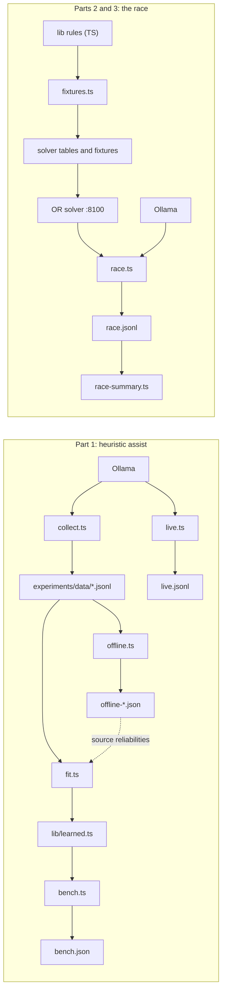
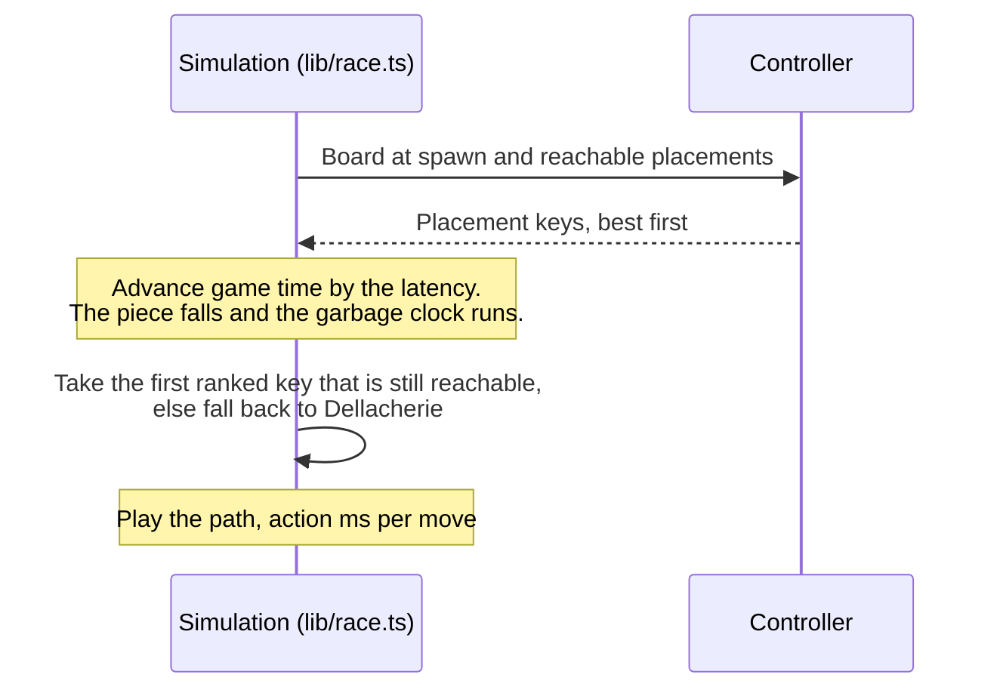

# Experiments

This page shows you how to reproduce every result in [experiments/RESULTS.md](../experiments/RESULTS.md) and how to run experiments of your own. For each script in `scripts/`, it covers what the script does, what it needs, how to call it, what it writes and how long it takes. It is written for engineers who want to check the published numbers or extend the study.

## Overview

The research has three parts. Each script backs one or more of them.

| Part | Question | Data |
|---|---|---|
| [Part 1](../experiments/RESULTS.md#heuristic-assist-for-clef-and-clef-flash-experiment-results) | When a decision model can't make up its mind, can a heuristic, or a blend of the model and a heuristic, pick better? Can the model's own judgments teach better heuristics? | `experiments/data/`, `bench.json`, `offline-*.json`, `live.jsonl` |
| [Part 2](../experiments/RESULTS.md#part-2-three-kinds-of-controller-at-hard-mode-tetris-garbage-per-piece-superseded-by-part-3) | How do decision models, heuristics and the OR solver compare in a real-time race with one garbage row every N pieces? Superseded by Part 3. | `race-pieces.jsonl` |
| [Part 3](../experiments/RESULTS.md#part-3-the-same-race-with-fair-time-based-garbage) | The same race with fair garbage: one row every N seconds on a clock shared by every board. | `race.jsonl` |

| Script | What it does | Needs | Writes | Backs |
|---|---|---|---|---|
| `collect.ts` | Asks the models for board ratings and move probabilities | Ollama with `clef` and `clef-flash` | `experiments/data/*.jsonl` (appends) | Part 1 |
| `fit.ts` | Fits the learned heuristics' weights to the collected judgments | Collected data | `lib/learned.ts` (overwrites) | Part 1 |
| `bench.ts` | Plays every heuristic with no model in the loop | Nothing | `experiments/bench.json` (overwrites) | Part 1 |
| `offline.ts` | Replays the recorded model decisions against a Monte Carlo oracle | Collected data | `experiments/offline-<model>.json` and an oracle cache | Part 1 |
| `live.ts` | Plays turn-based games in which the model decides every move | Ollama | `experiments/live.jsonl` (appends) | Part 1 |
| `race.ts` | Runs the real-time hard-mode race headless, in simulated time | The OR solver for `solver` contestants, Ollama for `model` contestants | `experiments/race.jsonl` (appends) | Parts 2 and 3 |
| `race-summary.ts` | Summarizes race rows, with paired bootstrap confidence intervals | A race file | Console only | Parts 2 and 3 |
| `fixtures.ts` | Exports the TypeScript rules and parity fixtures to the Python solver | Nothing | `or-solver/orsolver/tables.json`, `or-solver/tests/fixtures/engine.json` | Parts 2 and 3 (engine parity) |



## Before you start

Set up Node, Ollama, the models and the solver as described in [Getting started](getting-started.md). Then keep these points in mind:

- **Run every command from the repository root.** Node runs the `.ts` scripts directly, with no build step.
- **Only three scripts call out.** `collect.ts` and `live.ts` call Ollama. `race.ts` calls Ollama for `model:` contestants and the OR solver for `solver:` contestants. Everything else runs offline on the data in the repository.
- **Start the solver before a race with solver contestants:**

  ```bash
  npm run solver
  ```

  This serves the solver on `127.0.0.1:8100`.
- **Check the `errors` count after a race.** If the solver or Ollama isn't reachable, `race.ts` doesn't stop. Each failed request counts as an error, that piece falls under gravity, and the console line ends with `ERRORS <n>: <message>`. A mistyped heuristic id fails the same way, with `unknown method <id>`.

### Environment variables

| Variable | Default | Used by | Purpose |
|---|---|---|---|
| `OLLAMA_URL` | `http://localhost:11434` | `collect.ts`, `live.ts`, `race.ts` | Ollama base URL. The scripts append `/v1/systemone`. |
| `OR_SOLVER_URL` | `http://127.0.0.1:8100` | `race.ts` | OR solver base URL. Set it per process to [run races in parallel](#run-races-in-parallel). |
| `POE_BETA` | the current `poeBeta` in `lib/learned.ts` | `fit.ts` | The β weight that `fit.ts` writes for the `poe-tuned` heuristic |

### Files that grow and files that are replaced

Some scripts append to their output and some overwrite it. Know which before you rerun anything, because the published data lives in the same files.

| Behavior | Files |
|---|---|
| Appended to | `experiments/data/health.jsonl`, `experiments/data/moves-<model>.jsonl`, `experiments/live.jsonl`, `experiments/race.jsonl` (or the race `out=` file) |
| Overwritten | `lib/learned.ts`, `experiments/bench.json`, `experiments/offline-<model>.json`, `experiments/data/oracle-<model>.json`, `or-solver/orsolver/tables.json`, `or-solver/tests/fixtures/engine.json` |

To start Part 1 from scratch, move the published data aside first, for example `mv experiments/data experiments/data-published`. For races, write to a separate file with `out=`, as the recipes below do.

## Concepts

### Seeds

A seed fixes everything random in a game, so every contestant that plays the same seed gets the same pieces.

- **Pieces.** The 7-bag randomizer (`makeBag` in `lib/tetris.ts`) is seeded by the game seed.
- **Garbage.** Each garbage row's gap column comes from its own random stream, derived from the seed, so the k-th garbage row is the same on every board (`lib/engine.ts`).
- **Option letters.** The order in which placements are labeled A to Z for a model is shuffled by a seeded generator.
- **Sampled states.** `collect.ts` samples boards from fixed seed ranges (from 5000 for health ratings, 7000 for clef-flash moves, 9000 for clef moves), so it always asks about the same boards.
- **The oracle.** `offline.ts` seeds every rollout, so the oracle cache regenerates identically from the same data.

`bench.ts` plays seeds 1 to N. `live.ts` takes one seed. `race.ts` takes a list or range with `seeds=`, for example `seeds=1-8`, `seeds=1,3,5` or `seeds=1-3,7`.

### Tags

A tag is a free-form label that `race.ts` stores in every row it writes (`tag=<label>`; empty by default). `race-summary.ts` filters by tag and groups its tables by tag, so the tag is how you keep one experiment's rows apart from another's in the same file. The published data uses two tags:

| Tag | File | Part |
|---|---|---|
| `hard` | `experiments/race-pieces.jsonl` | Part 2 |
| `time` | `experiments/race.jsonl` | Part 3 |

`race-summary.ts` keeps only the last row for each combination of tag, contestant, seed, garbage interval and garbage unit. Rerunning a command therefore replaces those games in the summary instead of double-counting them, even though the file keeps both rows. Give each new experiment its own tag.

### Measured and fixed latency

The race runs in simulated game time, not wall-clock time. At each spawn the simulation asks the controller for a decision, charges the game a thinking time while the piece keeps falling, and then plays the answer out one action at a time.



The `latency=` key sets how much thinking time each decision is charged.

| Setting | Game time charged per decision | Use it for |
|---|---|---|
| `latency=measured` (default) | The real wall-clock time of the decision: compute time for a heuristic, the full HTTP round trip for the solver or a model | The published races. Thinking costs what it really costs, so results depend on your hardware and its load. |
| `latency=<ms>`, for example `latency=0` | The same fixed time for every decision | Repeatable runs. Heuristic races become fully deterministic. |

With a fixed latency, the game timing is repeatable, but not every decision is. The solver still stops at a wall-clock deadline (see [OR solver](or-solver.md)), so its choices can vary with machine speed, and model answers come from Ollama. The `think` column in summaries then reports the fixed value, not the real compute time.

Because game time is simulated, a heuristic's 3-minute game takes a second or two. A model's game takes roughly as long as it lasts, because its thinking time is real.

### Per-piece and time-based garbage

The race has used two garbage rules, and the data files differ accordingly.

| | Part 2 (superseded) | Part 3 (current) |
|---|---|---|
| Rule | One garbage row every N pieces placed | One garbage row every N seconds on a shared clock. Rows that queue up while a controller thinks are pushed in at its next lock. |
| File and tag | `experiments/race-pieces.jsonl`, `hard` | `experiments/race.jsonl`, `time` |
| `garbage` field | Pieces per row | Seconds per row |
| `garbageMs` field | Absent | `garbage` × 1000 |
| Code | Commit `a0b590c` | The current code |

The per-piece rule let slow controllers dodge garbage by placing fewer pieces, which is why Part 3 replaced it. The current `race.ts` can't produce per-piece rows. `race-summary.ts` reads both kinds of file: rows without `garbageMs` are labeled in pieces, the rest in seconds.

## Part 1: heuristic assist

Part 1 runs as a pipeline. `collect.ts` gathers the models' judgments. `fit.ts` turns them into the learned heuristics. `bench.ts`, `offline.ts` and `live.ts` then evaluate all 22 heuristics three ways: with no model, offline against an oracle, and live with the model in the loop.

These scripts play turn-based games with plain hard-drop placements: there is no gravity and no SRS rotation, and they score 100, 300, 500 and 800 points for 1 to 4 lines. Their scores aren't comparable with race scores, which use guideline scoring with a level multiplier and T-spins.

### collect.ts

Collects the models' own judgments: board-health ratings from clef, and move probabilities from both models.

**Needs:** Ollama with `clef` and `clef-flash` pulled.

**Usage:**

```bash
node --no-warnings scripts/collect.ts [healthN] [flashMovesN] [clefMovesN]
```

| Argument | Meaning |
|---|---|
| `healthN` | Number of boards for clef to rate for health |
| `flashMovesN` | Number of states on which to record clef-flash's move probabilities |
| `clefMovesN` | Number of states on which to record clef's move probabilities |

A missing or `0` count skips that stage. The published run used `150 100 50`.

**How it works:**

- **Boards** come from Dellacherie play with random mistakes: on each move, a uniformly random placement with probability 0.1, 0.3 or 0.6 (varying by seed), otherwise Dellacherie's pick. A state is kept every fifth piece, for up to 150 pieces per game, and the pool is shuffled. This gives boards from tidy to messy.
- **Health** asks clef one `score` question with five levels, from "terrible" to "excellent".
- **Moves** ask one `choice` question listing up to 26 hard-drop placements, built by `moveRequest` in `lib/prompt.ts` (the same request the app sends). States with fewer than 2 placements are skipped, which is why 100 requested clef-flash states produced 97 rows.

**Output:** rows appended to `experiments/data/`, one JSON object per line. Boards are 20 rows of 10 cells, top row first; a cell is `0` for empty, `1` to `7` for a piece (I, O, T, S, Z, L, J) or `8` for garbage.

`health.jsonl`:

| Field | Type | Meaning |
|---|---|---|
| `board` | `number[][]` | The rated board |
| `score` | `number` | Clef's health rating on the 0 to 4 scale |
| `probs` | `object` | Probability of each level, keyed `"0"` (terrible) to `"4"` (excellent) |

`moves-clef-flash.jsonl` and `moves-clef.jsonl`:

| Field | Type | Meaning |
|---|---|---|
| `board` | `number[][]` | The board before the move |
| `piece`, `next` | `string` | The current and next piece |
| `options` | `{ rot, col, letter }[]` | The placements shown to the model: rotation index (into `ROTATIONS` in `lib/tetris.ts`), left column of the shape, and its letter |
| `probs` | `number[]` | The model's probability for each option, in `options` order |
| `confidence` | `number` | The model's confidence for the move question |
| `ms` | `number` | Request time in milliseconds |

**Runtime:** about 20 minutes for `150 100 50`. In the published log, a clef health rating took about 1.3 to 1.8 s, a clef-flash move about 1 to 2.5 s, and a clef move about 3 to 7.6 s.

### fit.ts

Learns heuristic weights from the collected judgments and writes them to `lib/learned.ts`.

**Needs:** at least 20 health rows and 20 move rows. With fewer, it keeps the current weights for that part.

**Usage:**

```bash
POE_BETA=5 node --no-warnings scripts/fit.ts
```

**How it works:**

| Fit | Method | Feeds |
|---|---|---|
| Health | Ridge regression of clef's 0 to 4 ratings on board features | `clef-distilled`, `clef-hole-sense` |
| Move | Softmax regression matching the pooled move distributions of both models | `move-distilled` |
| β | Copied from `POE_BETA`, or kept from the current file | `poe-tuned` |
| Source reliabilities | Read from `experiments/offline-clef-flash.json` if it exists | `reliability-rank` |

It prints each fit's quality: n, R² and standardized weights for health; n, cross-entropy against uniform, top-1 agreement with the model and standardized weights for moves. The same report is written into the header comment of `lib/learned.ts`.

**Output:** `lib/learned.ts`, overwritten. This is a tracked source file that the learned and fusion heuristics read everywhere, including in the app.

> [!NOTE]
> The shipped `lib/learned.ts` was fitted on 119 move decisions, as its header records. `experiments/data/` now holds 147 move rows (97 clef-flash, 50 clef), so a fresh fit pools all of them and gives slightly different move weights. To keep the shipped weights, skip `fit.ts`, or restore the file afterwards with `git checkout lib/learned.ts`.

**Runtime:** under a second.

### bench.ts

The heuristic-only benchmark: every method plays the same seeds with no model in the loop.

**Needs:** nothing.

**Usage:**

```bash
node --no-warnings scripts/bench.ts [seeds] [maxPieces] [ids...]
```

The arguments are positional, so to pass ids you must give `seeds` and `maxPieces` first:

```bash
node --no-warnings scripts/bench.ts 5 500 lookahead well-keeper
```

| Argument | Default | Meaning |
|---|---|---|
| `seeds` | `5` | Plays seeds 1 to this number |
| `maxPieces` | `500` | Piece cap per game. Reaching it counts as surviving. |
| `ids` | all 22 | Only these method ids |

`npm run bench -- 5 500` runs the same command. Fusion methods see a flat model distribution, so the benchmark measures only their heuristic side.

**Output:** `experiments/bench.json`, or a file named after the ids when you pass them (`experiments/bench-lookahead-well-keeper.json` for the example above). The file is overwritten and holds `{ seeds, cap, rows }`, with one row per method:

| Field | Meaning |
|---|---|
| `id`, `kind` | Method id and kind (`classic`, `original`, `learned` or `fusion`) |
| `pieces`, `lines`, `score`, `tetrises` | Means over seeds |
| `survived` | Number of seeds that reached the cap |
| `avgHoles`, `avgHeight` | Holes and maximum height after each piece, averaged |
| `msPerMove` | Compute time per move |

**Runtime:** about 3 minutes for all 22 methods at `5 500`. `rollout` is the slowest at about 25 ms per move; most methods take under 5 ms.

### offline.ts

Tests every method on the real model probabilities from `collect.ts`, without new model calls. The ground truth for each option is a Monte Carlo oracle.

**Needs:** `experiments/data/moves-<model>.jsonl`.

**Usage:**

```bash
node --no-warnings scripts/offline.ts <model> [thresholds...]
```

| Argument | Default | Meaning |
|---|---|---|
| `model` | `clef-flash` | Which moves file to replay |
| `thresholds` | `0.05 0.1 0.15 0.25 1` | Assist gates. A method replaces the model's pick only when the model's confidence is below the gate, so `1` means every move. |

**How it works:**

- **The oracle** values each option with 12 rollouts of 8 more pieces: first the known next piece, then random pieces, all placed by Dellacherie. A rollout scores −500 if it tops out, otherwise `10·lines − 8·holes − 2·maxHeight − 0.3·aggHeight − 0.5·bumpiness`. Because the rollout policy is Dellacherie, the oracle favors Dellacherie-like play; `live.ts` is the check it can't bias.
- **The metrics** are regret (the best option's oracle value minus the picked one's; lower is better), the share of oracle-best picks, and the share of hole blunders (picks that create a new hole when another option doesn't).
- **The signal check** reports the mean Spearman correlation between the oracle and both the model's probabilities and the `lookahead` scores.
- **The β search** tries `poe-tuned` on every move with β from 0.25 to 21.

**Output:**

- `experiments/data/oracle-<model>.json`: the oracle cache, one array of option values per row of the moves file, in `options` order. It is matched to rows by position, so delete it whenever you replace the moves file.
- `experiments/offline-<model>.json`, overwritten:

| Field | Meaning |
|---|---|
| `model`, `n`, `gates` | The model, number of states, and gates used |
| `results` | `results[method][gate]` = `{ regret, best, blunders, assisted }`. The last three are fractions from 0 to 1. The model alone is `results["model-only"].all`. |
| `signal` | `{ modelRho, lookaheadRho }`, the Spearman correlations. `fit.ts` reads these from the clef-flash file for `reliability-rank`. |
| `betaSearch` | `{ beta, regret, best, blunders, assisted }` per β |
| `bestBeta` | The β with the lowest regret on the grid |

The shipped `poe-tuned` uses β = 5, which you set with `POE_BETA` when you run `fit.ts`; it isn't copied from `bestBeta`. Part 1 notes that the flash β curve is flat from about 5 upward.

The published runs used these gates (the clef gates are the ones stored in `experiments/offline-clef.json`):

```bash
node --no-warnings scripts/offline.ts clef-flash 0.015 0.02 0.025 0.03 1
node --no-warnings scripts/offline.ts clef 0.05 0.07 0.1 1
```

**Runtime:** under a minute per model, including building the oracle cache.

### live.ts

Plays live games with the model in the loop. The model decides every move, and the method takes over only when the model's confidence is below the gate. Every config plays the same seed, so every config gets the same pieces.

**Needs:** Ollama with the model.

**Usage:**

```bash
node --no-warnings scripts/live.ts <model> <pieces> <seed> <method|off>[@gate] ...
```

| Argument | Meaning |
|---|---|
| `model` | `clef-flash` or `clef` |
| `pieces` | Pieces per game. A game that tops out sooner is marked `toppedOut`. |
| `seed` | The game seed |
| `<method>@<gate>` | One game per config. `off` is the model alone, `lookahead@1` assists on every move, and `lookahead@0.025` assists when confidence is below 0.025. Without `@gate`, the gate is 0.15. |

**Output:** one row per game appended to `experiments/live.jsonl`, and one console line per game.

| Field | Meaning |
|---|---|
| `model`, `config`, `seed`, `cap` | The run's arguments |
| `pieces`, `toppedOut` | Pieces placed, and whether the game ended before the cap |
| `lines`, `score` | Lines cleared, and points at 100/300/500/800 per clear |
| `holes`, `maxHeight` | Holes and stack height on the final board |
| `assisted`, `overrides` | Moves on which the method stepped in, and on which it changed the model's pick |
| `avgConf` | Mean model confidence per piece |
| `minutes` | Wall-clock minutes the game took |

**Runtime:** about 1.3 to 2 minutes per 50-piece clef-flash game.

### Reproduce Part 1

```bash
node --no-warnings scripts/collect.ts 150 100 50
POE_BETA=5 node --no-warnings scripts/fit.ts
node --no-warnings scripts/bench.ts 5 500
node --no-warnings scripts/offline.ts clef-flash 0.015 0.02 0.025 0.03 1
node --no-warnings scripts/offline.ts clef 0.05 0.07 0.1 1
for seed in 3 4 5; do
  node --no-warnings scripts/live.ts clef-flash 50 $seed off lookahead@1 entropy-gate@1 poe-tuned@1 move-distilled@1 hole-guard@1 clef-hole-sense@1 lookahead@0.025
done
npm test
```

- **Skip `collect.ts`** to re-derive the analysis from the published data. `fit.ts`, `bench.ts` and `offline.ts` need no models; see the note under [fit.ts](#fitts) about the shipped weights.
- **Run `fit.ts` again after `offline.ts`** if you regenerated the offline results, so that `reliability-rank` uses the new reliabilities.
- **Compare** your output with the tables in [Part 1 of the results](../experiments/RESULTS.md#heuristic-assist-for-clef-and-clef-flash-experiment-results).

## Parts 2 and 3: the race

### race.ts

The headless hard-mode race. It uses the same simulation (`lib/race.ts`) and the same controllers (`lib/controllers.ts`) as the page, with real-time gravity, SRS rotation, a 500 ms lock delay, guideline scoring, levels and rising garbage. See [Game engine](game-engine.md) for the rules.

**Needs:** the OR solver for `solver` contestants and Ollama for `model` contestants. Heuristic contestants need neither.

**Usage:**

```bash
node --no-warnings scripts/race.ts [key=value ...] contestant ...
```

For example:

```bash
node --no-warnings scripts/race.ts seeds=1-5 garbage=6,3 solver:300+adv heuristic:lookahead heuristic:well-keeper
```

| Key | Default | Meaning |
|---|---|---|
| `seeds` | `1-10` | Seeds to play, as a range or list: `1-8`, `1,3,5`, `1-3,7` |
| `minutes` | `3` | Time limit per game, in game minutes. Lasting this long counts as surviving. |
| `gravity` | `1` | `0` turns gravity off: the piece waits for each decision, but the garbage clock keeps running. |
| `level` | `1` | Start level. Gravity speeds up every 10 lines from here. |
| `garbage` | `6` | Seconds per garbage row. A comma-separated list runs a ladder, for example `garbage=6,4,3,2`. `0` turns garbage off. |
| `action` | `80` | Milliseconds per visible move action. A soft drop costs a quarter of that per row. |
| `latency` | `measured` | `measured`, or a fixed number of milliseconds charged per decision. See [Measured and fixed latency](#measured-and-fixed-latency). |
| `tag` | empty | Label stored in every row. See [Tags](#tags). |
| `out` | `experiments/race.jsonl` | File to append rows to |

| Contestant | Meaning |
|---|---|
| `model:clef-flash`, `model:clef` | A decision model, with no heuristic assist. The assist exists only in the page and in `live.ts`. |
| `heuristic:<id>` | Any of the 22 heuristics, for example `heuristic:lookahead`. See [Controllers](controllers.md) for the ids. |
| `solver:<budgetMs>` | The OR solver with this time budget in milliseconds. `solver` alone means `solver:300`. Under gravity, the solver also caps its budget by the piece's fall time. |
| `+adv` suffix | Advanced moves (tucks and T-spins through SRS) for this contestant. Works with any contestant. |
| `+strict` suffix | No bag information: the solver isn't told which pieces remain in the current 7-bag. Affects only the solver. |

You can combine suffixes, for example `solver:300+adv+strict`. The script loops over garbage intervals, then seeds, then contestants, and each game is an independent simulation. Invalid values for `minutes`, `action`, `latency`, `seeds` or `garbage` stop the script with an error before any game starts.

**What happens on each piece:** when a controller's answer arrives, the simulation takes the first ranked placement that is still reachable. If none is, it falls back to Dellacherie over what is reachable now (counted in `fallbacks`). A failed request costs only that piece, which falls under gravity (counted in `errors`); no heuristic stands in.

**Output:** one row per game appended to the `out` file, and one console line per game.

| Field | Type | Meaning |
|---|---|---|
| `tag` | `string` | The `tag=` label |
| `contestant` | `string` | The contestant spec as typed, for example `solver:300+adv` |
| `seed` | `number` | Game seed |
| `garbage` | `number` | The garbage interval from the ladder: seconds per row, or pieces per row in Part 2 rows |
| `garbageMs` | `number` | `garbage` × 1000. Absent in Part 2 rows. |
| `level0` | `number` | Start level |
| `gravity` | `boolean` | Whether gravity was on |
| `minutes` | `number` | Time limit |
| `action` | `number` | Milliseconds per move action |
| `latency` | `string` | `"measured"`, or the fixed value as typed |
| `pieces`, `lines`, `score` | `number` | Totals at the end of the game |
| `level` | `number` | Level reached |
| `tspins`, `tetrises` | `number` | T-spins and Tetrises made |
| `toppedOut` | `boolean` | Whether the game ended in a top-out |
| `overAt` | `number` or `null` | Game seconds at top-out |
| `survivedS` | `number` | Game seconds survived: `overAt`, or the time limit |
| `late` | `number` | Pieces that locked before their decision arrived |
| `missed` | `number` | Decisions that arrived in time, but whose piece locked elsewhere because the lock delay ran out mid-move or gravity kept undoing the move |
| `errors` | `number` | Failed controller requests |
| `fallbacks` | `number` | Dellacherie fallbacks |
| `avgThinkMs` | `number` | Mean latency charged per decision |
| `holes`, `maxHeight` | `number` | Holes and stack height on the final board |
| `ppp` | `number` | Points per piece |
| `error` | `string` or `null` | The last error message |
| `wallS` | `number` | Wall-clock seconds the game took to simulate |

**Runtime:** in the published Part 3 run, a heuristic game took under 3 s of wall time, a solver game up to about 40 s, and a model game up to about 2 minutes. Run one after another, the Part 3 grid adds up to about 37 minutes of solver games, 11 minutes of model games and about a minute of heuristic games. To shorten it, [run races in parallel](#run-races-in-parallel).

### race-summary.ts

Summarizes race rows: survival, time survived, score and the mix of clears, plus a paired comparison of survival against a baseline contestant.

**Needs:** a race file.

**Usage:**

```bash
node --no-warnings scripts/race-summary.ts [file=experiments/race.jsonl] [tag=...] [vs=heuristic:lookahead]
```

| Option | Default | Meaning |
|---|---|---|
| `file` | `experiments/race.jsonl` | The race file to read |
| `tag` | all tags | Only rows with this tag |
| `vs` | `heuristic:lookahead` | The baseline contestant for the paired comparison |

It prints one table per tag and garbage interval, and keeps only the last row for each tag, contestant, seed and garbage interval (see [Tags](#tags)). Each table starts with this header:

```text
contestant                  survived  mean time  score    lines  T-spins  Tetrises  late  missed  errors  think   survival vs heuristic:lookahead
```

| Column | Meaning |
|---|---|
| `survived` | Games that lasted the full time limit, out of games played |
| `mean time` | Mean `survivedS` |
| `score`, `lines`, `T-spins`, `Tetrises`, `late`, `missed` | Means per game |
| `errors` | Total failed requests. It should be 0. |
| `think` | Mean `avgThinkMs` |
| `survival vs <baseline>` | Mean difference in seconds survived against the baseline on the same seeds, with a 95% paired bootstrap confidence interval (4,000 resamples) in brackets. The interval needs at least two shared seeds. |

**Runtime:** under a second.

### Run races in parallel

Each `race.ts` process sends its solver requests to one solver, at `OR_SOLVER_URL`. To run several processes at once, start one solver per process on its own port and split the contestants between the processes. The published Part 3 run was split this way into four processes, whose logs are `experiments/race-a.log` (`solver:300+adv` and the heuristics), `race-b.log` (`solver:300`), `race-c.log` (`solver:300+adv+strict`) and `race-models.log` (the models).

Start the solvers, each in its own terminal:

```bash
npm run solver
```

```bash
uv run --directory or-solver uvicorn orsolver.server:app --host 127.0.0.1 --port 8101
```

```bash
uv run --directory or-solver uvicorn orsolver.server:app --host 127.0.0.1 --port 8102
```

Then start the races, each in its own terminal:

```bash
node --no-warnings scripts/race.ts seeds=1-8 minutes=3 garbage=6,4,3,2 tag=time out=experiments/race-rerun.jsonl solver:300+adv heuristic:lookahead heuristic:well-keeper heuristic:dellacherie heuristic:danger-adaptive
```

```bash
OR_SOLVER_URL=http://127.0.0.1:8101 node --no-warnings scripts/race.ts seeds=1-8 minutes=3 garbage=6,4,3,2 tag=time out=experiments/race-rerun.jsonl solver:300
```

```bash
OR_SOLVER_URL=http://127.0.0.1:8102 node --no-warnings scripts/race.ts seeds=1-8 minutes=3 garbage=6,4,3,2 tag=time out=experiments/race-rerun.jsonl solver:300+adv+strict
```

```bash
node --no-warnings scripts/race.ts seeds=1-3 minutes=3 garbage=6,3 tag=time out=experiments/race-rerun.jsonl model:clef-flash model:clef
```

When they finish, summarize:

```bash
node --no-warnings scripts/race-summary.ts file=experiments/race-rerun.jsonl tag=time
```

> [!IMPORTANT]
> Give every solver process a free CPU core. The solver plans until a wall-clock deadline, so on a busy machine it searches less per move, and with `latency=measured` it is also charged for the slowdown. Either way, overloading the machine changes the results.

### Reproduce Part 3

These are the commands from Part 3 of the results, run one after another. They append to `experiments/race.jsonl` with the tag `time`. To keep the published rows separate from yours, add `out=experiments/race-rerun.jsonl` and pass the same file to `race-summary.ts`, as in [Run races in parallel](#run-races-in-parallel).

```bash
npm run solver
```

In a second terminal:

```bash
node --no-warnings scripts/race.ts seeds=1-8 minutes=3 garbage=6,4,3,2 tag=time solver:300+adv solver:300 solver:300+adv+strict heuristic:lookahead heuristic:well-keeper heuristic:dellacherie heuristic:danger-adaptive
node --no-warnings scripts/race.ts seeds=1-3 minutes=3 garbage=6,3 tag=time model:clef-flash model:clef
node --no-warnings scripts/race-summary.ts tag=time
```

Compare the output with [Part 3 of the results](../experiments/RESULTS.md#part-3-the-same-race-with-fair-time-based-garbage). Because latency is measured, expect small differences on other hardware.

### Reproduce Part 2

Part 2 used per-piece garbage, which only commit `a0b590c` implements. The published rows are in `experiments/race-pieces.jsonl`, and the current summary script reads them directly:

```bash
node --no-warnings scripts/race-summary.ts file=experiments/race-pieces.jsonl tag=hard
```

To rerun the games, check out that commit and write to an untracked file, so that you can switch back afterwards. Stop any running solver first, because the solver loads its code when it starts.

```bash
git checkout a0b590c
npm run solver
```

In a second terminal:

```bash
node --no-warnings scripts/race.ts seeds=1-8 minutes=3 garbage=8,5,3 tag=hard out=experiments/race-pieces-rerun.jsonl solver:300+adv solver:300 solver:300+adv+strict heuristic:lookahead heuristic:dellacherie heuristic:well-keeper heuristic:danger-adaptive
node --no-warnings scripts/race.ts seeds=1-3 minutes=3 garbage=8,5 tag=hard out=experiments/race-pieces-rerun.jsonl model:clef-flash model:clef
```

Then stop the solver, return to the main branch and summarize:

```bash
git checkout main
node --no-warnings scripts/race-summary.ts file=experiments/race-pieces-rerun.jsonl tag=hard
```

At that commit, `garbage=` counts pieces per row.

## Engine parity: fixtures.ts

The game rules have one source of truth: the TypeScript engine. `fixtures.ts` exports its tables to the Python OR solver, along with test fixtures that check the two engines agree.

**Needs:** nothing for `npm run fixtures`; uv and Python for `npm run test:solver`.

**Usage:**

```bash
npm run fixtures
npm run test:solver
```

`npm run test:solver` regenerates the fixtures and then runs the solver's pytest suite. Run both whenever you change `lib/tetris.ts`, `lib/srs.ts`, `lib/engine.ts` or the board features in `lib/heuristics.ts`, and commit the regenerated files with your change.

**Output:** two files, overwritten. The export is deterministic, so an unchanged engine produces identical files.

| File | Contents |
|---|---|
| `or-solver/orsolver/tables.json` | Board size, garbage cell id, pieces, SRS shapes, spawn states, wall kicks, move sets (basic and advanced), line scores, T-spin points and the gravity table |
| `or-solver/tests/fixtures/engine.json` | 17 boards (an empty board, 4 hand-made T-spin, tuck and well cases, and 12 from seeded random play) with, for every piece with and without advanced moves, the set of reachable locks; board features per board; and points for each clear and spin combination at levels 1 and 3 |

It prints `wrote tables.json and 238 reachability cases over 17 boards`: 17 boards × 7 pieces × 2 move sets.

**Runtime:** under a second.

## Run your own experiments

- **Pick a new tag** for every question you ask, and consider a separate `out=` file.
- **Fix the latency** (`latency=0` or a constant) to compare decision quality without thinking time, then use `latency=measured` to see what thinking time costs.
- **Change the baseline** with `vs=`, for example `race-summary.ts tag=mine vs=solver:300+adv`.
- **Add `+adv`** to any contestant to give it tucks and T-spins.
- **Add a heuristic** to `METHODS` in `lib/heuristics.ts`. It then appears in `bench.ts` and `offline.ts`, in `live.ts` configs and as `heuristic:<id>` in races. See [Add a heuristic](controllers.md#add-a-heuristic) and [Contributing](../CONTRIBUTING.md).

## Data in this repository

| File | Rows | Written by | Part |
|---|---|---|---|
| `experiments/data/health.jsonl` | 150 | `collect.ts` | 1 |
| `experiments/data/moves-clef-flash.jsonl` | 97 | `collect.ts` | 1 |
| `experiments/data/moves-clef.jsonl` | 50 | `collect.ts` | 1 |
| `experiments/data/oracle-clef-flash.json`, `oracle-clef.json` | One per moves row | `offline.ts` | 1 |
| `experiments/bench.json`, `bench.log` | 22 methods | `bench.ts` | 1 |
| `experiments/offline-clef-flash.json`, `offline-clef.json` and logs | | `offline.ts` | 1 |
| `experiments/live.jsonl` | 24 (8 configs × seeds 3, 4 and 5) | `live.ts` | 1 |
| `experiments/live-flash.log`, `live-flash-s4.log`, `live-flash-s5.log` | Seeds 3, 4 and 5 | `live.ts` | 1 |
| `experiments/collect.log` | | `collect.ts` | 1 |
| `experiments/race-pieces.jsonl` | 180, tag `hard` | `race.ts` at `a0b590c` | 2 |
| `experiments/race-pieces-a.log`, `-b.log`, `-c.log`, `-models.log` | | `race.ts` at `a0b590c` | 2 |
| `experiments/race.jsonl` | 236, tag `time` | `race.ts` | 3 |
| `experiments/race-a.log`, `race-b.log`, `race-c.log`, `race-models.log` | | `race.ts` | 3 |

## Next steps

- [Experiment results](../experiments/RESULTS.md): the published numbers to compare your runs against.
- [OR solver](or-solver.md): the solver's API, time budget and settings.
- [Controllers](controllers.md): the 22 heuristics, the model prompt and how ranked keys fall back.
- [Game engine](game-engine.md): the exact race rules, including gravity, lock delay, scoring and garbage.
