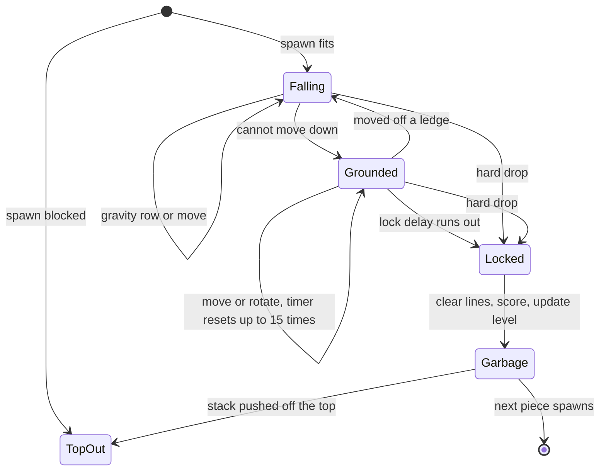

# Game engine

This page states the hard-mode Tetris rules exactly as the code applies them: the board, Super Rotation System (SRS) movement and wall kicks, tucks and T-spins, gravity, lock delay, scoring, time-based garbage, levels, top-out, and seeding. It is for engineers who want to write a controller, change a rule, or check a result. Every rule here comes from `lib/tetris.ts`, `lib/srs.ts`, `lib/engine.ts` and `lib/race.ts`; page defaults come from `app/page.tsx` and `app/Board.tsx`, and script defaults from `scripts/race.ts`.

## At a glance

| Rule | Value |
| --- | --- |
| Board | 10 columns by 20 rows, no hidden rows above the top |
| Rotation | SRS with the standard wall-kick tables; clockwise and counterclockwise only |
| Preview | One next piece; no hold |
| Randomizer | Seeded 7-bag |
| Gravity | Guideline curve, 1000 ms per row at level 1 down to 7 ms per row at level 15 |
| Lock delay | 500 ms, reset by moves while grounded, at most 15 resets per new lowest row |
| Levels | One level per 10 lines, from a start level of 1 to 15 |
| Scoring | Guideline line points and T-spin points, multiplied by the level |
| Garbage | One row every N seconds of game time, one gap per row, queued until the next lock |
| Top-out | The next piece cannot spawn, or garbage pushes the stack off the top |

## Where the rules live

The rules are plain TypeScript with no React and no I/O, so the browser, the headless scripts and the tests all run the same code.

| File | What it owns |
| --- | --- |
| `lib/tetris.ts` | Board type, piece shapes, the seeded RNG and 7-bag, line clears, height and hole counts, hard-drop placements |
| `lib/srs.ts` | SRS rotation states, kick tables, spawn position, T-spin detection, the reachability search |
| `lib/engine.ts` | Real-time game state: gravity, lock delay, scoring, levels, garbage, top-out |
| `lib/race.ts` | One board's simulation: fixed time steps, asking a controller at spawn, playing its moves back |

The TypeScript engine is the authority. `scripts/fixtures.ts` exports its tables (shapes, kicks, spawn, move order, scoring, gravity) to `or-solver/orsolver/tables.json`, plus reachability, feature and scoring cases to `or-solver/tests/fixtures/engine.json`. The Python solver loads those tables and its pytest suite checks parity against the fixtures. If you change a rule, regenerate and retest:

```bash
npm test
npm run test:solver
```

`npm run test:solver` runs `npm run fixtures` first. See [OR solver](or-solver.md) for the Python side.

## Board and coordinates

The board is 10 columns wide (`W`) and 20 rows tall (`H`). Row 0 is the top and `y` grows downward; column 0 is on the left. There are no buffer rows above row 0: every cell of the active piece must sit inside rows 0 to 19.

```text
x →   0 1 2 3 4 5 6 7 8 9
y  0  . . . . T . . . . .     a T at spawn
↓  1  . . . T T T . . . .
   …
  19  . . . . . . . . . .     floor
```

Each cell holds a number:

| Value | Meaning |
| --- | --- |
| `0` | Empty |
| `1` to `7` | A locked piece: I = 1, O = 2, T = 3, S = 4, Z = 5, L = 6, J = 7 |
| `8` | Garbage |

A row with no empty cell is cleared. The remaining rows keep their order and the same number of empty rows enter at the top.

### Two coordinate systems

The code describes a piece position in two ways. Keep them apart when you read controller code or prompts.

| System | Fields | Meaning |
| --- | --- | --- |
| SRS state (`PieceState`) | `x`, `y`, `rot` | Top-left corner of the piece's SRS bounding box on the board, and rotation state 0 to 3 |
| Placement (`Placement`) | `rot`, `col`, `y` | Index into the piece's distinct shapes (`ROTATIONS`), the shape's leftmost column, and the shape's top row once locked |

Distinct shapes per piece are: O has 1, I, S and Z have 2, and T, L and J have 4. The option text a decision model reads ("rotation 0, column 3: ...") uses placement coordinates.

## Pieces and rotation states

Each piece lives in a square SRS box: 4 by 4 for I, 2 by 2 for O, 3 by 3 for the rest. The spawn shapes, in box coordinates with `y` down, are:

| Piece | Box | Spawn cells `(x, y)` |
| --- | --- | --- |
| I | 4 | (0,1) (1,1) (2,1) (3,1) |
| O | 2 | (0,0) (1,0) (0,1) (1,1) |
| T | 3 | (1,0) (0,1) (1,1) (2,1) |
| S | 3 | (1,0) (2,0) (0,1) (1,1) |
| Z | 3 | (0,0) (1,0) (1,1) (2,1) |
| L | 3 | (2,0) (0,1) (1,1) (2,1) |
| J | 3 | (0,0) (0,1) (1,1) (2,1) |

Rotation states are 0 (spawn), 1 (R, one turn clockwise), 2 (two turns) and 3 (L, one turn counterclockwise). Turning clockwise inside an `n`-box maps each cell `(x, y)` to `(n - 1 - y, x)`. The O piece does not rotate: its rotation inputs are rejected.

## Spawn

A new piece enters in state 0 at `y = 0`, with its box at `x = 3` (the O piece at `x = 4`). That puts I in row 1, columns 3 to 6, O in columns 4 and 5, and the other pieces in rows 0 and 1, columns 3 to 5. On an empty board every piece falls 18 rows from spawn to the floor.

If the spawn cells are not all empty, the game is over.

## Inputs

Every move is a sequence of these actions. A controller does not send actions: it names a lock by its key (see below), and the board plays the search's path to that lock. Paths from the search always end with `drop`.

| Action | Effect |
| --- | --- |
| `left`, `right` | Shift one column, if the cells are free |
| `cw`, `ccw` | Rotate clockwise or counterclockwise, trying the kick tests in order |
| `down` | Soft drop one row; also restarts the gravity timer for the current row |
| `drop` | Hard drop to the lowest free row and lock immediately |

There is no 180-degree rotation and no hold.

## Wall kicks

A rotation tries up to five offsets in order and uses the first that fits. Test 1 is always `(0, 0)`, the rotation in place; tests 2 to 5 are the kicks. The tables below are copied from `lib/srs.ts` and, as in published SRS references, `y` points **up**. The engine applies each test as `(kx, -ky)` on its y-down board, so `+1` in a `y` column moves the piece one row toward the top.

J, L, S, T and Z pieces (`KICKS_JLSTZ`):

| Turn | Test 1 | Test 2 | Test 3 | Test 4 | Test 5 |
| --- | --- | --- | --- | --- | --- |
| 0 → 1 | (0, 0) | (-1, 0) | (-1, +1) | (0, -2) | (-1, -2) |
| 1 → 0 | (0, 0) | (+1, 0) | (+1, -1) | (0, +2) | (+1, +2) |
| 1 → 2 | (0, 0) | (+1, 0) | (+1, -1) | (0, +2) | (+1, +2) |
| 2 → 1 | (0, 0) | (-1, 0) | (-1, +1) | (0, -2) | (-1, -2) |
| 2 → 3 | (0, 0) | (+1, 0) | (+1, +1) | (0, -2) | (+1, -2) |
| 3 → 2 | (0, 0) | (-1, 0) | (-1, -1) | (0, +2) | (-1, +2) |
| 3 → 0 | (0, 0) | (-1, 0) | (-1, -1) | (0, +2) | (-1, +2) |
| 0 → 3 | (0, 0) | (+1, 0) | (+1, +1) | (0, -2) | (+1, -2) |

I piece (`KICKS_I`):

| Turn | Test 1 | Test 2 | Test 3 | Test 4 | Test 5 |
| --- | --- | --- | --- | --- | --- |
| 0 → 1 | (0, 0) | (-2, 0) | (+1, 0) | (-2, -1) | (+1, +2) |
| 1 → 0 | (0, 0) | (+2, 0) | (-1, 0) | (+2, +1) | (-1, -2) |
| 1 → 2 | (0, 0) | (-1, 0) | (+2, 0) | (-1, +2) | (+2, -1) |
| 2 → 1 | (0, 0) | (+1, 0) | (-2, 0) | (+1, -2) | (-2, +1) |
| 2 → 3 | (0, 0) | (+2, 0) | (-1, 0) | (+2, +1) | (-1, -2) |
| 3 → 2 | (0, 0) | (-2, 0) | (+1, 0) | (-2, -1) | (+1, +2) |
| 3 → 0 | (0, 0) | (+1, 0) | (-2, 0) | (+1, -2) | (-2, +1) |
| 0 → 3 | (0, 0) | (-1, 0) | (+2, 0) | (-1, +2) | (+2, -1) |

Because there are no rows above row 0, a kick that would lift a piece past the top fails like any other blocked test. The engine remembers which test succeeded (index 0 to 4); T-spin detection uses it. For background, see the [SRS page on tetris.wiki](https://tetris.wiki/Super_Rotation_System).

## Basic and advanced moves

The rules are the same for every board. What changes is which lock positions a controller is offered. `reachable(board, piece, start, advanced)` in `lib/srs.ts` runs a breadth-first search from the piece's current state and returns every distinct lock it can reach, each with a shortest action path.

| | Basic moves (`advanced = false`) | Advanced moves (`advanced = true`) |
| --- | --- | --- |
| Search moves | `cw`, `ccw`, `left`, `right` | `cw`, `ccw`, `left`, `right`, `down` |
| Lock candidates | Every reachable state, hard-dropped | Every reachable state that is resting on something |
| Tucks from spawn | No | Yes |
| Labels T-spins | No | Yes |
| From spawn | Equals the plain hard-drop set (`placements()`) | A superset of the basic set |

You turn advanced moves on per board with the **advanced moves** checkbox; the change applies from the next piece. Headless races use the `+adv` contestant flag.

Search details that other code depends on:

- **Move order is a contract.** Moves are tried in the order listed above, so paths rotate first, then shift, then soft drop. The Python solver uses the same order.
- **Trailing soft drops are trimmed.** The final `drop` covers them.
- **Duplicates collapse.** Locks with the same cells merge, then locks that leave the same board merge. The higher spin wins, then the shorter path.
- **Each lock has a key.** `key` is the resulting board (200 characters of `0` and `1`, row by row from the top) plus `|` and the spin: `none`, `mini` or `full`. The key does not depend on the path, so a controller can name its choice once and the board can replan the path from wherever the piece is later.

On an empty board from spawn, the search finds 34 locks for T, L and J, 17 for I, S and Z, and 9 for O.

### Tucks

A tuck is a lock that you cannot reach by dropping straight down from the top in that rotation and column: the piece has to slide under an overhang after it lands. The search sets `tuck: true` on such placements, and the option text a model reads says "tucked under an overhang". From spawn, only advanced moves reach them, because they need soft drops.

## T-spins

The engine checks for a T-spin when a T piece locks and its last successful move was a rotation. It uses the 3-corner rule on the four diagonal corners of the T's 3 by 3 box, around the center cell at box position (1, 1).

1. A corner counts as filled if it is a locked cell, a wall or the floor. Space above row 0 counts as empty.
2. Fewer than 3 filled corners: no spin.
3. 3 or more filled corners: the spin is **full** if both front corners are filled, or if the rotation used test 5 (kick index 4). Otherwise it is **mini**.

The front corners are the two on the side the T's nub points to:

| State | Nub points | Front corners (box `x, y`) |
| --- | --- | --- |
| 0 | Up | (0,0) and (2,0) |
| 1 (R) | Right | (2,0) and (2,2) |
| 2 | Down | (0,2) and (2,2) |
| 3 (L) | Left | (0,0) and (0,2) |

What keeps or breaks "last move was a rotation":

| Event after the rotation | Spin kept? |
| --- | --- |
| Hard drop that moves the piece down | No |
| Hard drop of zero rows (the piece is already resting) | Yes |
| Shift or soft drop | No |
| Gravity moves the piece down a row | No |
| Lock delay runs out | Yes |

A T-spin scores even if it clears no lines. The game's `tspins` counter only counts T-spins that clear at least one line. For background, see [T-Spin on tetris.wiki](https://tetris.wiki/T-Spin).

## Gravity

With real-time gravity on, the active piece falls one row every `gravityMs(level)` milliseconds of game time:

```ts
// lib/engine.ts: ms per row = 1000 * (0.8 - (L - 1) * 0.007) ^ (L - 1), rounded
export const GRAVITY_MS = Array.from({ length: 15 }, (_, i) => Math.round(1000 * Math.pow(0.8 - i * 0.007, i)));
```

| Level | ms per row | Level | ms per row | Level | ms per row |
| --- | --- | --- | --- | --- | --- |
| 1 | 1000 | 6 | 262 | 11 | 43 |
| 2 | 793 | 7 | 190 | 12 | 28 |
| 3 | 618 | 8 | 135 | 13 | 18 |
| 4 | 473 | 9 | 94 | 14 | 11 |
| 5 | 355 | 10 | 64 | 15 | 7 |

Levels above 15 keep the level 15 speed. Gravity can move a piece more than one row in a single time step when the step is longer than the row time.

With **real-time gravity** off (the turn-based race), the piece waits at spawn until its controller answers. There is no gravity and no lock delay: a piece locks only on a hard drop. The garbage clock still runs.

## Lock delay and move resets

A piece is grounded when it cannot move down one row. While it is grounded, the lock timer counts up, and when it reaches the lock delay (500 ms on the page and in `scripts/race.ts`) the piece locks where it is. A hard drop locks at once, with no delay.

The timer resets in two ways:

| Event | Effect |
| --- | --- |
| The piece reaches a new lowest row (by gravity, a soft drop or a downward kick) | Lock timer and reset count both go back to 0 |
| Any other successful move (shift, rotation or soft drop) that starts or ends grounded, while fewer than 15 resets are used | Lock timer goes back to 0 and the reset count goes up by 1 |

After 15 resets at the same lowest row, further moves no longer restart the timer, so the piece locks when the timer runs out. The constant is `MAX_RESETS` in `lib/engine.ts`; the delay is `lockDelayMs` in `EngineConfig`.

The whole life of a piece with gravity on:



## Scoring

Each lock scores `level × base points`, where the level is the one in effect before this lock's lines are counted.

| Lines cleared | No spin | Mini T-spin | Full T-spin |
| --- | --- | --- | --- |
| 0 | 0 | 100 | 400 |
| 1 | 100 | 200 | 800 |
| 2 | 300 | 400 | 1200 |
| 3 | 500 | — | 1600 |
| 4 | 800 | — | — |

```ts
// lib/tetris.ts and lib/engine.ts (types omitted)
export const LINE_SCORE = [0, 100, 300, 500, 800];
const TSPIN_POINTS = { mini: [100, 200, 400, 400], full: [400, 800, 1200, 1600] };
export const points = (lines, spin, level) => level * (spin === "none" ? LINE_SCORE[lines] : TSPIN_POINTS[spin][lines]);
```

The code's mini table also holds 400 for three lines; the parity fixtures treat mini T-spins as clearing at most two lines and full T-spins at most three. Nothing else scores: there are no drop points and no combo, back-to-back or perfect-clear bonuses.

Worked examples from `lib/engine.test.ts`: a Tetris at level 2 scores 1600, a T-spin double at level 1 scores 1200, and a mini T-spin single at level 1 scores 200.

## Levels

```text
level = startLevel + floor(lines / 10)
```

The page lets you pick a start level from 1 to 15 (default 1); `scripts/race.ts` takes `level=`. The level only rises, and it rises on the lock that crosses each multiple of 10 lines. Gravity stops speeding up at level 15, but the score multiplier keeps growing.

## Time-based garbage

Garbage rows rise from the bottom on a clock, the same clock on every board, so a slow controller cannot dodge garbage by placing fewer pieces.

| Step | What happens |
| --- | --- |
| Clock | Every millisecond of game time adds to `garbageClock`, including line-clear flashes and the time a controller spends thinking. Each time it reaches `garbageMs`, one row is queued (`pendingGarbage`). |
| Queue | Queued rows wait. They never land on a falling piece. |
| Landing | At the next lock, after lines clear and points are scored, every queued row is pushed in at the bottom. Each push moves the whole stack up one row. |
| Row shape | Each garbage row is filled (value `8`) except for one gap. Each row draws its own gap column, independent of the row before. |
| Gap RNG | The gap of the k-th row is the k-th draw of a garbage RNG seeded from the race seed. Every board in a race gets the same rows in the same order. |
| Overflow | If row 0 holds any filled cell when a row is pushed in, the stack is pushed off the top and the game is over. |

The interval is `garbageMs` in `EngineConfig`; `0` turns garbage off. On the page, **rising garbage every N seconds** is on by default at 6 seconds and accepts 1 to 60 seconds in 0.5-second steps. `scripts/race.ts` takes `garbage=` in seconds (default 6), and a comma-separated list such as `garbage=6,4,2.5` runs a ladder.

For example, with garbage every 2 seconds, a controller that spends 5 seconds on one piece has 2 rows queued when it finally locks, and both land together (this is the last test in `lib/engine.test.ts`).

## Top-out

A game ends in exactly two ways:

1. **Block out.** The next piece's spawn cells are not all empty.
2. **Garbage overflow.** A garbage row is pushed in while row 0 holds a filled cell.

There is no separate lock-out rule, because a piece can never sit above row 0. During play, both checks happen inside a lock, so every top-out happens at a lock. The race page ranks survival first (a later top-out beats an earlier one) and then score.

## Randomizer, seeds and determinism

The piece sequence is a seeded 7-bag: shuffle all seven pieces, deal them one at a time, then shuffle a new bag. `makeBag(seed)` shuffles with a Fisher-Yates shuffle driven by `mulberry32(seed)`, a small 32-bit pseudo-random generator. You see the current piece and one next piece. Because the bag is a public rule, controllers can also be told which pieces are still to come in the bag that holds the next piece (`bagRemainder()` in `lib/engine.ts`).

To print the first two bags for the page's default seed, run this from the repository root:

```bash
node --no-warnings -e 'import("./lib/tetris.ts").then(({ makeBag }) => { const next = makeBag(42); console.log(Array.from({ length: 14 }, () => next()).join(" ")); })'
```

```text
Z T J L I O S O S Z J I L T
```

One seed drives three independent streams, so drawing from one never shifts another:

| Stream | Seeded with | Used for |
| --- | --- | --- |
| Pieces | `seed` | The 7-bag |
| Garbage | `seed ^ 0x6a09e667` | Gap columns of garbage rows |
| Options | `seed ^ 0x9e3779b9` | Shuffling the options shown to a decision model (in `lib/race.ts`) |

The page's default seed is 42; `scripts/race.ts` defaults to `seeds=1-10`.

What the engine guarantees:

- **Same seed, same pieces.** Every board in a race gets the same piece sequence.
- **Same seed, same garbage.** Every board gets the same garbage rows with the same gaps, in the same order, at the same game times. Only where they land relative to each board's stack differs.
- **No hidden clock.** The engine never reads the wall clock or calls `Math.random`. Time enters only through `tick(g, ms)` (gravity and lock delay) and `passTime(g, ms)` (the garbage clock).
- **Replays.** Given the same seed, settings, and controller answers delivered at the same game times, a game replays exactly.

What it does not guarantee: browser races use real controller latency, so two runs of the same seed usually differ. For reproducible headless runs, pass a fixed latency to `scripts/race.ts` with `latency=<ms>`; see [Experiments](experiments.md).

## Time and the simulation step

`lib/race.ts` drives the engine for one board in fixed 10 ms steps (`STEP`), the same way in the browser and in `scripts/race.ts`. It stops at the exact step a piece spawns to ask the controller, pauses 150 ms (`FX_MS`) to flash cleared rows and arriving garbage while the garbage clock keeps running, and charges game time for every move it plays: the **moves** setting (default 80 ms) per shift, rotation or final `drop`, and a quarter of that, at least 10 ms, per row of a soft drop or of a hard drop shown row by row. [Timing model](architecture.md#timing-model) lists every timing constant and the order of each step.

The page pauses the race when the tab is hidden, because a hidden tab stops animation frames but not network requests, which would give slow controllers free thinking time.

## Next steps

- [Concepts](concepts.md): the three kinds of decision-maker and why the clock matters.
- [Controllers](controllers.md): how each controller turns the reachable locks into a ranked choice.
- [Architecture](architecture.md): the data flow from the board to Ollama and the solver, and the timing model.
- [OR solver](or-solver.md): how the Python service reuses these rules and checks parity.
