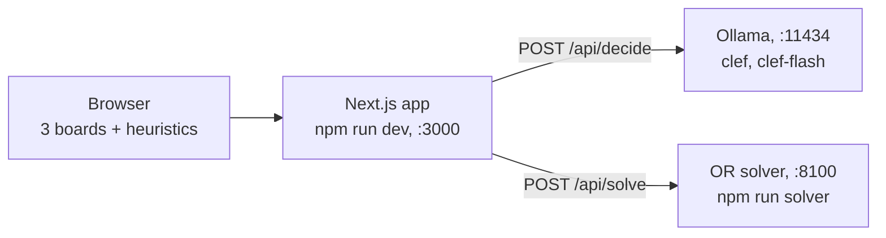

# Getting started

This guide takes you from a fresh machine to three boards racing in your browser. It covers the prerequisites, installing the app, the OR solver and the decision models, your first race, running with only some of the services, and checking your setup with the test suites. Commands run from the repository root in a macOS or Linux shell unless a step says otherwise.

## What you set up

The project has three parts. You can run the app on its own, then add the other two when you need them.

| Part | What it does | Needed for | Address |
|---|---|---|---|
| Next.js app | Serves the page with three boards. Runs the heuristics in the browser and proxies the other two controllers | Everything | `127.0.0.1:3000` |
| OR solver | A Python service that plans each placement several pieces ahead | The **OR solver** controller | `127.0.0.1:8100` |
| Ollama | Runs the local decision models `clef` and `clef-flash` | The **decision model** controllers | `localhost:11434` |



## Prerequisites

| Tool | Version | Needed for | Check with |
|---|---|---|---|
| [Node.js](https://nodejs.org/en/download) and npm | 26 | Everything | `node --version` |
| [uv](https://docs.astral.sh/uv/getting-started/installation/) | A current release | The OR solver and its tests | `uv --version` |
| Python | 3.13 (uv installs it for you) | The OR solver | None: uv reads `or-solver/.python-version` |
| [Ollama](https://ollama.com/download) | 0.35.1 or later (tested on 0.40.5) | The decision models | `ollama --version` |

Notes:

- **Node.js 26.** The tests and scripts run `.ts` files directly through Node's built-in type stripping (for example `node --no-warnings --test lib/*.test.ts`), with no build step.
- **Python.** `or-solver/pyproject.toml` accepts Python 3.12 or 3.13, and `or-solver/.python-version` pins 3.13. If you don't have it, uv downloads a managed copy the first time it runs, so a newer system Python does not get in the way.
- **Disk space for the models.** `clef` is the 27B model, about 18 GB to download. `clef-flash` is its smaller, faster variant, about 12 GB. You only need the models you plan to race. See the [clef model page](https://ollama.com/library/clef).

## Step 1: Install the app

Clone or download this repository, open a terminal in its root folder, then install the Node dependencies:

```bash
npm install
```

This installs Next.js 16, React 19, Tailwind CSS 4, TypeScript and ESLint from `package-lock.json`.

## Step 2: Set up the OR solver

Create the solver's virtual environment and install its dependencies (FastAPI, Uvicorn and, for tests, pytest) from `or-solver/uv.lock`:

```bash
uv sync --directory or-solver
```

This creates `or-solver/.venv`. You can skip this step: `npm run solver` and `npm run test:solver` both use `uv run`, which syncs the environment on first use. Running it now gets the downloads out of the way.

## Step 3: Install Ollama and pull the models

Skip this step if you only want to race heuristics and the OR solver.

1. Install Ollama from [ollama.com/download](https://ollama.com/download) and check the version. It must be 0.35.1 or later.

   ```bash
   ollama --version
   ```

2. Pull the two decision models:

   ```bash
   ollama pull clef
   ollama pull clef-flash
   ```

3. Confirm that both models are installed and that the Ollama server is answering:

   ```bash
   ollama list
   curl -s http://localhost:11434/api/version
   ```

   `ollama list` should show `clef:latest` and `clef-flash:latest`, and the `curl` call should print a small JSON object with the server version. If it can't connect, start Ollama: open the desktop app, or run `ollama serve` in its own terminal.

The app calls the models through Ollama's `/v1/systemone` endpoint. It asks one typed `choice` question per piece, listing up to 26 placements. [Concepts](concepts.md) explains how that works.

## Step 4: Start the services

Use one terminal for each long-running process.

1. **Ollama.** Make sure it is running (see step 3).

2. **OR solver.** In a second terminal:

   ```bash
   npm run solver
   ```

   This runs `uv run --directory or-solver uvicorn orsolver.server:app --host 127.0.0.1 --port 8100`. The service runs one small warm-up solve at startup. Check that it is up:

   ```bash
   curl -s http://127.0.0.1:8100/health
   ```

   The reply is `{"ok":true}`.

3. **App.** In a third terminal:

   ```bash
   npm run dev
   ```

   Open [http://127.0.0.1:3000](http://127.0.0.1:3000) in your browser.

`npm run dev` listens on `127.0.0.1` only, so only this machine can reach it. The project has two other ways to serve the page:

| Command | Listens on | Use it for |
|---|---|---|
| `npm run dev` | `127.0.0.1:3000` | Development on this machine. Recommended |
| `npm run dev:lan` | `0.0.0.0:3000` | Trusted networks only: it exposes the development endpoints and source maps to the network |
| `npm run demo` | `0.0.0.0:3000` | Showing the demo to an audience or on shared Wi-Fi. Runs `next build`, then a production server with no development endpoints |

The [lecture guide](lecture-guide.md) covers `npm run demo` in detail, and [SECURITY.md](../SECURITY.md) explains the network exposure.

## Step 5: Run your first race

The page opens with this lineup:

| Board | Controller | Defaults |
|---|---|---|
| 1 | `clef-flash` (decision model) | Advanced moves off, assist off. If you turn the assist on, the gate starts at confidence below 0.025 (0.1 for `clef`) |
| 2 | Lookahead (next piece), a heuristic | Advanced moves off. Dellacherie scoring on this move plus the best follow-up for the known next piece |
| 3 | OR solver | Advanced moves on, think budget 300 ms, strict info off (it may use the pieces left in the current 7-bag) |

And these race settings, in the row under the buttons:

| Setting | Default | What it does |
|---|---|---|
| seed | 42 | Picks the piece sequence and the gaps in the garbage rows. Every board gets the same pieces and the same garbage |
| minutes | 3 | Length of the race, shown on the LED clock (1 to 60) |
| real-time gravity | On | Pieces fall while each controller thinks. Off gives a turn-based race: the piece waits at the top for its controller |
| start level | 1 | Starting gravity level (1 to 15). The level rises every 10 lines |
| rising garbage every | On, 6 seconds | Adds one garbage row every N seconds (1 to 60) on a clock shared by every board. Each row waits in a queue and is pushed in when the board's current piece locks |
| moves | normal (80 ms) | How fast a piece plays out its moves once a decision arrives (slow 160 ms, fast 30 ms). Moving costs game time, because gravity keeps running |

Press **Start**. The music starts with the race and speeds up as the game gets harder. The **♪ on** / **♪ off** button mutes and unmutes it.

### Read a board

Each board shows the same parts, from top to bottom.

| Part | What it shows |
|---|---|
| Header | The controller's name, and its phase: `idle`, `thinking`, `moving`, `error` or `over` |
| Picker | The controller menu and its options. **advanced moves** allows tucks and T-spins through SRS wall kicks. Model boards add an **assist** heuristic menu and its confidence gate, **conf <**. The solver board adds a **think** budget (50, 300, 1000 or 2000 ms) and **strict info** |
| Playfield | The stack and the falling piece. A faint white outline marks where the piece would land if it dropped now. A dashed amber outline marks the placement the controller chose |
| Side column | The next piece, the time until the next garbage row, and rows `queued` for the next lock. Counters for `fallbacks`, `missed`, `errors` and `assists` (overrides / assists) appear once they are non-zero |
| Stats | `score`, `lines`, `level`, `pieces`, `T-spins`, `Tetrises`, `late` and `avg ms` (mean time per decision) |
| Info panel | While a controller thinks: how long it has been thinking and, with real-time gravity on, how long until the piece locks without it. Then the details of its last decision (next table) |

The info panel depends on the kind of controller:

| Controller | Info panel |
|---|---|
| Decision model | The model's confidence, its top three options with probabilities, and what the assist did (agreed or overrode) |
| Heuristic | The method name, its compute time, and a one-line description of the method |
| OR solver | T-spin tag when it plans one, planning horizon, nodes searched, time used against the budget, why it stopped, the expected value, the constraint status and up to two alternatives |

Three counters tell you when something other than the controller's choice decided a piece:

| Counter | Meaning |
|---|---|
| `late` | The piece locked before the decision arrived |
| `missed` | The decision arrived in time, but the lock delay ran out before the piece finished moving |
| `errors` | The controller failed (for example, a service was unreachable). That piece falls where gravity takes it, or drops straight down when real-time gravity is off |

### End of the race

The race ends when the clock reaches zero or every board has topped out. A podium then ranks the boards by survival first (a later top-out beats an earlier one) and score second.

In the recorded runs with garbage every 6 seconds, the OR solver and the lookahead heuristic survived all 3 minutes, and `clef-flash` topped out after about 55 seconds on average. Those runs used seeds 1 to 8 (1 to 3 for the models), not the page's default seed 42, and model speed depends on your hardware. See [Part 3 of the results](../experiments/RESULTS.md#part-3-the-same-race-with-fair-time-based-garbage).

### Things to know

- **Settings lock while a race runs**, except **moves**. Pause to change them. Changing a setting resets the race.
- **Controller changes apply from the next piece**, even during a race.
- **Switching to another tab pauses the race.** Press **Start** to resume.
- **The first model decision is slow**, because Ollama loads the model into memory. The app asks Ollama to keep it loaded for 30 minutes after the last request.
- **Reset** clears the boards and the clock and keeps your lineup.

## Run without Ollama or without the solver

Heuristics run in your browser, so `npm run dev` alone is enough for a race. Pick the controllers that match the services you have running.

| Running | Controllers that work | Try this lineup |
|---|---|---|
| App only | Any of the 22 heuristics | Lookahead, Dellacherie / El-Tetris and Well keeper |
| App and OR solver | Heuristics and the OR solver | Keep boards 2 and 3; switch board 1 to a heuristic |
| App and Ollama | Heuristics and the decision models | Keep boards 1 and 2; switch board 3 to `clef` or a heuristic |
| All three | Everything | The default lineup |

If a board's service is unreachable, the board doesn't stop or swap in another controller. It shows the error, counts it under `errors`, and lets that piece fall under gravity (with real-time gravity off, the piece drops straight down), then asks again for the next piece. The error text names the address it tried, for example `ollama unreachable at http://localhost:11434: ...` or `OR solver unreachable at http://127.0.0.1:8100: ...`. If Ollama answers but rejects the request, for example because a model is not pulled, the error starts with `ollama` and the HTTP status.

To watch a decision model play without time pressure, turn off **real-time gravity**. Each piece then waits at the top until its controller answers.

### Point the app at other service addresses

The app's API routes read two environment variables:

| Variable | Default | Used by |
|---|---|---|
| `OLLAMA_URL` | `http://localhost:11434` | `/api/decide`, `scripts/collect.ts`, `scripts/live.ts` and `scripts/race.ts` |
| `OR_SOLVER_URL` | `http://127.0.0.1:8100` | `/api/solve` and `scripts/race.ts` |

Set them when you start the app. For example, to use a second solver on port 8101:

```bash
uv run --directory or-solver uvicorn orsolver.server:app --host 127.0.0.1 --port 8101
OR_SOLVER_URL=http://127.0.0.1:8101 npm run dev
```

Run each command in its own terminal.

For the app, you can also put them in a `.env.local` file in the repository root, which Next.js loads automatically. The scripts read only the shell environment. The repository ignores `.env*` files, so they stay out of git.

## Verify your setup

Run the checks that match what you installed.

| Check | Command | Expected result |
|---|---|---|
| Node.js | `node --version` | `v26.x` |
| uv | `uv --version` | Prints a version |
| Ollama | `ollama --version` | 0.35.1 or later |
| Models | `ollama list` | `clef:latest` and `clef-flash:latest` |
| Solver service | `curl -s http://127.0.0.1:8100/health` | `{"ok":true}` |
| App | Open `http://127.0.0.1:3000` | Three boards and a clock |

### Run the TypeScript tests

```bash
npm test
```

This runs `node --no-warnings --test lib/*.test.ts`: the board, SRS rotation, engine, race simulation and heuristic tests. None of them need Ollama or the solver. The summary at the end should report `fail 0`.

### Run the solver tests

```bash
npm run test:solver
```

This runs in two stages:

1. `npm run fixtures` exports the TypeScript rules to Python. It rewrites `or-solver/orsolver/tables.json` (shapes, kicks, spawn, scoring, gravity) and `or-solver/tests/fixtures/engine.json` (reachable placements, board features and points for parity tests).
2. `uv run --directory or-solver pytest -q` checks that the Python engine matches the TypeScript one, and that the planner behaves, for example taking a Tetris when one is available and staying inside its time limit.

The run should end with `passed` and no failures. On an unchanged checkout, the regenerated fixtures are identical to the committed ones, so `git status` stays clean. If they change, you have changed the TypeScript rules, and the new fixtures belong in the same commit. See [CONTRIBUTING.md](../CONTRIBUTING.md).

### Run the linter

```bash
npm run lint
```

## Next steps

- [Lecture guide](lecture-guide.md): present the demo with `npm run demo`, a pre-talk checklist and suggested lineups.
- [Concepts](concepts.md): the three kinds of decision-maker and the ideas behind them.
- [Troubleshooting](troubleshooting.md): fixes for Ollama, the solver, ports, Node and audio.
- [Experiments](experiments.md): reproduce every result in `experiments/RESULTS.md`.
