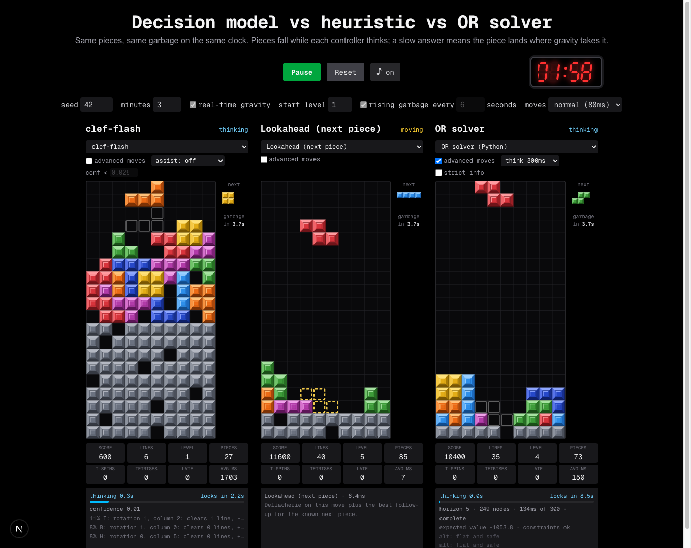
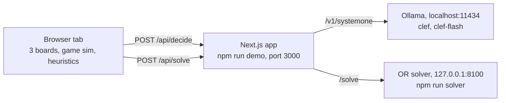

# Lecture guide

This guide is for presenting the demo to a live audience. It covers what to start before the talk, how to keep the page safe on a shared network, which lineups and settings show each finding, what to point at on screen, a 10 to 15 minute story arc tied to the results in [`experiments/RESULTS.md`](../experiments/RESULTS.md), and what to do when something misbehaves on stage. It assumes you have already completed [Getting started](getting-started.md) on the machine you will present from.



## What the audience sees

Three boards play hard-mode Tetris side by side. Every board gets the same pieces and the same garbage rows on the same clock, so the only difference between them is the decision-maker:

- A **decision model** (`clef` or `clef-flash`, running locally in Ollama) reads the board and picks one of up to 26 listed placements.
- A **heuristic** (one of 22 hand-written or learned scoring rules) scores every placement and takes the best, in a few milliseconds.
- The **OR solver** (a Python operations-research service) plans several pieces ahead under a time budget and plays only the first move.

Pieces keep falling while each controller thinks. A slow answer means the piece lands wherever gravity takes it. That one rule drives most of the story.

## Before the talk

### What runs where

Heuristics run inside the browser tab. The other two controllers go through the app's API routes to local services.



A lineup of only heuristics needs nothing but the app. That makes it your safest fallback (see [When something goes wrong](#when-something-goes-wrong)).

### The day before

1. Build the production app once, so the build is not your first surprise on the day:

   ```bash
   npm run build
   ```

2. Check that both models are pulled. `ollama list` should show `clef` and `clef-flash`:

   ```bash
   ollama list
   ```

   If either is missing, pull it:

   ```bash
   ollama pull clef
   ollama pull clef-flash
   ```

3. Rehearse the full talk once on the seed you plan to use (the default is 42). For a given seed every run deals the same pieces and the same garbage rows, but results still vary between runs, because model and solver latency are measured for real.

### Thirty minutes before

Use three terminals, all at the repository root.

1. **Check Ollama.** The app expects it at `http://localhost:11434` (override with the `OLLAMA_URL` environment variable). This prints the running version:

   ```bash
   curl -s http://localhost:11434/api/version
   ```

2. **Start the OR solver** in terminal 1. It listens on `127.0.0.1:8100` only, and it runs one small solve at startup to warm its caches:

   ```bash
   npm run solver
   ```

   Check it from another terminal. The expected reply is `{"ok":true}`:

   ```bash
   curl -s http://127.0.0.1:8100/health
   ```

3. **Start the app** in terminal 2. `npm run demo` builds and then serves the production build on `0.0.0.0:3000`. If you built the day before and changed nothing, `npm start` serves that build without rebuilding.

   ```bash
   npm run demo
   ```

4. **Warm up both models** in terminal 3, so the first decision on stage is not slowed by Ollama loading a model. This sends one small two-option question per model through the app's `/api/decide` route:

   ```bash
   for m in clef clef-flash; do
     node -e 'console.log(JSON.stringify({ model: process.argv[1], board: Array(20).fill(".".repeat(10)).join("\n"), piece: "T",
       options: [{ letter: "A", text: "rotation 0, column 0" }, { letter: "B", text: "rotation 0, column 7" }] }))' "$m" |
       curl -s -X POST http://127.0.0.1:3000/api/decide -H "Content-Type: application/json" -d @-
     echo
   done
   ```

   Each line of output is a JSON object with `letter`, `probabilities`, `confidence` and `ms` (how long Ollama took, in milliseconds). An `error` field instead means Ollama is not reachable or answered with an error. Run the loop a second time to see the warm latency.

   Every request asks Ollama to keep the model loaded for 30 minutes after it (`keep_alive: "30m"` in [`lib/prompt.ts`](../lib/prompt.ts)). Warm up within 30 minutes of going on, and again after a long break.

### Five minutes before

1. Open `http://localhost:3000` in a browser window of its own and make it full screen. The tab title reads "Tetris controller race".
2. If the three boards wrap onto two rows, zoom the browser out until they sit side by side.
3. Set the lineup and settings for your first act (see [Suggested lineups](#suggested-lineups)).
4. Do a ten-second dry run. Press **Start** and check that each board's panel fills in: `confidence` on the model board, a method name with a time in ms on the heuristic board, and `horizon` on the OR solver board. Then press **Pause** and **Reset**. Reset restores the clock and the boards and keeps your lineup and settings.
5. Decide on music. The chiptune starts with the first **Start** click, because browsers only allow audio after a click. The music button reads **♪ on** or **♪ off** and works at any time, so set it to **♪ off** before Start if the room should stay quiet.
6. Keep the race tab visible. Switching tabs or minimizing the window pauses the race on purpose: a hidden tab stops animation frames but not network requests, which would hand slow controllers free thinking time. If it pauses, press **Start** to resume.

## Network safety

Pick how the app listens before you plug into a venue network.

| Command | Listens on | Build | Who can open it | Use it for |
|---|---|---|---|---|
| `npm run demo` | `0.0.0.0:3000` | Production | Anyone on the network | Presenting, including letting the audience open the page |
| `npm run build && npx next start -H 127.0.0.1 -p 3000` | `127.0.0.1:3000` | Production | This machine only | Presenting from your own laptop on untrusted Wi-Fi |
| `npm run dev` | `127.0.0.1:3000` | Development | This machine only | Working on the code |
| `npm run dev:lan` | `0.0.0.0:3000` | Development | Anyone on the network | Trusted networks only |

- **Never present with `npm run dev:lan` on a shared network.** The development server exposes developer endpoints and source maps to everyone who can reach it.
- **`npm run demo` is safe to show on a network.** It serves a production build with no developer endpoints and no source maps.
- **Anyone who opens the page in demo mode uses your models and solver.** Each viewer's races run in their own browser, but their model and solver boards send requests to your app, which forwards them to your Ollama and your solver. That can slow your own boards mid-talk. Share the address only if you want the audience to play along, and use the local-only command otherwise.
- **The OR solver is never exposed directly.** It listens on `127.0.0.1:8100`, and other machines reach it only through the app's `/api/solve` route.

## Settings reference

### Page settings

The settings row sits under the **Start**, **Reset** and music buttons. Every setting except **moves** is locked while a race runs, and changing one resets the race, so press **Pause** first.

| Setting | Default | Range | What it does |
|---|---|---|---|
| **seed** | 42 | Any integer | Picks the piece sequence and the garbage rows, the same on every board |
| **minutes** | 3 | 1 to 60 | Race length on the countdown clock |
| **real-time gravity** | On | On or off | Off is the turn-based race: the piece waits at the top until its controller answers |
| **start level** | 1 | 1 to 15 | Starting speed. Gravity speeds up every 10 lines, from 1000 ms per row at level 1 to 7 ms per row at level 15 |
| **rising garbage every _N_ seconds** | On, 6 | 1 to 60, in steps of 0.5 | One garbage row every _N_ seconds on a clock shared by all boards. Rows queued while a controller thinks are pushed in at its next lock |
| **moves** | normal (80ms) | slow (160ms), normal (80ms), fast (30ms) | How fast a decided move plays out. It costs game time, because gravity keeps running. Can be changed mid-race |

Garbage keeps its clock even with gravity off, so a slow controller still collects queued rows while it thinks. For a calm walkthrough, turn off both gravity and garbage.

### Board settings

Each board has its own controls above the playfield. They stay enabled during a race, and a change applies from the next piece.

| Control | Shown for | Default | What it does |
|---|---|---|---|
| Controller picker | Every board | **clef-flash**, **Lookahead (next piece)**, **OR solver (Python)** | Groups: Decision model, Operations research, and four heuristic groups (classic, original, learned from the model, fusion) |
| **advanced moves** | Every board | On for the OR solver board in the default lineup, off for the other two. Switching a board's controller keeps its setting | Adds tucks (last-second slides under an overhang) and T-spins through SRS wall kicks |
| **assist** | Decision models | **assist: off** | Lets one of the 22 heuristics replace the model's pick when the model is unsure |
| **conf <** | Decision models | 0.025 for clef-flash, 0.1 for clef | The assist steps in when the model's confidence is below this. Set it to 1 to assist on every move. Enabled only once an assist is picked |
| **think** | OR solver | **think 300ms** | Time budget per decision: 50, 300, 1000 or 2000 ms. Under gravity the solver also caps itself at a quarter of the piece's fall time |
| **strict info** | OR solver | Off | On hides which pieces are left in the current 7-piece bag. That information is public, but only the solver uses it |

Two boards with the same controller show the same name in their headings and on the podium. When you compare variants (advanced moves on and off, strict info on and off), tell the audience which side is which.

## What to point at on screen

| Element | Where | What it means |
|---|---|---|
| Phase | Top right of each board | `idle`, `thinking`, `moving`, `over` or `error` |
| Thinking bar | Top of the panel under the board | `thinking 1.8s` counts the wait. `locks in` counts down to the moment the piece locks without a decision, and turns red under 0.8 s. The bar fills as the two meet. The `locks in` countdown and the bar appear only with gravity on |
| Target ghost | On the playfield | A dashed amber outline is where the controller decided to put the piece. A faint white outline is where the piece would land if dropped now, shown before a decision arrives |
| **late** | Stats grid | Pieces that locked before the decision arrived |
| **missed** | Column right of the board, once above 0 | Decisions that arrived in time, but the lock delay ran out mid-move |
| **fallbacks** | Same column | The pick was no longer reachable, so Dellacherie chose instead |
| **errors** | Same column, in red | The controller's request failed, so that piece fell under gravity (or dropped straight down with gravity off) |
| **assists** | Same column | Shown as overrides/assists: how often the assist stepped in, and how often it changed the pick |
| **garbage in** and **queued** | Same column | Countdown to the next garbage row, and rows waiting to be pushed in when the current piece locks |
| **avg ms** | Stats grid | Mean decision time |
| **T-spins** and **Tetrises** | Stats grid | T-spins that cleared lines, and four-line clears |
| Model panel | Under a model board | `confidence`, the top three options with their probabilities, and an amber assist line such as "Lookahead (next piece) overrode C → K" or "... agreed with C" |
| Heuristic panel | Under a heuristic board | The method name, its compute time in ms, and a one-line description |
| Solver panel | Under the OR solver board | A fuchsia `T-spin` or `mini T-spin` tag when it plans one; `horizon` (how many pieces deep the plan looked); `nodes` (boards the search expanded); time used of the think budget; `complete` or `deadline` (whether the search finished or ran out of time); `expected value`; `constraints` (`ok`, `relaxed` or `forced`); and up to two `alt:` lines explaining runner-up moves |
| Countdown clock | Top right of the page | Seven-segment LED clock. It pulses in the last 10 seconds |
| Podium | Above the boards, when the race ends | Ranked by survival first (a later top-out beats an earlier one), then by score, with each top-out time |

The music speeds up with the highest level any live board has reached and with how far into the race you are, and jumps again in the last 10 seconds.

## Suggested lineups

Each lineup isolates one point. The "In the recorded runs" column quotes [`experiments/RESULTS.md`](../experiments/RESULTS.md). Unless a row names another part, the numbers come from Part 3: 3-minute races with time-based garbage, seeds 1 to 8 for the solver and heuristics, seeds 1 to 3 for the models. A single live race on one seed can go either way, so present these as what the data shows, not as a promise about the next 3 minutes.

| Goal | Left / middle / right | Settings | In the recorded runs |
|---|---|---|---|
| The headline race | **clef-flash** / **Lookahead (next piece)** / **OR solver** with advanced moves (the default lineup) | Defaults: gravity on, garbage every 6 s | clef-flash survived 0 of 3 races (mean 55 s). Lookahead and the solver survived 8 of 8; lookahead scored more (111,988 against 87,675) |
| Pressure | The default lineup | Garbage every 4 s or 3 s | At 4 s: solver 8/8, lookahead 6/8. At 3 s: solver 2/8 (mean 146 s), lookahead 0/8 (mean 148 s). A rough tie: the paired confidence intervals touch or include zero |
| Advanced moves | **OR solver** with advanced moves / **OR solver** without / **Lookahead (next piece)** | Garbage every 3 s or 2 s | At 2 s: 72 s with advanced moves against 56 s without, and 1.8 to 2.3 T-spins per game. The heuristics made none |
| Bag knowledge | **OR solver** / **OR solver** with strict info / **Lookahead (next piece)**, advanced moves on for both solvers | Garbage every 2 s | At 2 s: 72 s with bag knowledge against 58 s without |
| Weaker heuristics collapse | **Lookahead (next piece)** / **Dellacherie / El-Tetris** / **Well keeper** | Garbage every 4 s | Lookahead 6/8; Dellacherie 1/8 (mean 128 s); Well keeper 0/8 (mean 103 s). Needs no Ollama and no solver |
| Calm walkthrough | **clef-flash** / **clef** / **OR solver** | Gravity off, garbage off | No race numbers: use it to read the panels. Part 1: median model confidence was 0.020 for flash and 0.077 for clef |
| The assist | **clef-flash**, assist off / **clef-flash** with **assist: Clef + hole sense** / **Lookahead (next piece)** | Gravity off, garbage off; set **conf <** to 1 for an assist on every move | Part 1, live over 50 pieces on seeds 3 to 5: flash alone ended with 26.3 holes on average, every always-on assist except Hole guard with 0. Clef + hole sense had the best mean score (2,367 against 767) |
| Learning from the model | **Clef-distilled** / **Clef + hole sense** / **Lookahead (next piece)** | Garbage off | Part 1, heuristic-only benchmark: Clef-distilled lasted about 106 pieces with 15 holes on average; Clef + hole sense reached the 500-piece cap on 5 of 5 seeds |
| Speed versus lock delay | The default lineup | **start level** 13 or higher, **moves** normal (80ms) | From Part 2: at high levels gravity (7 to 18 ms per row) outruns 80 ms moves, so even a decision made in time can run out of lock delay mid-move. That shows as **missed** |

## A 10 to 15 minute story arc

The arc runs in six acts and builds toward one lesson: how fairly the garbage clock is set decides who looks smartest. Timings are a guide. For a 10-minute slot, skip act 3 and keep act 2 to one minute.

### Act 1: the setup (1 minute)

- **On screen:** the default lineup, paused, with the clock at 3:00.
- **Say:** three kinds of decision-maker, one game. Same pieces, same garbage, same clock. A learned intuition, a hand-tuned rule and a planner.
- **Point at:** the three board names and the controller pickers.

### Act 2: slow motion (3 minutes)

- **On screen:** the calm walkthrough lineup, with gravity and garbage off. Press **Start**.
- **Say:** the decision model gets one typed question per move. It lists up to 26 possible placements, each described by rotation, column, lines cleared, new holes, height and bumpiness, and the model returns a probability for each.
- **Point at:** the model panel's `confidence` and its top three options. Then the solver panel's `horizon` and `nodes`, and compare **avg ms** across the three boards.
- **Finding (Part 1):** both models are nearly always undecided, with median confidence 0.020 for flash and 0.077 for clef. Their ranking still carries signal: Spearman correlation with the oracle is 0.44 for flash and 0.51 for clef. The ranking is informative; the top pick is not reliable.

### Act 3: help from a heuristic (2 minutes)

- **On screen:** the assist lineup. Gravity and garbage stay off.
- **Say:** when the model is unsure, let a heuristic decide. The gate sets how unsure counts.
- **Point at:** the amber "overrode" and "agreed" lines, the **assists** counter, and the holes piling up on the unassisted board.
- **Finding (Part 1):** offline, the best assists cut flash's regret by about two-thirds (17.2 to 5.7). Live over 50 pieces, holes drop from 26 to 0 and the score triples. Both models dig holes they could avoid, and clef's ratings show why: at equal height, it rates boards with more holes slightly higher. Clef + hole sense is a fit of clef's own board ratings with the missing hole penalty added back, and it was the best live assist.

### Act 4: real time (3 minutes)

- **On screen:** the headline race. Press **Pause**, set the three boards back to the default lineup (**clef-flash** with **assist: off**, **Lookahead (next piece)**, **OR solver** with advanced moves), turn **real-time gravity** and **rising garbage** back on at 6 seconds (each setting change resets the race), then press **Start**.
- **Say:** now the piece falls while the controller thinks.
- **Point at:** the thinking bar racing the `locks in` countdown, the **late** counter, and the target ghost appearing after the piece has already fallen part of the way.
- **Finding (Part 3):** clef-flash takes about 2.2 s per move and clef about 7.6 s. Both top out within 35 to 75 s, with **late** up to 3.3 per game. At garbage every 6 s, lookahead and the solver both survived every recorded race, and lookahead scored more.

### Act 5: turn up the pressure (3 minutes)

- **On screen:** pause, set **rising garbage every** to 3 or 4 seconds, and replace the topped-out model board with **Well keeper** or **Dellacherie / El-Tetris**. Press **Start**.
- **Say:** fewer seconds between garbage rows. Planning should start to pay.
- **Point at:** the solver panel's `T-spin` tag and the **T-spins** counter, the **queued** garbage count, and the weaker heuristic's stack rising.
- **Finding (Part 3):** the solver roughly ties lookahead. At 4 s it survived 8 of 8 against 6 of 8; at 3 s it survived more races (2 of 8 against 0 of 8) but lasted about as long on average (146 s against 148 s). The paired confidence intervals touch or include zero. Advanced moves and bag knowledge still help it. Well keeper and Danger adaptive save rows for Tetrises, and those are exactly the rows the garbage pushes into, so they collapse.

### Act 6: the twist and the close (2 minutes)

- **On screen:** the podium from act 5, then optionally the Part 2 and Part 3 survival tables in [`experiments/RESULTS.md`](../experiments/RESULTS.md).
- **Say:** the first version of this race used garbage per piece placed, one row every N pieces. Under that rule the solver beat lookahead by 38 to 44 s, and clef "survived" 3 minutes by placing only about 26 pieces. A slow controller placed fewer pieces, so it got less garbage. Time-based garbage made the race fair, and the solver's lead mostly disappeared.
- **Lesson (Part 3):** a controller is only as good as the clock it is judged on. A fast, simple rule with one piece of lookahead competes with a planner that searches thousands of futures, and a learned intuition that is right on average still cannot keep up with gravity.
- **Point at:** the podium ranking, survival first, then score.

## When something goes wrong

Board controls stay live during a race, so the fastest on-stage fix is often to switch the failing board to a heuristic. The change applies from the next piece.

| Symptom | Likely cause | Fix |
|---|---|---|
| Model board shows `error: ollama unreachable at http://localhost:11434: ...` | Ollama is not running | Start Ollama, or switch the board to **Lookahead (next piece)** and carry on |
| Model board shows `error: ollama` followed by a status code | Ollama answered with an error | Check that `ollama list` shows both models, and switch the board to a heuristic for now |
| The first model decision takes many seconds | The model is loading | Warm up both models before the talk. If it happens live, name it: this is a cold start |
| Solver board shows `error: OR solver unreachable at http://127.0.0.1:8100: ...` | The solver is not running | Run `npm run solver` in another terminal, or switch the board to **Lookahead (next piece)** or **Monte Carlo rollout** |
| The race paused by itself | The tab was hidden | Press **Start** |
| **Start** is grayed out | The race is over: the clock reached zero or every board topped out | Press **Reset** |
| A setting cannot be changed | The race is running | Press **Pause**. Changing a setting resets the race |
| No music | Audio starts only after the first **Start** click | Check that the button reads **♪ on**, and check the system volume |
| The boards wrap onto two rows | The window is too narrow | Zoom the browser out |
| Your boards slow down in demo mode | Audience members opened the page and their races are using your models and solver | Restart with `npx next start -H 127.0.0.1 -p 3000` after `npm run build` (see [Network safety](#network-safety)) |
| `npm run demo` fails because port 3000 is in use | Another server holds the port | Find it with `lsof -i :3000` and stop it |
| Ollama and the solver are both unavailable | Anything | Run the weaker-heuristics lineup, which needs only the app, and show the model and solver results from [`experiments/RESULTS.md`](../experiments/RESULTS.md) |

For more fixes, see [Troubleshooting](troubleshooting.md).

## Next steps

- [Concepts](concepts.md): the ideas behind the three kinds of decision-maker, in more depth for questions after the talk.
- [Experiments](experiments.md): rerun the races behind every number quoted here.
- [Part 3 of the results](../experiments/RESULTS.md#part-3-the-same-race-with-fair-time-based-garbage): the full tables for the fair, time-based race.
- [Troubleshooting](troubleshooting.md): fixes for Ollama, the solver, ports and audio.
