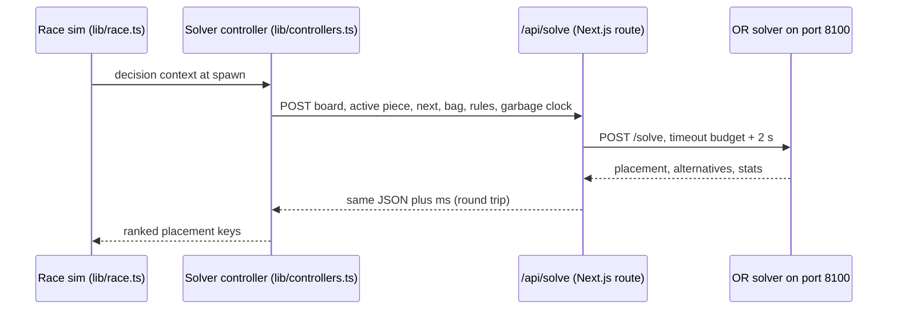
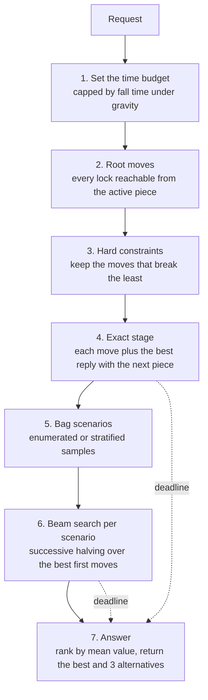

# OR solver

The OR solver is the operations research (OR) player in the race. It is a small Python service that plans several pieces ahead under hard constraints and a time budget, plays only the first placement, and plans again for the next piece. This page is for engineers who want to run it, call its HTTP API, understand the search, or change it.

## At a glance

| Item | Value |
|---|---|
| Location | [`or-solver/`](../or-solver/) |
| Runtime | Python 3.13 with [FastAPI](https://fastapi.tiangolo.com/) and uvicorn, managed by [uv](https://docs.astral.sh/uv/) |
| Address | `http://127.0.0.1:8100` (this machine only) |
| Endpoints | `GET /health`, `POST /solve` |
| Called by | the app's `/api/solve` route and `scripts/race.ts` |
| Rules | generated from the TypeScript engine and checked by parity tests |

The approach is **rolling-horizon planning**: look a fixed number of pieces into the future, commit only to the move you must make now, and plan again from scratch when the next piece arrives. You re-plan because the future is uncertain: you know the next piece, you know which pieces are left in the current bag but not their order, and garbage keeps arriving.

## How it fits in



- The solver controller sends the board, the falling piece in its spawn state (the sim asks at spawn), the next piece, the bag remainder (unless the board's **strict info** option is on), the rules, and the garbage clock.
- The route forwards the request to `OR_SOLVER_URL`, which defaults to `http://127.0.0.1:8100`. `scripts/race.ts` calls the same variable directly, without the route.
- The controller turns the returned cells (the placement first, then the alternatives) into the engine's placement keys by comparing the boards they produce, so the two engines may pick different cells for the same result.
- If the solver is unreachable, the request fails and that piece falls where gravity takes it (with gravity off, it drops straight down). No heuristic stands in, which keeps the race honest. If none of the returned picks is still reachable when the answer arrives, the sim falls back to Dellacherie.

## Layout

| Path | What it holds |
|---|---|
| `or-solver/pyproject.toml` | Project metadata and dependencies: `fastapi>=0.115`, `uvicorn>=0.30`; dev group `pytest>=8`; optional extra `cpsat` (`ortools>=9.12`) |
| `or-solver/.python-version` | `3.13` (the project accepts `>=3.12,<3.14`) |
| `or-solver/uv.lock` | Locked dependency versions |
| `or-solver/orsolver/server.py` | FastAPI app, request models and validation, startup warm-up |
| `or-solver/orsolver/search.py` | The planner: `solve()`, constraints, scenarios, beam search, `settings()` |
| `or-solver/orsolver/evaluate.py` | Board features (`analyze()`), the Dellacherie evaluator, bonuses |
| `or-solver/orsolver/engine.py` | Rules logic: bitboards, SRS moves and kicks, T-spin detection, locks, hard drops, garbage rows |
| `or-solver/orsolver/tables.json` | Rules tables generated from TypeScript; do not edit by hand |
| `or-solver/tests/test_engine.py` | Parity tests against the TypeScript engine |
| `or-solver/tests/test_search.py` | Behavior tests for the planner |
| `or-solver/tests/fixtures/engine.json` | Parity fixtures generated from TypeScript |

The `cpsat` extra installs OR-Tools, but no module imports it yet.

## Set up

You need uv. See the [uv installation guide](https://docs.astral.sh/uv/getting-started/installation/).

```bash
uv sync --directory or-solver
```

This creates `or-solver/.venv` and installs the dependencies and the dev group (pytest). uv reads `.python-version` and fetches Python 3.13 if you don't have it. You can skip this step: `uv run` syncs the environment on first use.

## Run

```bash
npm run solver
```

This is the same as:

```bash
uv run --directory or-solver uvicorn orsolver.server:app --host 127.0.0.1 --port 8100
```

At startup the service runs one small solve to import everything and fill the caches, then calls `gc.freeze()` to keep the garbage collector out of the hot path. Check that it is up:

```bash
curl -s http://127.0.0.1:8100/health
```

```json
{"ok":true}
```

FastAPI also serves an interactive schema at `http://127.0.0.1:8100/docs`.

To use another port, start the service there and point the app at it, each in its own terminal:

```bash
uv run --directory or-solver uvicorn orsolver.server:app --host 127.0.0.1 --port 8101
OR_SOLVER_URL=http://127.0.0.1:8101 npm run dev
```

For parallel experiment runs, start one solver per port (8101, 8102, ...) and set `OR_SOLVER_URL` per run. See [Experiments](experiments.md).

Keep the service bound to `127.0.0.1`. It has no authentication, and the browser never needs to reach it: the app calls it server-side through `/api/solve`. See [SECURITY.md](../SECURITY.md).

## HTTP API

### GET /health

Returns `{"ok": true}` once the service has started.

### POST /solve

Plans one placement for the falling piece. The request is validated by the pydantic models in [`server.py`](../or-solver/orsolver/server.py). All fields except `board` and `active` are optional.

A piece is one of `"I"`, `"O"`, `"T"`, `"S"`, `"Z"`, `"L"`, `"J"`.

#### Request body

| Field | Type | Default | Description |
|---|---|---|---|
| `board` | `int[20][10]` | required | Row 0 is the top. Cell ids 0-8: 0 is empty, 1-7 are pieces, 8 is garbage. Any nonzero cell is filled. |
| `active` | object | required | The falling piece now (see below). |
| `next` | piece[] | `[]` | Up to 6 pieces. Only the first is used. |
| `bagRemainder` | piece[] or `null` | `null` | Up to 7 pieces still to come in the 7-bag that holds `next`. `null` means no bag knowledge: future pieces are treated as independent and uniform. |
| `rules` | object | see below | Game rules that affect the plan. |
| `state` | object | see below | The garbage clock for this board. |
| `timing` | object | see below | The think budget. |
| `solver` | object | see below | Search options. |

A **7-bag** is the guideline randomizer: each run of 7 pieces holds one of each piece in random order, so the pieces left in the current bag are public knowledge.

`active`:

| Field | Type | Range | Description |
|---|---|---|---|
| `piece` | piece | | The falling piece. |
| `x` | int | -3 to 10 | Column of the SRS bounding box origin. |
| `y` | int | -3 to 20 | Row of the SRS bounding box origin (row 0 is the top). |
| `rot` | int | 0 to 3 | Rotation state: 0 is spawn, each clockwise turn adds 1. |

Spawn is `x = 3, y = 0, rot = 0` for every piece except O, which spawns at `x = 4`. The race sim always asks at spawn and the piece falls while the solver thinks. The solver searches from whatever position you send, so another caller can also ask mid-fall.

`rules`:

| Field | Type | Default | Description |
|---|---|---|---|
| `advanced` | bool | `false` | Adds soft drop to the move set, so locks include tucks (slides under an overhang) and spins, and T-spins are detected. |
| `level` | int, at least 1 | `1` | Accepted but not used by the search. |
| `gravityMsPerRow` | int, at least 0 | `0` | Milliseconds per row of gravity. 0 means no gravity, and the budget is not capped by fall time. |
| `lockDelayMs` | int, at least 0 | `500` | Accepted but not used by the search. |
| `garbageMs` | float, 0 to 600000 | `0` | One garbage row every `garbageMs` of game time. 0 turns garbage off. |

`state`:

| Field | Type | Default | Description |
|---|---|---|---|
| `pendingGarbage` | int, 0 to 40 | `0` | Rows already queued. They land when this piece locks. |
| `msUntilGarbage` | float, 0 to 600000 | `0` | Milliseconds until the next row is queued. |
| `avgPieceMs` | float, above 0 and up to 600000 | `1000` | This board's average time per piece, used to place future rows between future pieces. The search uses at least 50. |

`timing`:

| Field | Type | Default | Description |
|---|---|---|---|
| `budgetMs` | int, 10 to 10000 | `300` | Think budget in milliseconds. Under gravity the solver may use less (see [Set the time budget](#1-set-the-time-budget)). |

`solver`:

| Field | Type | Default | Description |
|---|---|---|---|
| `nodeBudget` | int, 1 to 10000000, or `null` | `null` | When set, the search stops after this many nodes instead of at the wall-clock deadline. A node is one board the search expands. See [Determinism and node budgets](#determinism-and-node-budgets). |

#### Example

From the repo root, with the solver running. This asks for a T on an empty board with an I next and S, Z, L left in the bag:

```bash
curl -s http://127.0.0.1:8100/solve \
  -H 'Content-Type: application/json' \
  -d "$(node -e 'console.log(JSON.stringify({
    board: Array.from({ length: 20 }, () => Array(10).fill(0)),
    active: { piece: "T", x: 3, y: 0, rot: 0 },
    next: ["I"],
    bagRemainder: ["S", "Z", "L"],
    rules: { advanced: true },
    timing: { budgetMs: 300 },
    solver: { nodeBudget: 2000 }
  }))')"
```

The response, formatted. With `nodeBudget` set, everything except `solveMs` is the same on every run:

```json
{
  "gameOver": false,
  "placement": {
    "cells": [[0, 19], [1, 18], [1, 19], [2, 19]],
    "spin": "none", "lines": 0, "value": -1045.87, "why": "flat and safe"
  },
  "alternatives": [
    { "cells": [[7, 19], [8, 18], [8, 19], [9, 19]], "spin": "none", "lines": 0, "value": -1046.99, "why": "flat and safe" },
    { "cells": [[3, 19], [4, 18], [4, 19], [5, 19]], "spin": "none", "lines": 0, "value": -1062.88, "why": "flat and safe" },
    { "cells": [[4, 19], [5, 18], [5, 19], [6, 19]], "spin": "none", "lines": 0, "value": -1060.23, "why": "flat and safe" }
  ],
  "expected": { "value": -1045.87, "worst": -1070.24, "pTopout": 0.0 },
  "horizon": 5,
  "nodes": 270,
  "evals": 5838,
  "scenarios": 6,
  "budgetMs": 300,
  "solveMs": 158.8,
  "stoppedBy": "complete",
  "constraints": { "status": "ok", "violated": [] }
}
```

Values are evaluator scores, not game points, so they are usually negative. Only their differences matter.

#### Response body

| Field | Type | Description |
|---|---|---|
| `gameOver` | bool | `true` when the active piece has no reachable lock. Then `placement` is `null`, `alternatives` is empty, `horizon` is 0 and `expected.pTopout` is 1. |
| `placement` | lock or `null` | The move to play (see below). |
| `alternatives` | lock[] | Up to three more moves, next in the solver's ranking. |
| `expected.value` | float | The placement's mean value over the scenarios it was compared on (or its exact-stage value if no scenarios ran). |
| `expected.worst` | float | The placement's lowest scenario value. |
| `expected.pTopout` | float | Fraction of scenarios in which the placement topped out within the horizon. |
| `horizon` | int | How many pieces deep the chosen move was compared: 1 (current piece only), 2 (exact stage), or 2 plus the scenario length. |
| `nodes` | int | Nodes expanded. This is what `nodeBudget` counts. |
| `evals` | int | Boards scored after the root, counted after deduplication at each step of the exact stage and the beam. |
| `scenarios` | int | Scenarios every surviving move was compared on. |
| `budgetMs` | int | The budget actually used, after the gravity cap. |
| `solveMs` | float | Time spent inside the solver, in milliseconds. |
| `stoppedBy` | string | `"complete"`, `"deadline"` or `"nodeBudget"`. |
| `constraints.status` | string | `"ok"`, `"relaxed"` or `"forced"` (see [Constraints](#constraints-and-loosening-order)). |
| `constraints.violated` | string[] | Constraints the placement breaks. |

Each lock in `placement` and `alternatives`:

| Field | Type | Description |
|---|---|---|
| `cells` | `[x, y][]` | The four cells the piece occupies when it locks, before lines clear. Row 0 is the top. |
| `spin` | string | `"none"`, `"mini"` or `"full"` (T-spins, advanced moves only). |
| `lines` | int | Lines this lock clears. |
| `value` | float | The move's value, as for `expected.value`. |
| `why` | string | A short description, such as `"T-spin double"`, `"Tetris"`, `"clears 2"`, `"+1 sealed hole"`, `"opens a T-slot"`, `"breaks heightCap"`, or `"flat and safe"`. |

The app's `/api/solve` route returns the same JSON plus `ms`, the round trip from the route in milliseconds. The fields the app reads are typed as `SolveReply` in [`lib/controllers.ts`](../lib/controllers.ts). The solver's board in the app shows `horizon`, `nodes`, `solveMs` (against the chosen budget) and `stoppedBy`.

#### Errors

| Where | Status | When |
|---|---|---|
| Solver | 422 | The body fails validation. FastAPI returns a `detail` list whose messages say what failed, for example `Value error, board must be 20 rows of 10 cells with ids 0-8`. |
| `/api/solve` | 400 | `board` is not an array, `active.piece` is not a string, or `timing.budgetMs` is missing, 0 or less, or above 10000. Body: `{"error": "bad request"}`. |
| `/api/solve` | 502 | The solver returned an error (its `detail` is passed on in `error` as a JSON string) or could not be reached or timed out (`OR solver unreachable at ...`). |

## How the search works

The planner is `solve()` in [`search.py`](../or-solver/orsolver/search.py). It is an **anytime** algorithm: it always has an answer, and each stage that finishes before the deadline improves it.



### 1. Set the time budget

The solver starts from `timing.budgetMs`. Under gravity, thinking time is fall time, so it caps the budget at a quarter of the time the piece needs to fall to the stack:

```text
fall_rows = max(1, 20 - stack height - active.y - 2)
budget    = min(budgetMs, max(15, 0.25 * fall_rows * gravityMsPerRow))
```

The search deadline is 85% of that budget minus 2 ms, which leaves room for the HTTP round trip. The capped value is returned as `budgetMs` and also picks the search settings in step 5.

### 2. Root moves

The solver finds every lock reachable from the active piece's current position with SRS rotation and wall kicks (`reachable()` in [`engine.py`](../or-solver/orsolver/engine.py)). The basic move set is rotate clockwise, rotate counterclockwise, left and right, followed by a hard drop. With `advanced`, soft drop joins the set and any grounded position can lock, which adds tucks and spins. A T that reaches a grounded position by a rotation is a T-spin under the 3-corner rule: at least three of the four corners of its 3x3 box are filled (walls and floor count). It is full when both front corners are filled or the last (fifth) kick test was used, mini otherwise. Locks are deduplicated by the board they produce, keeping the strongest spin.

If no lock is reachable, the response has `gameOver: true`.

### 3. Hard constraints

Each root move is scored and checked against three hard constraints. Only the moves with the lowest total constraint weight go on. See [Constraints and loosening order](#constraints-and-loosening-order).

### 4. Exact stage: current and next piece

For each remaining move, best first, the solver adds the best score of any lock the next piece can reach from spawn, with the same move set as the root (so spins count when `advanced` is on). This has the same form as the lookahead heuristic in [`lib/heuristics.ts`](../lib/heuristics.ts) (Dellacherie for this move plus the best follow-up for the known next piece), with the solver's bonuses and constraints added. It is the fallback answer: if the deadline hits during this stage, only the moves that finished are compared with each other, never moves searched to different depths.

### 5. Bag scenarios

A **scenario** is one guess at the piece order after `next`. `make_scenarios()` builds them:

- With `bagRemainder: null`, each scenario is a sequence of independent, uniformly random pieces.
- With a bag remainder, the remaining pieces of the current bag come first and later bags are random 7-bags.
  - When the possible orders of the remainder (cut to the scenario length) number no more than the scenario count, they are enumerated. If they cover the whole scenario length, each order appears once. Otherwise they repeat, each with a fresh random tail, to fill the count.
  - When there are too many orders, the solver samples them, stratified so that every remaining piece leads equally often.
- Garbage gap columns for future rows are sampled per scenario.

The scenario length, beam width, scenario count and number of first moves kept come from `settings()`, keyed on the budget from step 1:

| Budget | Scenario length after next | Beam width | Scenarios | First moves kept | Horizon when complete |
|---|---|---|---|---|---|
| under 60 ms | 1 | 2 | 3 | 3 | 3 |
| 60 ms to under 400 ms | 3 | 3 | 8 | 5 | 5 |
| 400 ms to under 1200 ms | 4 | 4 | 12 | 6 | 6 |
| 1200 ms and up | 5 | 5 | 16 | 8 | 7 |

The board's think menu offers 50, 300, 1000 and 2000 ms, one per row before the gravity cap. The default lineup uses 300 ms.

### 6. Beam search with successive halving

**Beam search** expands a search tree one level at a time and keeps only the best few nodes (the beam width) at each level. For one first move and one scenario, `beam()` plays out the next piece and then the scenario's pieces:

- The next piece uses full SRS moves when `advanced` is on. Deeper pieces use hard drops from the top, which are much faster.
- A plan's value is the sum of its placements' scores. The current and next piece count fully, and each later piece is weighted by `GAMMA = 0.9` times the one before.
- Boards are deduplicated, keeping the best value. A board where the next piece cannot spawn, or where garbage pushes the stack off the top, is a top-out.
- If every line in the beam tops out, the scenario scores its best value so far minus `DEAD = 100000`, scaled by the same depth weight, so dying later is still better than dying sooner.

**Successive halving** spends the budget on the moves still in contention. The strongest first moves from step 4 (up to "first moves kept") are each evaluated on the first 4 scenarios, or all of them if there are fewer. Then the better half by mean value is kept (at least 2), the number of scenarios doubles (up to all of them), and the next round runs. It stops after a round that used every scenario or compared only 2 moves. This stage runs only when the exact stage finished, there is a next piece, and more than one move is left.

### 7. Answer

The moves that survived successive halving are ranked by mean value over the scenarios of the last completed round, so a deadline in the middle of a round never mixes depths. The rest of the constraint-filtered moves follow in exact-stage order, each carrying its mean over the scenarios it was evaluated on, or its exact-stage value. The first becomes `placement` and the next three become `alternatives`. The expected value, worst case and top-out rate come from the chosen move's scenario samples.

## Evaluation

[`evaluate.py`](../or-solver/orsolver/evaluate.py) scores each placement as the Dellacherie evaluator plus the solver's bonuses. The search never looks at game points; it maximizes this score.

### Dellacherie features

`dell()` uses Dellacherie's six features with the El-Tetris weights, the same evaluator as the Dellacherie heuristic in `lib/heuristics.ts`:

| Feature | Weight | Meaning |
|---|---|---|
| Landing height | -4.500158825082766 | Height of the piece's center where it lands. |
| Eroded cells | 3.4181268101392694 | Lines cleared times the piece's cells in those lines. |
| Row transitions | -3.2178882868487753 | Changes between filled and empty along each row; the walls count as filled. |
| Column transitions | -9.348695305445199 | Changes between filled and empty down each column; the floor counts as filled. |
| Holes | -7.899265427351652 | Empty cells with a filled cell somewhere above them. |
| Wells | -3.3855972247263626 | Cumulative well depth: each well cell adds its depth in the well (1 + 2 + ...). |

### Bonuses

While the stack is safe, `bonus()` adds rewards for attacking play. The stack is safe when the height of the board the piece lands on, plus the garbage due after this lock and the next, is at most 10 rows. At the root and in the exact stage that garbage counts; inside the beam, only the height does. Under pressure every bonus is 0 and the score is pure survival.

| Event | Bonus |
|---|---|
| Mini T-spin clearing 0, 1, 2 lines | 3, 8, 15 |
| Full T-spin clearing 0, 1, 2, 3 lines | 10, 40, 70, 100 |
| Tetris (4 lines) | 30 |
| The board after the lock has a T-slot | 6 (once, however many slots) |

A **T-slot** (T-spin-double slot) is a row with exactly one gap, under a row that is full except for a three-wide gap centered on it, under a row that fills exactly one of the slot's two top corners and leaves the cell above the center open. A T rotated into it clears two lines.

### Holes: closed and overhang

`analyze()` splits holes in two:

- An **overhang** hole can still be reached by a path of empty cells from the top, moving only down and sideways. A tuck or spin may fill it later.
- A **closed** (sealed) hole cannot be reached that way.

Dellacherie's hole feature counts both. Only the `noNewSealedHoles` constraint tells them apart, so the solver may leave an overhang for a later tuck or spin but avoids sealing a hole when it can.

## Constraints and loosening order

`violations()` checks each root move against three hard constraints. Each move gets a rank: the sum of the weights of the constraints it breaks. Only the moves with the lowest rank are searched.

| Constraint | Weight | Broken when |
|---|---|---|
| `noNewSealedHoles` | 1 | The lock clears no lines and leaves more closed holes than before. |
| `heightCap` | 2 | The stack after the lock is taller than 16 rows minus the garbage due after this lock and the next. |
| `spawnSafe` | 8 | The garbage that lands right after this lock pushes the stack off the top, or any cell in columns 3 to 6 of the top two rows is filled. |

The weights set the loosening order. A move that only seals a hole beats one that only breaks the height cap, and that beats one that breaks both. `spawnSafe` outweighs the other two combined, so the solver breaks it only when every reachable move does.

`constraints.status` reports the outcome:

| Status | Rank of the chosen move | Meaning |
|---|---|---|
| `ok` | 0 | No constraint broken. |
| `relaxed` | 1 to 7 | Sealed-hole or height constraints loosened. |
| `forced` | 8 or more | Every move blocks the spawn area or tops out. |

## Garbage planning

Garbage runs on a clock shared by every board. Rows queued while a controller thinks land at its next lock. The solver models that clock with two small functions inside `solve()`:

```text
p           = max(50, avgPieceMs)              lock j happens about j * p ms from now (lock 1 = this piece)
arrived(t)  = 0                                if garbageMs is 0 or t < msUntilGarbage
            = 1 + floor((t - msUntilGarbage) / garbageMs)    otherwise
rows_at(j)  = (pendingGarbage if j = 1) + arrived(j * p) - arrived((j - 1) * p)
```

`rows_at(j)` is the number of rows pushed in right after lock `j`. For example, with `garbageMs: 3000`, `msUntilGarbage: 1000`, `avgPieceMs: 800` and `pendingGarbage: 1`, the rows after locks 1 to 6 are 1, 1, 0, 0, 1, 0.

The solver uses this schedule in three places:

- **Pending garbage.** `rows_at(1) + rows_at(2)` lowers the height cap and the safe-stack threshold for the bonuses.
- **The root.** The rows due after this lock are pushed into each root board, with sampled gaps, before the next piece is planned. A move that gets pushed off the top breaks `spawnSafe` and scores as a top-out.
- **Scenarios.** Inside each scenario, `rows_at(d + 2)` rows with sampled gaps land after beam level `d`. A board pushed off the top is dropped.

## Determinism and node budgets

Every random choice (scenario orders, random tails, garbage gaps) comes from one generator seeded with a CRC-32 of the board, the active piece's type, the next piece and the bag remainder. The same request always builds the same scenarios.

What can vary is how far the search gets. By default it stops at a wall-clock deadline, so a slower or busier machine gets a shallower plan and may answer differently. Set `solver.nodeBudget` to stop after a fixed number of nodes instead. The wall clock is then ignored, and the response is the same on every run except for `solveMs`. `stoppedBy` reports `"nodeBudget"` when the budget cut the search short.

## Performance

- **Bitboards.** A board is a tuple of 20 row integers with bit `x` set when column `x` is filled. Features, collisions and line clears are bit operations, and boards are hashable, so they dedupe and cache cheaply.
- **Caches.** `analyze()` is memoized for up to 400,000 boards and `drops()` (all hard drops of a piece) for up to 40,000 board and piece pairs.
- **Fast deeper levels.** Below the next piece, the beam uses hard drops from the top instead of the full SRS search.
- **Warm start.** The startup solve fills the caches, and `gc.freeze()` keeps the garbage collector from pausing the first real requests.
- **Wall-clock budget.** The deadline is measured in real time. The endpoint is synchronous, so FastAPI runs it in a thread pool and concurrent requests to one service compete for one Python process. For parallel experiment runs, start one service per port.
- **Measured cost.** In the races, the solver took about 80 to 140 ms per decision against about 5 ms for lookahead (Part 2), and 100 to 160 ms under time-based garbage (Part 3). See [RESULTS.md](../experiments/RESULTS.md).

Under fair, time-based garbage the solver roughly ties the lookahead heuristic, and advanced moves and bag knowledge still help it. Read the full numbers in [Part 3 of the results](../experiments/RESULTS.md#part-3-the-same-race-with-fair-time-based-garbage).

## Testing

```bash
npm run test:solver
```

This regenerates `tables.json` and the fixtures from TypeScript (`npm run fixtures`), then runs pytest. To run pytest alone, without regenerating:

```bash
uv run --directory or-solver pytest -q
```

The suite currently has 264 tests.

### Parity tests

The TypeScript engine is the single source of the rules. `scripts/fixtures.ts` writes two files:

- `or-solver/orsolver/tables.json`: board size, garbage cell id, pieces, SRS shapes, spawn states, kick tables, move order, line scores, T-spin points and the gravity table.
- `or-solver/tests/fixtures/engine.json`: 17 boards (empty; hand-made T-spin double, T-spin triple, tuck and Tetris-well boards; and seeded random play with some garbage rows) with the TypeScript results for each.

[`test_engine.py`](../or-solver/tests/test_engine.py) checks the Python engine against them, 257 tests in all:

| Test | Cases | Checks |
|---|---|---|
| `test_reachable_lock_sets_match_ts` | 238 (17 boards × 7 pieces × basic and advanced) | The set of reachable locks (board, spin, lines) from spawn matches `lib/srs.ts`. |
| `test_features_match_ts` | 17 | Heights, aggregate and max height, bumpiness, holes, rows with holes, row and column transitions, and wells match `boardFeatures` in `lib/heuristics.ts`. |
| `test_points_match_ts` | 1 | Guideline points for every line count, spin and level in the fixtures match `lib/engine.ts`. |
| `test_fast_drops_equal_basic_reachability_from_spawn` | 1 | The fast hard drops equal basic reachability from spawn on boards no taller than 14 rows. |

### Behavior tests

[`test_search.py`](../or-solver/tests/test_search.py) checks what the planner does:

| Test | Checks |
|---|---|
| `test_takes_the_tetris` | With an I and a four-row well, it clears four lines. |
| `test_takes_the_tspin_double_with_advanced_moves` | With advanced moves it plays the full T-spin double; without them, no spin. |
| `test_never_seals_a_hole_when_it_can_avoid_it` | On every fixture board and piece, an `ok` answer never breaks `noNewSealedHoles`. |
| `test_keeps_to_a_short_time_limit` | A 50 ms budget returns a placement in under 150 ms. |
| `test_node_budget_is_deterministic` | Two runs with the same `nodeBudget` pick the same placement. |
| `test_garbage_landing_now_is_planned_for` | On a tall stack with a row about to land, it avoids leaving a cell in the top row. |
| `test_scenarios_padded_when_few_bag_orders_remain` | Small remainders are padded to the scenario count; an exactly enumerated horizon has no duplicates. |

## Extend the solver

### Change the rules

Change the rules in TypeScript (`lib/tetris.ts`, `lib/srs.ts`, `lib/engine.ts`), never in `tables.json`. Then regenerate and test:

```bash
npm test
npm run test:solver
```

If the change adds logic rather than table data, implement it in `engine.py` and extend `scripts/fixtures.ts` so a parity test covers it. The move order (rotate, then shift, then drop) is part of the contract between `lib/srs.ts` and the Python engine.

### Change the evaluator

- **Weights.** `DELL` in `evaluate.py` mirrors the Dellacherie weights in `lib/heuristics.ts`. Change both together, or the exact stage stops matching the lookahead heuristic.
- **Bonuses.** Edit `SPIN_BONUS`, the Tetris and T-slot terms in `bonus()`, or the safe-stack threshold in `is_attack()`.
- **New features.** Add a field to `Feat` and compute it in `analyze()`, which is cached, so the cost is paid once per board. If the feature also exists in TypeScript, export it in `scripts/fixtures.ts` and assert it in `test_features_match_ts`.

Add a behavior test to `test_search.py` for the play you expect, as the existing tests do for Tetrises and T-spins.

### Add a constraint

Add a name and weight to `CONSTRAINTS` in `search.py` and a check to `violations()`. The weight sets where it falls in the loosening order; a rank of 8 or more is reported as `forced`, so a weight of 8 or more puts it alongside `spawnSafe`. The name then appears in `constraints.violated` and in the `why` text (`breaks ...`).

### Tune the search

The knobs are `GAMMA` (the weight of each later piece), `DEAD` (the top-out penalty), the table in `settings()`, and the 4 starting scenarios in successive halving. Call `solve()` with a fixed `nodeBudget` for repeatable comparisons on the same boards, and use timed races to see the effect in play. See [Experiments](experiments.md).

### Keep the response contract

The app reads `placement`, `alternatives`, `expected.value`, `horizon`, `nodes`, `solveMs`, `stoppedBy` and `constraints` (see `SolveReply` in `lib/controllers.ts`). You can add fields freely; rename or remove these only together with the controller.

## Next steps

- [Controllers](controllers.md): how the solver's answer becomes a move, next to the decision models and heuristics.
- [Architecture](architecture.md): the full data flow and the single source of rules.
- [Game engine](game-engine.md): the exact rules the solver plans against.
- [Experiments](experiments.md): reproduce the races that measure the solver.
