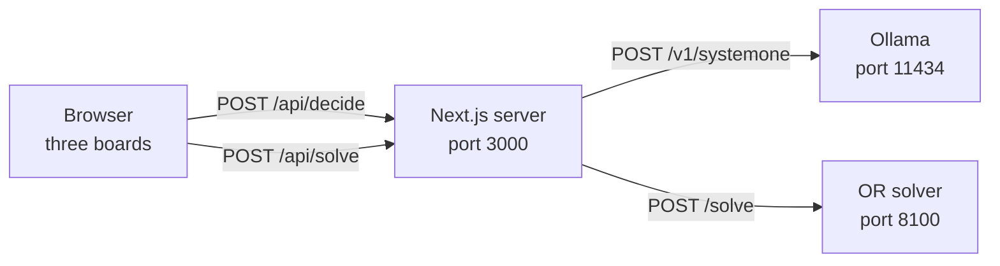

# Troubleshooting

This page lists the problems you are most likely to hit when you install, run or change the project, with the cause and the fix for each. Start with the one-minute check, then jump to the symptom that matches what you see.

## Check your setup in one minute

Run these from the repository root. Each line checks one piece of the stack.

```bash
node -v                                   # v26.x, the version the project is tested on
uv --version                              # any recent uv
curl -s http://localhost:11434/api/version   # Ollama is running; needs 0.35.1 or later
ollama list                               # clef and clef-flash are listed
curl -s http://127.0.0.1:8100/health      # the OR solver answers {"ok":true}
npm test                                  # the TypeScript rules tests pass
```

You need Ollama and the models only for the decision-model boards, and the solver only for the OR solver board. The heuristic boards run entirely in the browser.

## Where errors come from

The browser never talks to Ollama or the solver directly. Each decision-model or solver board posts to an API route in the Next.js server, which forwards the request. Knowing which hop failed tells you which process to fix.



When a request fails, the board shows `error` as its phase, prints the message in red in its panel, and counts it under `errors`. With real-time gravity the piece falls where gravity takes it; in the turn-based race it drops straight down. No heuristic stands in, which keeps the race honest. After the piece locks, the message stays as an amber note that starts with `controller error:`, and the next piece asks again.

| Message on the board | What it means | Go to |
|---|---|---|
| `ollama unreachable at http://localhost:11434: fetch failed` | Nothing is listening on the Ollama port. | [Ollama is not running](#ollama-is-not-installed-or-not-running) |
| `ollama <status>: <message>` | Ollama answered with an error, most often a model that is not pulled. | [The model is not pulled](#the-model-is-not-pulled) |
| `ollama returned no move answer` | Ollama answered without an answer to the move question. | [Check the Ollama version](#ollama-is-not-installed-or-not-running) |
| `OR solver unreachable at http://127.0.0.1:8100: ...` | The solver is not running, or it did not answer in time. | [OR solver unreachable](#or-solver-unreachable-on-the-solver-board) |
| `locked before the decision arrived (2.4s)` | Not an error: the controller was too slow for this piece. | [Pieces lock where they land](#pieces-lock-where-they-land) |
| `lock delay ran out before the move finished` | Not an error: the decision arrived, but the move took too long. | [Pieces lock where they land](#pieces-lock-where-they-land) |

## Decision models (Ollama)

### Ollama is not installed or not running

**Symptom.** Every decision-model board shows `ollama unreachable at http://localhost:11434: fetch failed`.

**Cause.** The app sends model requests to Ollama at `http://localhost:11434`. Either Ollama is not installed, or its server is not running.

**Fix.**

1. Install Ollama 0.35.1 or later. The project needs Ollama's `/v1/systemone` endpoint, which older versions do not have. It is tested on 0.40.5.
2. Start the server, either by opening the Ollama app or by running it in its own terminal:

   ```bash
   ollama serve
   ```

3. Confirm that it answers and check its version:

   ```bash
   curl -s http://localhost:11434/api/version
   ```

If Ollama runs on another host or port, point the app at it with `OLLAMA_URL`. The API route and the experiment scripts that call Ollama read the same variable.

```bash
OLLAMA_URL=http://localhost:11500 npm run dev
```

### The model is not pulled

**Symptom.** A decision-model board shows an error in the form `ollama <status>: <message>`.

**Cause.** Ollama is running but returned an error. The most common reason is that the model the board asks for (`clef` or `clef-flash`) is not on this machine.

**Fix.** Pull both models, then confirm they are listed:

```bash
ollama pull clef
ollama pull clef-flash
ollama list
```

If both models are listed and the error remains, check that Ollama is 0.35.1 or later (see [Ollama is not installed or not running](#ollama-is-not-installed-or-not-running)): older versions do not have the `/v1/systemone` endpoint.

You can read about the models on their library page: [ollama.com/library/clef](https://ollama.com/library/clef).

### The first decision is very slow

**Symptom.** The first piece on a decision-model board takes much longer than the rest, and it often locks before the answer arrives.

**Cause.** Ollama loads a model into memory on its first request. Later requests are fast because the app asks Ollama to keep the model loaded for 30 minutes after each request (`keep_alive: "30m"` in [`lib/prompt.ts`](../lib/prompt.ts)).

**Fix.** Warm each model up before a race that matters:

1. Pick the model on a board (for example `clef` on one board and `clef-flash` on another).
2. Press **Start** and wait until each model board shows a `confidence` line in its panel.
3. Press **Reset**. The race starts over on the same seed, with the models loaded.

To see which models are loaded and when they will unload, run:

```bash
ollama ps
```

The OR solver does not need this step. It runs one small solve when it starts, before it accepts requests.

## OR solver

### "OR solver unreachable" on the solver board

**Symptom.** The OR solver board shows `OR solver unreachable at http://127.0.0.1:8100:` followed by a reason.

**Cause.** The app forwards solver requests to `http://127.0.0.1:8100`. If the reason is `fetch failed`, nothing is listening there. If the reason mentions a timeout, the solver is running but did not answer within the board's think budget plus 2 seconds.

**Fix.**

1. Start the solver in its own terminal and leave it running:

   ```bash
   npm run solver
   ```

   The first run creates a virtual environment in `or-solver/` and installs the dependencies, so it needs a network connection once.
2. Check that it answers:

   ```bash
   curl -s http://127.0.0.1:8100/health
   ```

   The expected reply is `{"ok":true}`.
3. If it still times out, pick a smaller `think` budget on the solver board.

If you run the solver on another port, tell the app with `OR_SOLVER_URL`:

```bash
uv run --directory or-solver uvicorn orsolver.server:app --host 127.0.0.1 --port 8101
OR_SOLVER_URL=http://127.0.0.1:8101 npm run dev
```

Run the two commands in separate terminals. See [The OR solver](or-solver.md) for the full service reference.

## Install and startup

### Port 3000 or 8100 is already in use

**Symptom.** `npm run dev` or `npm run demo` prints `Failed to start server` and an `EADDRINUSE` error, or `npm run solver` reports that the address is already in use.

**Cause.** Another process holds the port, most often an earlier `npm run dev` or `npm run solver` that is still running in another terminal. The npm scripts pass the port explicitly (`-p 3000`, `--port 8100`), so neither server moves to a free port on its own.

**Fix.**

1. Find the process that holds the port:

   ```bash
   lsof -nP -iTCP:3000 -sTCP:LISTEN
   lsof -nP -iTCP:8100 -sTCP:LISTEN
   ```

2. Stop it. Press Ctrl+C in its terminal, or end it by the PID that `lsof` printed:

   ```bash
   kill <PID>
   ```

3. Or run on another port instead. For the app:

   ```bash
   npx next dev -H 127.0.0.1 -p 3001
   ```

   Then open `http://127.0.0.1:3001`. For the solver, see the `OR_SOLVER_URL` example in [OR solver unreachable](#or-solver-unreachable-on-the-solver-board).

### Tests or scripts fail with "Unknown file extension .ts"

**Symptom.** `npm test`, `npm run bench`, `npm run fixtures` or a script in `scripts/` fails with `ERR_UNKNOWN_FILE_EXTENSION` for a `.ts` file.

**Cause.** The tests and scripts run TypeScript files directly with Node's built-in type stripping, for example `node --no-warnings --test lib/*.test.ts`. Node versions before 22.18 do not run `.ts` files without an extra flag, so they fail with this error.

**Fix.** Check your version, then install Node 26, the version the project is developed and tested on, with your version manager or the official installer.

```bash
node -v
```

After you switch versions, reinstall the dependencies:

```bash
npm install
```

### `uv: command not found`, or the wrong Python version

**Symptom.** `npm run solver` or `npm run test:solver` fails with `uv: command not found`, or uv reports that no suitable Python interpreter is available.

**Cause.** The solver is a Python project managed by [uv](https://docs.astral.sh/uv/). It pins Python 3.13 in `or-solver/.python-version`, and `or-solver/pyproject.toml` accepts Python 3.12 or 3.13.

**Fix.**

1. Install uv by following the [uv installation guide](https://docs.astral.sh/uv/getting-started/installation/), then check it:

   ```bash
   uv --version
   ```

2. uv normally downloads the pinned Python for you. If it cannot, install it yourself:

   ```bash
   uv python install 3.13
   ```

You do not need to activate a virtual environment. The npm scripts run everything through `uv run --directory or-solver`.

## Running the race

### Other devices on the network cannot connect

**Symptom.** The app works on this machine, but a phone, a projector laptop or another computer on the same network cannot load it.

**Cause.** `npm run dev` listens on `127.0.0.1` only, so it accepts connections from this machine alone. This is deliberate: the development server exposes developer endpoints and source maps that should not face a network.

**Fix.** Pick the mode that matches the network:

| Command | Listens on | Use it when |
|---|---|---|
| `npm run demo` | `0.0.0.0:3000`, production build | You present to an audience or use shared Wi-Fi. No dev endpoints, no source maps. |
| `npm run dev:lan` | `0.0.0.0:3000`, development server | You develop on a network you trust and want hot reload on another device. |

Then open `http://<this machine's LAN address>:3000` on the other device. With `dev:lan`, use this machine's IPv4 address or its `.local` name: those are the only origins allowed to load development assets. If your firewall asks whether to accept incoming connections, allow them for Node.

`npm run demo` builds before it starts, so run it again after you change the code. Leave Ollama and the solver listening on `127.0.0.1`: other devices reach them only through the app's API routes. See [SECURITY.md](../SECURITY.md) for the reasoning and the [lecture guide](lecture-guide.md) for a pre-talk checklist.

### No sound

**Symptom.** The race runs, but there is no music.

**Cause.** Browsers allow audio only after a user gesture, so the app creates its synthesizer when you first press **Start**. The music plays only while the race runs: it pauses with the race and stops when the race ends or you press **Reset**.

**Fix.**

1. Press **Start**. Music never plays before the first press.
2. Check the music button next to **Reset**. It reads `♪ on` when sound is on and `♪ off` when it is muted. Click it to switch.
3. Check that the browser tab is not muted and that your system output volume is up.

### The race paused by itself

**Symptom.** The clock stopped, the boards froze and the button reads **Start** again.

**Cause.** The app pauses the race whenever its tab becomes hidden, for example when you switch tabs or minimize the window. Some browsers also treat a fully covered window as hidden. A hidden tab stops animation frames but not network requests, so without the pause, slow controllers would get free thinking time while the boards stood still.

**Fix.** Bring the tab back and press **Start**. The race continues where it stopped. Any decision that was in flight is canceled and asked again for the same piece. When you present, keep the demo tab visible, for example on its own display.

### The Start button is grayed out

**Symptom.** You cannot press **Start**.

**Cause.** The race has finished: the clock reached zero, or every board topped out.

**Fix.** Press **Reset**. Changing the seed, minutes, real-time gravity, start level or garbage settings also resets the race.

### Pieces lock where they land

**Symptom.** A board's pieces drop straight down from where they spawned instead of moving to a planned spot, and its `late` counter goes up. The panel shows `locked before the decision arrived` with the seconds spent waiting.

**Cause.** This is the real-time rule, not a bug. The app asks the controller for a decision when the piece spawns, and gravity keeps running while it thinks. If the piece locks before the answer arrives, it stays where gravity put it and counts as `late`. A related counter, `missed`, means the decision arrived in time but the lock delay ran out before the piece finished moving.

The decision models are the usual cause. In the Part 3 races, clef-flash took about 2.2 seconds per move and clef about 7.6 seconds, and their boards were `late` up to 3.3 times per game ([results](../experiments/RESULTS.md#part-3-the-same-race-with-fair-time-based-garbage)).

**Fix.** Decide whether you want to measure this or avoid it:

- To keep the real-time race but give slow controllers a better chance, [warm the models up](#the-first-decision-is-very-slow), use `clef-flash` instead of `clef`, or keep the **start level** low so pieces fall more slowly.
- To reduce `missed`, set **moves** to `fast (30ms)`.
- To remove the time pressure entirely, clear **real-time gravity**. Each piece then waits at the top for its controller, which makes a turn-based race.

See [Game engine](game-engine.md) for the gravity table and lock delay, and [Controllers](controllers.md) for how a decision becomes a move.

## Changing the code

### Tests fail after you change the rules

**Symptom.** After you change something in `lib/` such as kicks, scoring, gravity or spawn, `npm test` fails, or `npm run test:solver` fails its parity tests.

**Cause.** The TypeScript engine is the authority for the rules, and the Python solver must match it. `npm run fixtures` exports the TypeScript tables to `or-solver/orsolver/tables.json` and writes the parity cases to `or-solver/tests/fixtures/engine.json`. If those files are stale, or the Python logic no longer matches, the parity tests fail.

**Fix.**

1. If `npm test` fails, decide whether the change was intended. If it was, update the expectations in the matching `lib/*.test.ts` file.
2. Regenerate the fixtures and run the solver tests. `test:solver` regenerates the fixtures first, so one command does both:

   ```bash
   npm run test:solver
   ```

3. If parity still fails, port the change to Python. Shapes, kicks, spawn states, move order, scoring and gravity come from `tables.json`, but logic such as reachability and T-spin detection lives in `or-solver/orsolver/engine.py`, and board features live in `or-solver/orsolver/evaluate.py`.
4. Restart `npm run solver`. The solver reads `tables.json` when it starts.
5. Commit the regenerated `tables.json` and `engine.json` together with your change.

See [Architecture](architecture.md) for how the two engines stay in sync, and [CONTRIBUTING.md](../CONTRIBUTING.md) for the full checklist.

## Still stuck

Open an issue in this repository and include:

- the output of `node -v`, `uv --version` and `ollama --version`;
- the command you ran, or the exact message on the board;
- the settings and seed of the race, if the problem happens during one.

Leave out personal details such as paths from your home directory. To report a security problem, follow [SECURITY.md](../SECURITY.md) instead of opening a public issue.

## Next steps

- [Getting started](getting-started.md): install everything and run your first race.
- [Lecture guide](lecture-guide.md): prepare and present the demo.
- [The OR solver](or-solver.md): run, test and extend the Python service.
- [Architecture](architecture.md): see how the board, the API routes and the services fit together.
